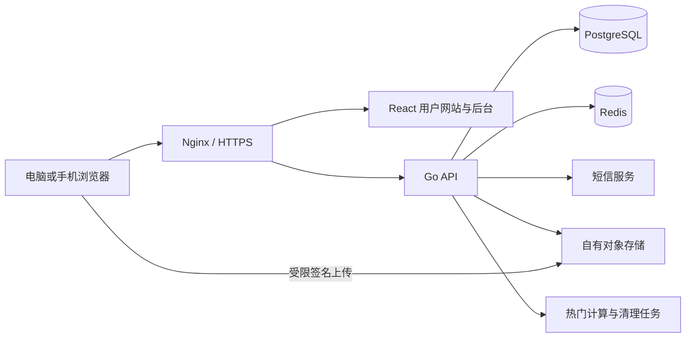

# 技术方案

## 1 选型与部署

React 前端、Go 后端、Redis 和独立图片存储已确定。数据库、具体云服务商及版本仍为方案建议，开发前完成运行环境确认。

| 层级 | 建议方案 | 用途 |
| --- | --- | --- |
| 用户网站 | React、TypeScript、Vite | 电脑端与移动端响应式页面 |
| 管理后台 | React、TypeScript | 商品、审核、内容及推荐管理 |
| 后端 | Go，单体应用 | 接口、权限、业务校验、定时任务 |
| 数据库 | PostgreSQL | 商品、会员、配置、审核及统计数据 |
| 缓存 | Redis | 推荐榜单、分类配置等热点查询缓存，以及请求频率限制 |
| 图片存储 | 自有云账号下的对象存储 | 独立保存原始上传、处理后的展示图和缩略图 |
| 入口 | Nginx、HTTPS | 静态资源、接口转发、访问日志 |
| 短信 | 可替换的短信服务商 | 注册、登录和找回密码 |

首期采用 Go 单体应用，数据库保存业务记录，Redis 加速读取与排名查询，图片直接上传至受控对象存储。暂不引入消息队列、独立搜索集群或专门的推荐服务。后续是否扩容，根据实际访问量和性能记录决定。

用户网站、后台与接口建议使用同一站点入口，接口统一以 `/api/v1` 开头。后台可部署在 `/admin`，通过前端独立构建及后端权限检查隔离。React 客户端路由需配置刷新回退，API 错误不得回退为页面 HTML。

搜索引擎收录若成为明确目标，再评估 React 服务端渲染或预渲染。当前不将 SEO 专项建设纳入已确认范围。

## 2 应用职责

| 业务域 | 主要职责 |
| --- | --- |
| 身份与会话 | 短信验证、注册、登录、退出、用户停用 |
| 商品与分类 | 商品读写、动态属性、筛选、搜索、状态管理 |
| 发布审核 | 提交、退回、通过、版本检查和审核记录 |
| 媒体 | 上传授权、文件检查、图片处理、受控预览 |
| 内容与客服 | 站点设置、说明页面、客服二维码 |
| 收藏与推荐 | 本人收藏、有效浏览、热门计算、人工精选 |

前端负责输入提示及交互；后端负责数据校验、归属、权限与状态变更。列表、详情、收藏和推荐使用一致的公开条件，避免页面之间出现可见范围不一致。

公开条件为：商品处于 `published`，当前版本已审核通过，所属分类已启用。停用分类前，后台应提示受影响商品数量；重新启用不会自动通过原本未审核的商品。

## 3 数据与状态一致性

商品编辑、审核、下架采用数据库事务。请求携带 `expected_version`，后端锁定商品记录后检查版本、当前状态及操作人权限，再统一更新商品、图集关联和审核记录。

会员不能通过请求参数指定发布人、审核状态、推荐顺序或审核版本。管理员代为修改也需记录操作人。审核通过的版本必须与当前展示版本相同。

公开接口在返回时重新检查可见性。热门分数可以缓存，但下架或撤回不等待下一次热度计算才生效。浏览器已经显示的旧页面无法远程收回，用户再次请求详情或执行操作时应得到最新状态。

### 3.1 Redis 的职责

| 数据 | Redis 用法 | 持久记录及失效处理 |
| --- | --- | --- |
| 热门推荐 | 保存分数、排序后的商品编号及计算批次 | 数据库保存可重算的统计和最近计算结果；缓存丢失可重建 |
| 首页候选 | 缓存精选、热门、新发布的候选编号，不直接缓存整页最终响应 | 返回前查询数据库，检查商品状态、审核版本、分类和当前资料 |
| 分类与展示配置 | 短期缓存公开查询结果 | 修改后主动失效；分类启用状态仍以数据库检查结果为准 |
| 请求频率 | 限制短信、登录、上传授权及统计接口的高频请求 | Redis 故障时短信发送等受限接口暂停或使用经验证的替代限流，不能直接放开 |

缓存建议设置有效期：分类及普通配置5分钟，首页候选1分钟，热门计算快照60分钟；热门分数仍按建议的15分钟周期更新。以上为初始运行参数。Redis 支持键过期机制，具体使用方式见[官方说明](https://redis.io/docs/latest/develop/using-commands/keyspace/)。

业务写入先提交数据库，再失效相关缓存；两者不是同一个事务。即使缓存删除失败，公开商品也必须经过数据库的状态与内容版本检查，不能把旧缓存当成发布依据。客服联系方式及权限相关配置首期直接读取数据库，避免停用后仍展示旧二维码。

会话、验证码挑战、收藏及浏览统计仍以数据库为记录来源，不因引入 Redis 改变其持久化方式。Redis 不保存图片文件，不承担审核结果或商品资料的唯一存储。

Redis 不可用时，展示接口限流后回查数据库；热门区域读取最近计算结果，结果过期则按新发布补齐。数据库也不可用时返回明确错误，不返回未经当前状态校验的缓存内容。

## 4 登录及访问控制

- 使用服务端会话和 `HttpOnly`、`Secure` Cookie；数据库只保存会话令牌摘要。
- 修改请求检查来源并提供 CSRF 防护。会员数据接口逐项检查资源归属。
- 验证码按注册、登录、重置密码区分用途，设置有效期、尝试次数、手机号和请求来源频率限制。
- 密码使用成熟的密码散列实现；密码重置、用户停用后撤销原会话。
- 管理员身份通过受控初始化及授权流程设置，注册接口不能创建管理员。
- 日志不记录密码、短信验证码、完整会话令牌或云服务密钥。普通页面不返回会员私人手机号。

上述为开发控制要求，具体会话时长和短信限额在实施时结合短信供应商配置。

## 5 图片存储与处理

### 5.1 存储方式

图片使用建设方自己开通和管理的对象存储，服务商可在阿里云 OSS、腾讯云 COS 等方案中选择，本次尚不确定采购品牌。原始文件私有保存，展示图和缩略图单独管理；数据库只保存对象键、文件信息、所属商品及排序关系。

图片域名、存储账号、访问权限、账单和导出能力归建设方控制。存储、CDN 和业务代码分开配置，便于更换服务商。图片展示流量由对象存储承担，后续按访问情况接入 CDN；应用服务器不长期堆放用户图片。

上传授权由 Go 服务生成，浏览器直接上传。以 OSS 为例，签名上传 URL 可用于授权指定上传请求，凭据不需要交给浏览器，参考[官方上传说明](https://www.alibabacloud.com/help/en/oss/user-guide/upload-files-using-presigned-urls)。具体大小约束须使用所选服务支持的上传策略，并由完成校验再次核实。

### 5.2 处理流程

1. 后端生成仅用于指定对象、限定大小和有效时间的上传参数。
2. 用户上传后，后端核验实际格式、大小、解码结果及图片归属，去除 EXIF 等非展示信息。
3. 原始文件保持私有。上传者与管理员通过短期授权预览；完成处理不等于审核通过。
4. 商品审核通过后开放处理后的展示图和缩略图。客服二维码、首页素材由管理员配置时单独授权发布。
5. 下架或撤回后停止通过业务接口提供图集，撤销对应公开对象访问并清理缓存。审核记录需要保留的资料继续私有保存。

公开图片可能已被访问者下载或缓存，系统只能阻止后续受控访问，不能承诺收回已传播副本。各商品的公开展示对象应独立管理，避免下架一个商品影响其他已展示商品。

### 5.3 图集容量

取消每商品200张图片上限，不设置固定的商品图片总张数限制。单张原始图片暂建议不超过10 MB，仍待确认；文件大小、单次请求数量和上传速率与商品图集总量分别管理。

上传采用队列，建议每次处理20张、同时上传3张，完成一批后继续下一批；这些参数不构成商品总张数上限。分张反馈成功、失败和重试，已保存的图片不会因后续失败丢失。

商品先建立草稿，图片分批关联；编辑通过追加、移除和移动位置更新，不要求每次提交全部图片编号。会员编辑页、详情页和后台审核页均分页获取图集，不一次解码、渲染或下载所有大图。

服务器配置请求体大小、图片处理并发和存储用量告警。遇到资源不足时保留草稿并提示稍后重试，不能静默截断图集，也不能把单批数量限制转换成商品总量限制。

“查看原图”在前台实际指查看经处理的大图，不直接暴露私有原始上传文件。

## 6 搜索与筛选

- 同一属性组内多选采用“任一满足”，不同属性组之间采用“同时满足”。
- 关键词匹配商品编号及标题。筛选条件使用稳定编码，名称修改不改变旧商品含义。
- 价格仅为展示报价。租赁价格按报价单位比较，不将每小时与每月价格直接混排或自动换算。
- 跨单位列表可按最新或热门排序；使用价格区间或价格排序时应先确定出售或同一种租赁单位。
- “联系客服报价”不参加数值区间筛选；价格排序时列于有明确报价的商品之后。
- 默认采用数据库查询及索引；中文分词和复杂检索需求未列入首期。

## 7 推荐算法

首期建议采用规则加权的热门排序：首页分别显示人工精选、近期热门和新发布。初始公式为“近7个自然日有效浏览 × 1 ＋ 近7个自然日首次收藏且当前有效的人数 × 5 ＋ 新发布加分”。首次公开不足72小时加10分，建议每15分钟重算。

Go 负责筛选候选、计算和排序；PostgreSQL 保存业务及统计记录；Redis 保存可重建的榜单快照。读取缓存后仍检查商品当前是否允许公开。

选型理由、计算示例、去重口径、Redis 用法及后续改进见[推荐算法说明](10-recommendation-design.md)。权重和周期仍为建议，未作为本次反馈已确认的经营规则。

## 8 部署与运维

首期使用 Go、PostgreSQL、Redis 和独立对象存储，构建任务放在开发机或构建环境。现服务器的内存空间较紧，应在上线前实测数据库、Redis、应用及图片处理任务的资源使用；如不足则调整规格或将数据服务独立部署，不在生产服务器上同时执行高负载构建。

Redis 仅允许受控网络访问，设置认证、内存上限、超时和连接池。缓存与限流分别设置过期和故障策略，不能把限流记录被淘汰视为可以无限发送短信。运行参数在容量测试后确定。

数据库、Redis、对象存储和短信账号归建设方所有；生产配置通过环境或受控配置文件提供，密钥不进入 GitHub。提供健康检查、错误日志、磁盘与内存监控、缓存命中率、对象存储容量及流量监控，以及数据库和图片的备份恢复说明。

Redis 数据丢失后可重建缓存；数据库备份和图片备份仍需独立完成。对象存储的版本保留及恢复配置在上线前验证，不能把 Redis 持久化文件当作业务备份。

单实例可以满足首期实施复杂度要求，但存在单点故障；本方案不承诺高可用。是否增加独立数据库、冗余节点及备份频率，由上线前的容量和恢复要求决定。

## 9 开发参考

- [React：从头构建 React 应用](https://react.dev/learn/build-a-react-app-from-scratch)
- [Go：数据库事务](https://go.dev/doc/database/execute-transactions)
- [PostgreSQL：锁与并发控制](https://www.postgresql.org/docs/current/explicit-locking.html)

开发时以当时选定版本的官方文档为准，版本号和依赖锁文件随代码提交。
