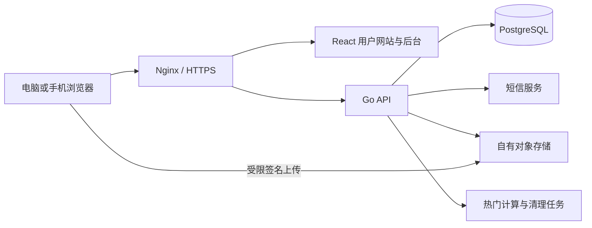

# 技术方案

## 1 选型与部署

React 前端、Go 后端已确定。其余选型为本次建议，开发前完成版本和运行环境确认。

| 层级 | 建议方案 | 用途 |
| --- | --- | --- |
| 用户网站 | React、TypeScript、Vite | 电脑端与移动端响应式页面 |
| 管理后台 | React、TypeScript | 商品、审核、内容及推荐管理 |
| 后端 | Go，单体应用 | 接口、权限、业务校验、定时任务 |
| 数据库 | PostgreSQL | 商品、会员、配置、审核及统计数据 |
| 图片 | 自有云账号下的对象存储 | 原始上传、处理后的展示图和缩略图 |
| 入口 | Nginx、HTTPS | 静态资源、接口转发、访问日志 |
| 短信 | 可替换的短信服务商 | 注册、登录和找回密码 |

首期不拆分微服务，不引入消息队列、独立搜索集群或专门的推荐服务。查询与推荐由 Go 和 PostgreSQL 完成，图片直接上传至受控对象存储。后续是否扩容，根据实际访问量和性能记录决定。



用户网站、后台与接口建议使用同一站点入口，接口统一以 `/api/v1` 开头。后台可部署在 `/admin`，通过前端独立构建及后端权限检查隔离。React 客户端路由需配置刷新回退，API 错误不得回退为页面 HTML。

搜索引擎收录若成为明确目标，再评估 React 服务端渲染或预渲染。当前不将 SEO 专项建设纳入已确认范围。

## 2 应用职责

| 业务域 | 主要职责 |
| --- | --- |
| 身份与会话 | 短信验证、注册、登录、退出、用户停用 |
| 商品与分类 | 商品读写、动态属性、筛选、搜索、状态管理 |
| 发布审核 | 提交、退回、通过、版本检查和审核记录 |
| 媒体 | 上传授权、文件检查、图片处理、受控预览 |
| 内容与客服 | 站点设置、说明页面、客服二维码 |
| 收藏与推荐 | 本人收藏、有效浏览、热门计算、人工精选 |

前端负责输入提示及交互；后端负责数据校验、归属、权限与状态变更。列表、详情、收藏和推荐使用一致的公开条件，避免页面之间出现可见范围不一致。

公开条件为：商品处于 `published`，当前版本已审核通过，所属分类已启用。停用分类前，后台应提示受影响商品数量；重新启用不会自动通过原本未审核的商品。

## 3 数据与状态一致性

商品编辑、审核、下架采用数据库事务。请求携带 `expected_version`，后端锁定商品记录后检查版本、当前状态及操作人权限，再统一更新商品、图集关联和审核记录。

会员不能通过请求参数指定发布人、审核状态、推荐顺序或审核版本。管理员代为修改也需记录操作人。审核通过的版本必须与当前展示版本相同。

公开接口在返回时重新检查可见性。热门分数可以缓存，但下架或撤回不等待下一次热度计算才生效。浏览器已经显示的旧页面无法远程收回，用户再次请求详情或执行操作时应得到最新状态。

## 4 登录及访问控制

- 使用服务端会话和 `HttpOnly`、`Secure` Cookie；数据库只保存会话令牌摘要。
- 修改请求检查来源并提供 CSRF 防护。会员数据接口逐项检查资源归属。
- 验证码按注册、登录、重置密码区分用途，设置有效期、尝试次数、手机号和请求来源频率限制。
- 密码使用成熟的密码散列实现；密码重置、用户停用后撤销原会话。
- 管理员身份通过受控初始化及授权流程设置，注册接口不能创建管理员。
- 日志不记录密码、短信验证码、完整会话令牌或云服务密钥。普通页面不返回会员私人手机号。

上述为开发控制要求，具体会话时长和短信限额在实施时结合短信供应商配置。

## 5 图片处理

1. 后端生成仅用于指定对象、限定大小和有效时间的上传参数。
2. 用户上传后，后端核验实际格式、大小、解码结果及图片归属，去除 EXIF 等非展示信息。
3. 原始文件保持私有。上传者与管理员通过短期授权预览；完成处理不等于审核通过。
4. 商品审核通过后开放处理后的展示图和缩略图。客服二维码、首页素材由管理员配置时单独授权发布。
5. 下架或撤回后停止通过业务接口提供图集，撤销对应公开对象访问并清理缓存。审核记录需要保留的资料继续私有保存。

公开图片可能已被访问者下载或缓存，系统只能阻止后续受控访问，不能承诺收回已传播副本。各商品的公开展示对象应独立管理，避免下架一个商品影响其他已展示商品。

建议每个商品最多200张图片、单张原始图片不超过10 MB，以兼容已发现的大图集；该上限尚未确认。批量上传应限制并发、分张重试，列表只加载缩略图，详情按批次加载。

“查看原图”在前台实际指查看经处理的大图，不直接暴露私有原始上传文件。

## 6 搜索与筛选

- 同一属性组内多选采用“任一满足”，不同属性组之间采用“同时满足”。
- 关键词匹配商品编号及标题。筛选条件使用稳定编码，名称修改不改变旧商品含义。
- 价格仅为展示报价。租赁价格按报价单位比较，不将每小时与每月价格直接混排或自动换算。
- 跨单位列表可按最新或热门排序；使用价格区间或价格排序时应先确定出售或同一种租赁单位。
- “联系客服报价”不参加数值区间筛选；价格排序时列于有明确报价的商品之后。
- 默认采用数据库查询及索引；中文分词和复杂检索需求未列入首期。

## 7 热门推荐规则建议

### 7.1 排列方式

首页分为人工精选、近期热门和新发布三个区域。先安排人工精选，再按热门排序补充，最后展示新发布。同次首页响应内去重；商品不足时减少展示数量。

首期采用全站热门，不建立个人兴趣画像。推荐目的为辅助用户发现近期受关注的商品，不能表述为成交量或交易信用排名。

### 7.2 计算方法

建议初始规则：

```text
热度 = 近7个自然日有效浏览数 × 1
     + 近7个自然日首次收藏且当前仍有效的人数 × 5
     + 新发布加分

首次公开不足72小时：新发布加分为10；否则为0。
```

统计日期使用北京时间，窗口包含计算当天及之前6天。同一访客、同一商品、同一天的浏览只计一次；已登录时使用账号标识，未登录时使用服务器签发的匿名标识。切换设备、清除 Cookie 或登录状态变化仍可能产生重复，首期不承诺识别所有刷量行为。

收藏按用户与商品唯一计数，取消后不计分。再次收藏不刷新首次收藏时间，也不累积多条记录。首次公开时间在编辑、复审或下架重发时不刷新。

建议每15分钟重算一次。分数相同时按首次公开时间、商品编号稳定排序。新站数据不足时按首次公开时间补齐；不生成模拟浏览或收藏。

### 7.3 运营调整

后台可查看浏览、收藏、新发布加分、总分、规则版本和计算时间。调整权重后触发重算；自动任务和手动刷新共用一套计算逻辑，防止重复执行造成累加。

此处权重、周期和展示数量均为初始建议，确认记录见[待确认事项 R03](09-review-items.md)。

## 8 部署与运维

首期使用单套 Go 服务及数据库，构建任务放在开发机或构建环境。现服务器的内存空间较紧，应在上线前实测数据库、应用及图片处理任务的资源使用；如不足则调整规格，不在生产服务器上同时执行高负载构建。

数据库、对象存储和短信账号归建设方所有；生产配置通过环境或受控配置文件提供，密钥不进入 GitHub。提供健康检查、错误日志、磁盘与内存监控，以及数据库备份和恢复操作说明。

单实例可以满足首期实施复杂度要求，但存在单点故障；本方案不承诺高可用。是否增加独立数据库、冗余节点及备份频率，由上线前的容量和恢复要求决定。

## 9 开发参考

- [React：从头构建 React 应用](https://react.dev/learn/build-a-react-app-from-scratch)
- [Go：数据库事务](https://go.dev/doc/database/execute-transactions)
- [PostgreSQL：锁与并发控制](https://www.postgresql.org/docs/current/explicit-locking.html)

开发时以当时选定版本的官方文档为准，版本号和依赖锁文件随代码提交。
