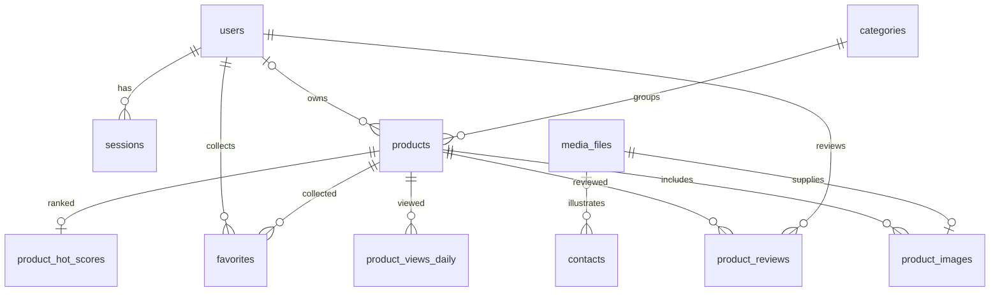

# 数据库说明

## 1 设计范围

本稿为 PostgreSQL 数据模型建议，用于开发评审，未创建或修改任何生产数据库。业务含义以[功能需求](02-functional-requirements.md)和[业务流程](03-business-flows.md)为准；本稿不包含订单、余额、支付或结算模型。

Redis 保存可重建的缓存和运行期频率计数；商品、审核、会话、收藏及统计记录仍由 PostgreSQL 保存。图片文件及审核图集清单位于独立对象存储，数据库保存其引用。

字段类型与约束将在开发阶段形成正式迁移文件。主键原则上由后端生成 UUID；时间使用 timestamptz，按 UTC 存储和传输，页面按北京时间显示。浏览统计日期单独按北京时间生成。

报价使用 numeric(12,2)，不使用浮点数。币种按待确认事项 R01 统一配置；旧积分报价需先确认含义，不直接换算。

## 2 数据表总览

| 表 | 用途 |
| --- | --- |
| `users` | 会员及管理员账号。 |
| `sessions` | 登录会话，客户端使用安全 Cookie。 |
| `sms_challenges` | 短信验证码，用途隔离、一次消费。 |
| `categories` | 展示分类以及可维护的筛选项。 |
| `products` | 出售或出租的商品展示资料。 |
| `media_files` | 上传文件、私有原始对象及公开展示资源的索引。 |
| `product_images` | 商品图集，按 sort_order 排序，第一张为封面。 |
| `product_reviews` | 审核结果及审核时内容快照，便于说明退回原因。 |
| `favorites` | 会员收藏及取消状态，用户与商品唯一。 |
| `contacts` | 客服账号和二维码，后台自行维护。 |
| `content_pages` | 关于我们、流程说明、客服验证说明、协议等静态内容。 |
| `site_settings` | 少量网站设置，按固定 key 的结构校验。 |
| `product_views_daily` | 近期有效浏览去重记录，仅用于热门排序，不做复杂用户画像。 |
| `product_hot_scores` | 最近一批热门计算快照，供排名解释、数据库回查及 Redis 重建。 |
| `admin_logs` | 商品、审核、二维码和配置的基本管理操作记录。 |

## 3 主要关联

平台录入和旧数据导入可不关联会员；会员投稿必须关联发布人。商品、图集、审核和收藏存在业务关联，不通过级联删除直接清空历史记录。

## 4 字段说明

“可空”仅表示存储层是否允许空值，提交审核时仍需校验业务必填项。外键、唯一性和状态要求列在各表说明后。

### 4.1 users

会员及管理员账号。

| 字段 | 类型 | 可空 | 说明 |
| --- | --- | --- | --- |
| `id` | `uuid` | 否 | 主键 |
| `phone` | `varchar(20)` | 否 | 手机号，接口脱敏展示 |
| `password_hash` | `text` | 是 | 密码散列；不保存明文 |
| `nickname` | `varchar(40)` | 否 | 昵称 |
| `role` | `varchar(10)` | 否 | 会员或管理员，只能由受控管理操作授权；member / admin |
| `enabled` | `boolean` | 否 | 账户是否可用 |
| `legacy_id` | `text` | 是 | 旧平台会员编号，可空 |
| `created_at` | `timestamptz` | 否 | 创建时间，UTC |
| `updated_at` | `timestamptz` | 否 | 最近修改时间，由应用更新 |

手机号唯一，旧会员编号在非空时唯一。密码字段允许为空，用于尚未完成密码重设的迁移账号；新注册按注册规则设置密码。账号停用后撤销会话。

### 4.2 sessions

登录会话，客户端使用安全 Cookie。

| 字段 | 类型 | 可空 | 说明 |
| --- | --- | --- | --- |
| `id` | `uuid` | 否 | 主键 |
| `user_id` | `uuid` | 否 | 所属用户；关联 users.id |
| `token_hash` | `text` | 否 | 会话随机值的摘要 |
| `expires_at` | `timestamptz` | 否 | 有效期 |
| `created_at` | `timestamptz` | 否 | 创建时间，UTC |

令牌摘要唯一。会话必须关联有效用户；过期记录定期清理。

### 4.3 sms_challenges

短信验证码，用途隔离、一次消费。

| 字段 | 类型 | 可空 | 说明 |
| --- | --- | --- | --- |
| `id` | `uuid` | 否 | 主键 |
| `phone` | `varchar(20)` | 否 | 手机号 |
| `purpose` | `text` | 否 | 用途；register / login / reset_password |
| `code_hash` | `text` | 否 | 验证码带密钥摘要，避免直接保存 |
| `attempts` | `integer` | 否 | 已尝试次数 |
| `expires_at` | `timestamptz` | 否 | 过期时间 |
| `used_at` | `timestamptz` | 是 | 消费时间 |
| `created_at` | `timestamptz` | 否 | 创建时间，UTC |

验证码只保存带服务端密钥的摘要，不能以普通哈希替代低熵验证码的保护。消费时原子检查用途、有效期和尝试次数；新验证码应使同手机号同用途旧挑战失效。

### 4.4 categories

展示分类以及可维护的筛选项。

| 字段 | 类型 | 可空 | 说明 |
| --- | --- | --- | --- |
| `id` | `uuid` | 否 | 主键 |
| `code` | `varchar(40)` | 否 | 稳定编码 |
| `name` | `varchar(60)` | 否 | 分类名 |
| `trade_type` | `text` | 否 | 出售或出租；sale / rent |
| `price_units` | `jsonb` | 否 | 本分类允许的报价单位；例如 hour、day |
| `filter_config` | `jsonb` | 否 | 筛选分组、选项编码、名称及单选/多选方式 |
| `sort_order` | `integer` | 否 | 排列顺序 |
| `enabled` | `boolean` | 否 | 是否启用 |
| `updated_at` | `timestamptz` | 否 | 最近修改时间，由应用更新 |

分类编码唯一。trade_type 与商品交易类型一致；price_units 出售仅允许 account，出租从 hour、day、week、month 中配置。缩减单位前检查已有商品，不静默改变旧报价。已被商品使用的筛选选项可停用，但不能直接删除其编码。filter_config 的结构由后端校验。

### 4.5 products

出售或出租的商品展示资料。

| 字段 | 类型 | 可空 | 说明 |
| --- | --- | --- | --- |
| `id` | `uuid` | 否 | 主键 |
| `owner_id` | `uuid` | 是 | 发布会员；平台自营可空；关联 users.id |
| `source` | `text` | 否 | 平台录入、会员投稿、旧站导入；platform / member / legacy |
| `category_id` | `uuid` | 否 | 所属展示分类；关联 categories.id |
| `product_code` | `varchar(40)` | 否 | 公开商品编号 |
| `title` | `varchar(100)` | 否 | 标题 |
| `trade_type` | `text` | 否 | 出售或出租；sale / rent |
| `price_amount` | `numeric(12,2)` | 是 | 展示报价，可空表示联系客服 |
| `price_unit` | `text` | 否 | 账号、小时、天、周、月；仅说明报价单位；account / hour / day / week / month |
| `attributes` | `jsonb` | 否 | 区服、性别、XVIP及筛选选项编码；Go 按分类配置校验 |
| `description` | `text` | 否 | 商品介绍；不填写游戏密码、验证码或证件 |
| `status` | `text` | 否 | 草稿、待审、已展示、退回修改、已下架；draft / pending / rejected / published / offline |
| `version` | `integer` | 否 | 内容版本，修改时递增 |
| `approved_version` | `integer` | 是 | 最后审核通过的内容版本 |
| `manual_rank` | `integer` | 否 | 后台手动推荐序号；0 为不推荐 |
| `published_at` | `timestamptz` | 是 | 首次公开时间；编辑及重新发布不刷新；旧数据时间未知时为空，不享受新品加分 |
| `legacy_id` | `text` | 是 | 旧商品编号映射 |
| `submitted_at` | `timestamptz` | 是 | 最近提交审核时间；重新提交时更新 |
| `created_at` | `timestamptz` | 否 | 创建时间，UTC |
| `updated_at` | `timestamptz` | 否 | 最近修改时间，由应用更新 |

商品编号唯一，旧商品编号在非空时唯一。会员投稿必须有 owner_id；published 状态必须满足 approved_version = version。出售单位为 account，出租单位限 hour、day、week、month。manual_rank 为0时不入人工精选，正数越小越靠前。

### 4.6 media_files

上传文件、私有原始对象及公开展示资源的索引。

| 字段 | 类型 | 可空 | 说明 |
| --- | --- | --- | --- |
| `id` | `uuid` | 否 | 主键 |
| `owner_id` | `uuid` | 是 | 上传者；关联 users.id |
| `object_key` | `text` | 否 | 私有原始对象键 |
| `public_key` | `text` | 是 | 处理后的公开展示对象键，可空 |
| `mime_type` | `text` | 否 | 实际检测出的图片类型 |
| `byte_size` | `bigint` | 否 | 文件大小 |
| `state` | `text` | 否 | 上传、校验完成、不可使用；uploaded / ready / blocked |
| `created_at` | `timestamptz` | 否 | 创建时间，UTC |

私有对象键、非空公开对象键均唯一。允许 JPEG、PNG、WebP，按实际解码结果确认。state=ready 只表示文件检查完成，不表示审核通过；是否公开另由关联商品或管理员配置决定。public_key 表示展示资源组，缩略图和大图使用确定的派生路径。

### 4.7 product_images

商品图集，按 sort_order 排序，第一张为封面。

| 字段 | 类型 | 可空 | 说明 |
| --- | --- | --- | --- |
| `product_id` | `uuid` | 否 | 商品；关联 products.id |
| `media_id` | `uuid` | 否 | 图片；关联 media_files.id |
| `sort_order` | `bigint` | 否 | 图集顺序；通过增量移动调整，不要求前端回传完整图集 |

联合主键为 product_id、media_id；media_id 另设唯一约束，每条商品媒体记录仅绑定一个商品，不与客服或首页配置复用。需要复用图片时生成独立媒体记录及展示对象。商品内 sort_order 唯一，排序最小的图片作为封面；提交时至少有一张校验完成的图片。图片不可被其他会员引用。

每张图片独立关联，不设置每商品200条或其他固定条数约束。按 product_id、sort_order 分页查询；追加和移除只修改本次涉及的记录。商品版本与图集变更在同一事务中更新。

### 4.8 product_reviews

审核结果及审核时内容快照，便于说明退回原因。

| 字段 | 类型 | 可空 | 说明 |
| --- | --- | --- | --- |
| `id` | `uuid` | 否 | 主键 |
| `product_id` | `uuid` | 否 | 商品；关联 products.id |
| `product_version` | `integer` | 否 | 被审核版本 |
| `reviewer_id` | `uuid` | 否 | 管理员；关联 users.id |
| `decision` | `text` | 否 | 通过、退回、管理员下架；approve / reject / offline |
| `reason` | `text` | 否 | 退回或下架必须由服务端校验原因 |
| `snapshot` | `jsonb` | 否 | 审核时标题、图片、报价、属性的快照 |
| `created_at` | `timestamptz` | 否 | 创建时间，UTC |

审核记录追加保存。退回、管理员下架必须有原因；通过时记录内容版本。snapshot 包含当时资料、私有图集清单对象键与内容摘要，完整图片清单按审核版本独立保存，避免在每次详情响应中内嵌整个大图集。不保存账号密码或私人认证资料。

### 4.9 favorites

会员收藏及取消状态，用户与商品唯一。

| 字段 | 类型 | 可空 | 说明 |
| --- | --- | --- | --- |
| `user_id` | `uuid` | 否 | 收藏会员；关联 users.id |
| `product_id` | `uuid` | 否 | 收藏商品；关联 products.id |
| `active` | `boolean` | 否 | 当前是否有效；取消置为 false，再次收藏改回 true |
| `created_at` | `timestamptz` | 否 | 首次收藏时间，后续取消或再次收藏不重置 |
| `updated_at` | `timestamptz` | 否 | 最近修改时间，由应用更新 |

联合主键为 user_id、product_id。取消收藏更新 active，不删除该配对记录；重复收藏不新增记录，不刷新 created_at。只统计 active=true 且首次收藏时间在统计窗口内的数据。

### 4.10 contacts

客服账号和二维码，后台自行维护。

| 字段 | 类型 | 可空 | 说明 |
| --- | --- | --- | --- |
| `id` | `uuid` | 否 | 主键 |
| `name` | `varchar(60)` | 否 | 客服名称 |
| `purpose` | `text` | 否 | 通用、上架、买号、租号；general / listing / sale / rent |
| `channel` | `varchar(20)` | 否 | 微信、QQ 等 |
| `contact_value` | `varchar(100)` | 否 | 公开联系方式 |
| `qr_media_id` | `uuid` | 是 | 二维码图片；关联 media_files.id |
| `enabled` | `boolean` | 否 | 是否展示 |
| `sort_order` | `integer` | 否 | 展示顺序 |
| `updated_at` | `timestamptz` | 否 | 最近修改时间，由应用更新 |

二维码关联已校验图片。管理员启用客服时才发布对应展示资源；停用客服不再通过公开接口返回。

### 4.11 content_pages

关于我们、流程说明、客服验证说明、协议等静态内容。

| 字段 | 类型 | 可空 | 说明 |
| --- | --- | --- | --- |
| `id` | `uuid` | 否 | 主键 |
| `slug` | `varchar(60)` | 否 | 固定页面路径 |
| `title` | `varchar(100)` | 否 | 标题 |
| `body` | `text` | 否 | 净化后的正文 |
| `published` | `boolean` | 否 | 是否公开 |
| `updated_at` | `timestamptz` | 否 | 最近修改时间，由应用更新 |

slug 唯一。正文采用受限富文本或 Markdown，渲染前处理危险内容；只返回 published=true 的页面。

### 4.12 site_settings

少量网站设置，按固定 key 的结构校验。

| 字段 | 类型 | 可空 | 说明 |
| --- | --- | --- | --- |
| `key` | `varchar(50)` | 否 | branding、home_banners、hot_rules 等允许的键 |
| `value` | `jsonb` | 否 | 不同 key 使用不同 JSON 结构 |
| `updated_at` | `timestamptz` | 否 | 最近修改时间，由应用更新 |

key 为主键，仅支持后端明确允许的配置。hot_rules 存权重、刷新周期及规则版本；home_banners 引用自有媒体编号，不存任意外部脚本。内部键 recommendation_state 保存最近成功计算的 batch_id、rule_version、calculated_at 和候选总数，由计算任务写入，普通配置接口不得修改。

### 4.13 product_views_daily

近期有效浏览去重记录，仅用于热门排序，不做复杂用户画像。

| 字段 | 类型 | 可空 | 说明 |
| --- | --- | --- | --- |
| `product_id` | `uuid` | 否 | 商品；关联 products.id |
| `stat_date` | `date` | 否 | Asia/Shanghai 日期，由服务端生成 |
| `visitor_hash` | `text` | 否 | 登录用户或签名匿名访客标识的不可逆摘要 |
| `created_at` | `timestamptz` | 否 | 创建时间，UTC |

联合主键为 product_id、stat_date、visitor_hash。日期由服务器按北京时间生成；同一商品同一访客同一天只插入一次。超过统计及排查所需保留期的数据定期清理。

### 4.14 product_hot_scores

最近一批热门计算快照，供排名解释、数据库回查及 Redis 重建。

| 字段 | 类型 | 可空 | 说明 |
| --- | --- | --- | --- |
| `product_id` | `uuid` | 否 | 商品；关联 products.id |
| `batch_id` | `uuid` | 否 | 本次计算批次，与 recommendation_state 一致 |
| `views_7d` | `integer` | 否 | 7 个自然日的去重浏览合计 |
| `favorites_7d` | `integer` | 否 | 统计窗口内首次收藏且当前仍有效的人数 |
| `fresh_bonus` | `integer` | 否 | 新发布加分 |
| `score` | `numeric(14,2)` | 否 | 按规则计算的热度 |
| `rule_version` | `integer` | 否 | 规则版本 |
| `calculated_at` | `timestamptz` | 否 | 最近计算时间 |

product_id 同时为主键和外键。每批结果与 recommendation_state 在事务中整体替换，删除本批已不在候选范围内的旧记录；空结果也更新批次元数据。结果从原始统计重算，不在历史分数上累加。缓存中保留同一 batch_id，公开查询仍检查商品状态、审核版本和分类。

### 4.15 admin_logs

商品、审核、二维码和配置的基本管理操作记录。

| 字段 | 类型 | 可空 | 说明 |
| --- | --- | --- | --- |
| `id` | `uuid` | 否 | 主键 |
| `actor_id` | `uuid` | 否 | 管理员；关联 users.id |
| `action` | `varchar(60)` | 否 | 操作类型 |
| `target_type` | `varchar(40)` | 否 | 对象类型 |
| `target_id` | `text` | 是 | 对象编号 |
| `summary` | `text` | 否 | 操作摘要，不保存密码和验证码 |
| `created_at` | `timestamptz` | 否 | 创建时间，UTC |

记录管理员修改商品、审核、客服及站点配置等关键操作。摘要保留必要字段，不复制密钥、验证码或完整会员隐私信息。

## 5 动态属性结构

分类中的 filter_config 为配置数组，每组至少包含稳定编码、名称、类型、是否必填、是否允许多选、排序和选项。每个选项有稳定编码、展示名称及启用状态。商品 attributes 以分组编码为键，以选项编码或受校验的数值为值。

例如，分类配置区服组 `server`，其中一个选项编码为 `east_1`；商品保存该编码，页面从分类配置读取名称。该示例不代表最终区服清单。

服务端验证分组是否属于当前分类、选项是否存在、单选或多选数量及数值范围。停用旧选项时保留已有商品的可读名称，新投稿不得继续选择；需要更改含义时新增编码，不直接覆盖旧含义。

分类交易类型不能在已有商品引用时直接改为另一类型。分类停用使所属商品退出公开查询，但不改写商品原状态。

## 6 索引建议

| 对象 | 索引或约束 | 对应查询 |
| --- | --- | --- |
| 商品列表 | category_id、status、published_at、id | 分类与最新列表 |
| 我的发布 | owner_id、status、updated_at、id | 本人商品及状态筛选 |
| 动态属性 | attributes 的 GIN 索引 | 编码匹配筛选，按实际查询计划验证 |
| 审核历史 | product_id、created_at | 商品审核记录 |
| 收藏统计 | product_id、active、created_at | 有效收藏和热门计算 |
| 本人收藏 | user_id、active、created_at | 收藏列表 |
| 浏览清理 | stat_date | 统计窗口及过期记录清理 |
| 热门列表 | score、product_id | 稳定热度排序 |
| 会话清理 | expires_at | 会话过期清理 |
| 短信限制 | phone、purpose、created_at | 查询近期挑战和频率检查 |

标题关键词可先采用数据库受控匹配，是否增加专用索引依据实际数据和查询计划确定，不假设普通标题索引可优化全部模糊查询。

## 7 一致性与数据维护

- 编辑、审核、下架在事务中检查内容版本和状态。商品及图集更新与审核记录应保持一致。
- 数据库约束负责非空、唯一和基本枚举；资源归属、分类匹配、有效媒体和允许的状态迁移仍需后端校验。
- 不直接物理删除仍有审核或收藏关联的商品；首期以停用、下架为主要处理方式。
- 媒体清理先检查商品、审核快照、客服及首页配置的全部引用，不能仅根据 product_images 删除原始文件。
- 会话、验证码和浏览明细设置保留期；账号注销和个人数据清理如需开放，应另行明确流程与保留范围。
- 数据迁移使用 legacy_id 去重，并保留导入批次核对报告。无法核实的数据不自动转为公开内容。

## 8 尚待开发阶段确定

数据库及驱动版本、Redis 运行参数、连接池、正式迁移文件、索引细节、记录保留期、备份频率及恢复目标，在业务审阅后结合部署环境确定。不得把本稿直接当作已运行数据库的说明。
