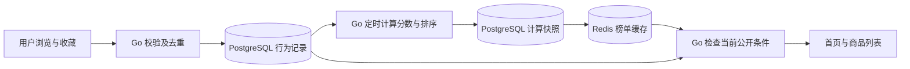

# 推荐算法说明

## 1 本期采用什么方案

建议首期采用“规则加权热门排序”，配合人工精选和新发布区域。系统根据真实浏览、收藏及首次发布时间给商品计算热度，再按分数排列。

这一方案适合当前以商品展示和客服咨询为主的业务：上线初期没有积累足够的本站行为记录，也没有可核实的线上成交结果；先使用能够解释和核对的排序规则，便于运营调整。相同入口和筛选条件下，用户看到相同的热门排序。

| 方案 | 依据 | 本期安排 |
| --- | --- | --- |
| 规则加权热门 | 浏览、收藏、发布时间 | 作为首期建议，直接服务首页热门 |
| 人工精选 | 运营人员选择及排列 | 独立区域，不把人工安排伪装成自然热度 |
| 内容相似推荐 | 当前商品或用户明确选择的区服、类型、价格范围 | 后续可用于“相似账号”，本期不自动增加 |
| 协同过滤或学习排序 | 足够的用户行为、曝光记录及验证样本 | 先积累并评估数据，本期不建设训练系统 |

Redis 用于保存排名和加快查询，排序规则由 Go 实现。引入 Redis 不会自动产生个性化推荐能力。

本说明中的权重、统计窗口、新品加分和刷新周期仍为建议，待审阅确认。新增 Redis、独立图片存储以及取消商品图片总张数上限已按本次反馈纳入方案。

## 2 哪些商品可以进入推荐

推荐候选必须同时满足：

1. 商品状态为已展示，当前内容版本已经审核通过。
2. 所属分类启用，展示所需图片与资料有效。
3. 符合当前页面的出售或出租、分类及筛选条件。

待审、退回、下架或已编辑但未重新审核的商品，即使历史分数很高，也不能推荐。管理员审核预览不计入浏览；建议排除发布人查看本人商品的行为，减少自己刷新带来的影响。

用户在列表中选择“最新”或“价格排序”时，按其选择排序，不能被热门推荐覆盖。列表选择热度排序时，先确定符合筛选条件的商品，再按热度排列；不能只过滤一小段全站榜单后就认定没有结果。

## 3 热度如何计算

### 3.1 初始公式

```text
商品热度 = V × 1 + F × 5 + N

V：近7个自然日的有效浏览累计数
F：近7个自然日首次收藏，且目前仍在收藏的人数
N：首次公开不足72小时为10，否则为0
```

权重1、5、10是便于首期观察的起始参数，并非已经经过本站数据验证的最佳值。收藏需要用户主动保存商品，初始权重设得比一次浏览高；新品加分用于给新商品一定展示机会。

不使用图片张数、售价或用户重复上传次数加分。图片总量取消上限后，多传图片不会提高热度。也不把打开客服二维码当作已成交。

### 3.2 有效浏览 V

详情成功显示后上报一次浏览，首页卡片曝光、页面预加载、切换商品图片和后台预览不算详情浏览。

同一访客看同一个商品，同一天只记一次。重复刷新20次仍记1次；第二天再次查看可再记1次。因此 V 是每天去重后相加的访问数，不是7天内去重人数。

登录后按会员标识去重；游客按服务器签发的匿名浏览标识去重。服务端生成统计日期，前端不能指定浏览数和访问时间。后台校验商品可公开、请求频率及访客标识，再写入数据库唯一键。

切换设备、清除浏览器记录或从游客转为登录状态，仍可能被计为不同访客。首期将其作为热门排序的近似行为信号，不声称能识别所有真实自然人。

### 3.3 有效收藏 F

同一会员与同一商品只有一条收藏关系。首次收藏在窗口内且当前仍有效，计1人；取消后计0。再次收藏恢复原记录，不刷新首次收藏时间，也不重复累计。

例如，10月20日首次收藏、11月10日取消后重新收藏，不作为11月10日的新增收藏加分。这条规则让 F 表示近期新增关注，避免反复取消和收藏刷新热度。

### 3.4 新品加分 N

从商品第一次审核通过并公开的时间开始计算，未满72小时加10分。修改资料、复审、下架后重新发布，均不重置首次公开时间。

旧站导入应保留可信的原首次发布时间。时间无法核实时，保留为空并标记待核对，不以导入时间冒充首次公开，也不给新品加分。

### 3.5 时间口径

统计采用北京时间，窗口为计算当天及之前6天，并以本次计算时刻为截止点。例如11月10日中午计算时，统计11月4日零点至11月10日中午的有效记录。

窗口内每天的浏览权重相同，超过窗口的记录不再计分。这是按窗口淘汰旧数据，尚未使用逐日衰减。新品72小时到期也会一次性减少10分；若后续发现边界跳动影响明显，再考虑平滑衰减。

## 4 计算示例

以下为说明公式的虚构数据，不代表网站实际流量。

| 商品 | 有效浏览 V | 有效收藏 F | 首次公开时间 | 新品加分 N | 计算 | 热度 |
| --- | --- | --- | --- | --- | --- | --- |
| A | 120 | 8 | 10天前 | 0 | 120 + 8 × 5 | 160 |
| B | 80 | 18 | 5天前 | 0 | 80 + 18 × 5 | 170 |
| C | 50 | 6 | 1天前 | 10 | 50 + 6 × 5 + 10 | 90 |

推荐顺序为 B、A、C。B 的浏览少于 A，但新增收藏更多，因此排在前面；C 得到新品加分，但不会因此直接超过所有热门商品。

分数相同时，首次公开较近的排在前面；仍相同则按公开商品编号升序。首次公开时间未知的，在同分商品中排在时间已知的后面，保证每次查询顺序稳定。

## 5 首页怎样安排

### 5.1 三个区域

- 人工精选：运营挑选商品并设置顺序，突出近期希望展示的内容。
- 近期热门：按上述公式排序，反映本站近期关注度。
- 新发布：按可信的首次公开时间排列，给新商品保留单独入口。

区域数量和卡片数由后台配置，具体展示量随页面设计确定。同次首页响应先安排精选，再安排热门，最后安排新发布；已经显示的商品不在后续区域重复出现。

新发布区域有自己的展示位置，不要求新品先在热度上超过老商品。仅有新品加分、没有浏览和收藏的商品，可用于补位，但不表述为已经受到大量关注。

### 5.2 新站没有数据时

初始阶段主要依靠人工精选和新发布。热门优先取已有有效浏览或收藏的商品，不足的位置按首次公开时间补齐；未知发布时间的旧商品可由运营精选，不伪造成新品。

当一个区域主要由补位商品组成时，页面可标注“新发布补充”或使用“推荐浏览”名称，不显示虚构热度。库存不足时减少卡片数，不重复同一商品凑满。

### 5.3 分类型推荐

全站首页可以展示全站候选；用户进入出售、时日租或周月租等入口后，使用对应分类候选。分类限制先于评分，避免热门出售商品挤占租赁列表。

这属于按页面条件推荐，与根据某个用户历史行为进行个人画像推荐不同。

## 6 Go、PostgreSQL 与 Redis 怎样配合



### 6.1 数据职责

| 位置 | 保存内容 | 用途 |
| --- | --- | --- |
| PostgreSQL | 商品、首次发布时间、收藏和每天去重浏览 | 真实业务及统计记录 |
| PostgreSQL | 分数构成、规则版本、计算批次和时间 | 供后台解释排名，Redis 故障时回查 |
| Redis | 商品分数、已排序编号、当前榜单批次 | 加速榜单读取和重复查询 |
| Go | 候选过滤、公式、定时任务、缓存发布和结果检查 | 执行业务规则 |

首期每条有效浏览在数据库完成去重记录；Redis 用于接口限流，不先在 Redis 累加后长期不落库。网络重试由数据库唯一键去重，收藏同样只保留一条关系。

### 6.2 Redis 的数据结构

建议使用有序集合保存商品与分数，便于按分数读取；Redis 的有序集合具有成员唯一和按分值排序的能力，见[官方说明](https://redis.io/docs/latest/develop/data-types/sorted-sets/)。

同分时仍需满足本项目的“首次发布时间、商品编号”次序，不能直接依赖 Redis 的默认同分顺序。Go 计算好完整次序后，另缓存有序编号列表，首页从该列表读取；有序集合用于查分及后台辅助查询。

缓存按计算批次保存，示例名称为 `hot:{batch_id}:scores`、`hot:{batch_id}:ordered`，另有当前批次指针。前两个是临时计算结果，数据库中的分数快照才是回查依据。

### 6.3 刷新与故障处理

1. 建议每15分钟启动一次计算，人工刷新也走同一任务。同一时刻只运行一批，避免旧任务覆盖新结果。
2. 固定统计截止时间，读取规则版本，从一致的数据视图计算全量合格商品。
3. 在数据库事务中替换分数快照和批次元数据，包括空榜单；记录中的批次一致。
4. 将完整结果写入 Redis 新批次键，再切换当前指针。读请求不能看到写入一半的榜单。
5. 下架、撤回或停用分类后主动移除缓存候选。即使缓存操作失败，返回前的数据库检查也会排除该商品，并继续取后续候选补齐。
6. Redis 不可用或快照不存在时，读取数据库最近快照；超过60分钟仍未成功计算则按新发布补齐，并在后台显示计算异常。数据库不可用时返回错误。

缓存指针失效或一次请求过程中批次键过期时，按缓存未命中处理，不能返回残缺榜单。热门结果属于定时统计，允许最多一个正常刷新周期的浏览和收藏延迟；下架与权限检查不采用这个延迟。

复杂筛选列表可直接关联数据库分数表查询，避免为每一种筛选组合建立 Redis 榜单。

## 7 运营如何调整

后台显示每个商品的有效浏览、有效收藏、新品加分、总分、首次公开时间、规则版本和计算时间。参数修改写入版本记录，下一次成功计算后显示实际生效批次。

发现浏览多但收藏少的商品长期占据前列，可以先查看是否存在重复流量或曝光集中，再决定是否提高收藏权重。每次只调整少量参数，记录修改日期和原因，比较调整前后的榜单及用户行为。

初期可以直接核对进入热门的商品、类别分布、新品进入情况和用户收藏。点击率需要记录曝光次数，客服转化率需要明确咨询事件；当前模型没有这些记录，不能从浏览量直接推算。若后续需要效果报表，再补充相应采集及数据定义。

## 8 已知局限与后续方向

| 问题 | 首期处理 | 后续可评估 |
| --- | --- | --- |
| 热门商品曝光更多，容易继续领先 | 保留人工精选和独立新发布区域 | 适当轮换展示、增加探索位置 |
| 匿名访问存在重复和刷量 | 每日去重、接口限流、排除后台及本人浏览 | 异常访问识别和更严格的有效行为口径 |
| 旧热度退出窗口时分数跳动 | 后台可查看统计周期与构成 | 按天衰减，使近期行为逐步获得更高权重 |
| 用户兴趣不同 | 按当前分类和筛选限制候选 | 内容相似推荐；数据充分后再评估个性化 |
| 权重未经本站效果验证 | 明确标为初始值，记录每次调整 | 有足够曝光和咨询数据后做对照评估 |

以上为后续选择，不增加到本期开发范围。首期目标是让推荐有真实依据、排名可解释、运营可调整，并与商品上下架保持一致。

## 9 验收要点

- 上述 A、B、C 示例必须算出160、170、90，排序为 B、A、C。
- 同访客、同商品、同日重复刷新只记一次；切换图片不额外加分。
- 取消收藏不再计分，再次收藏不刷新首次收藏日期。
- 新品满72小时后不再加分，修改及重新发布不刷新首次公开时间。
- 旧商品发布时间不明时不享受新品加分，图片张数不影响热度。
- 人工精选、热门、新发布在同次首页响应中去重；下架商品即使仍在 Redis 中也不返回。
- 同分排序在正常缓存、数据库回查和任务重跑时一致；空榜单更新不会遗留旧结果。
- 清空 Redis 后能重建榜单，计算失败时显示真实状态，不产生模拟数据。
