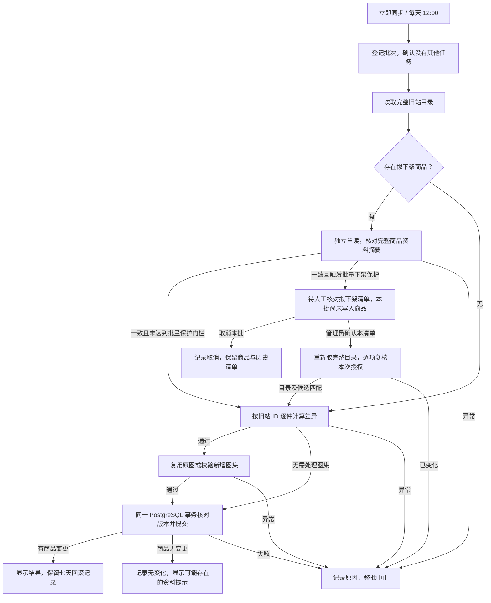

# 旧站商品同步

管理端「日常工作 → 旧站同步 → 立即同步」直接启动后台任务。页面从 PostgreSQL 读取阶段和计数，刷新页面后继续显示同一批次。完成后可点开「新增」「更新」「恢复上架」「下架」或「商品提示」，查看商品编号和实际变动。

手动入口在管理端 Go 服务中运行。每天北京时间 **12:00** 的入口由 systemd 启动同一二进制的 `legacy-sync` 子命令。两个入口使用同一套校验和数据库事务。定时器须在服务器安装，且管理端已允许定时执行。一次只允许运行一批。计划时刻当天已执行，或者另有任务在运行时，定时入口跳过本次触发。

进度条的百分比按阶段折算。读取和复核显示分页进度，比对显示商品件数，图片显示已处理的图集数。提交阶段显示 95%，数据库提交完成才显示 100%。进度条的扫描高光参考 [StyleKit 进度条](https://www.stylekit.top/en/animations/progress-bar)。

## 流程



## 批量下架需要人工核对时

1. 在「同步状态」打开拟下架清单，逐页核对商品编号。触发保护时，该批的新增、更新和下架均未生效。页面显示任务已经停在哪一步。
2. 确认清单正确后，选择「确认并继续同步」，核对弹窗件数再确认。后台创建关联的人工复核批次，重新读取旧站目录，核对目录摘要和拟下架商品身份，继续执行商品字段、编号冲突和图集等原有校验。通过后整批提交；资料或候选变化时停止，重新同步可以生成当前清单。一次确认只针对所选批次。
3. 如果这次不同步，选「取消本批」并确认。取消保留批次与明细供追溯，商品及图片保持原样。需要同步时可以重新发起。已生效的批次按已有七天回滚规则处理。

## 商品和图片规则

1. **目录完整性。** 每次读取检查分页总数、页大小和重复 ID，多页目录再核对首屏的完整商品资料。拟下架时独立重读全目录，按旧站 ID 排序后核对标题、报价、状态、图片清单等来源字段的摘要。两次读取不一致时整批中止。拟下架件数达到 `max(12, 向上取整(当前公开的迁移商品数 × 10%))`，或拟下架至少 2 件且旧站总数不足当前公开迁移商品一半时，也会中止。新增和下架分别计数。

2. **商品归属。** 旧站以 `legacy_id` 对照。同号不同 ID 或租售分类冲突时整批中止。补齐新商品后上架，按字段更新匹配商品。两次完整目录中均缺失的迁移商品软下架，有明确状态的商品可同步该状态。回归旧站目录时恢复同步下架的同一商品。新站平台录入与会员商品保留。人工下架、回收或审核中的迁移商品保留状态，并在有冲突时显示提示。

3. **报价和人工维护。** 出售按整号计价。租赁仅采纳旧站明确的计价单位，或标题明确且金额与接口一致的租期。新商品报价无法确认时显示「联系客服」，原数值保存在管理审计内。保留新站人工录入的时段报价、标题、属性和图集。批次快照以该轮完整的来源读取为准，此后的旧站修改进入下一次同步。

4. **图片准备。** 已验证的同商品图片可按来源 URL 或内容摘要复用。新增文件先做大小限制、解码、去元数据和安全重编码，再存入现有私有 OSS，核对大小和散列后登记为可用。新增素材准备在数据库事务外。旧站新图有问题时，有完整图集的现有商品继续使用整组原图。需要上架的商品缺少可用图集，或者其他必要资料校验不过时，整批中止。每批新图下载上限 256 MiB，重试可复用已经校验的候选对象。在同一 URL 原地替换文件需要单独核对。

5. **整批提交。** 提交时核对实际商品版本和快照、分类与媒体可用性。新增、更新、恢复上架、下架、图集关联、回滚所需的媒体引用及成功审计记录在一笔事务内提交。任何一步报错，业务变更整批撤销，另存失败原因。连接中断时使用原请求 ID 查询。同账号同 ID 回到原批次。任务失去心跳后可重新发起，已校验的候选图仍按私有对象清理规则处理。

6. **七天回滚。** 有实际变更的已完成批次可回滚。事务重新核对全部受影响商品的状态、内容、版本和图集，且原有上线所需分类仍可用。已改动的商品会阻止整批回滚。批次新建商品回到草稿并保留 ID，原有商品恢复原资料、报价、可见状态和图集，随后暂停定时同步。回滚期内用数据库引用保护原图，计时从提交时刻开始。手动入口仍可发起下一次同步。

## 部署与启用

后端与管理端需要配套发布。迁移 `0024_legacy_sync_source_digest.sql` 保存来源目录摘要，`0025_legacy_sync_review.sql` 记录需要复核的类型及人工复核的来源批次。既有批次只有在来源摘要有效、保护原因和全部商品明细相符时才标为批量下架复核。

1. 核对当前数据库版本并备份，等待在途同步结束。在维护窗口暂停定时触发，执行同版本二进制的 `migrate`，再一起切换 Go 后端和管理端产物。从 0024 升级只需应用 0025。核对商品、图集、历史批次、复核标记及管理端定时开关，再恢复原有定时器状态。更早的实例须按版本顺序应用缺少的迁移，其中 0022 会归档旧预览并将定时规则设为暂停。
2. 核对部署环境的私有 OSS 访问和已有原图引用。可从同版本二进制只读检查来源。

   ```sh
   /opt/qingye-production/current/qingye-api legacy-sync --check-source
   ```

3. 通过「立即同步」运行首批，并检查成功或阻止原因及各项计数。需要每天执行时，安装并验证计时器，然后在管理端选择「恢复定时」。

   ```sh
   install -m 0644 qingye-production-legacy-sync.service qingye-production-legacy-sync.timer /etc/systemd/system/
   systemd-analyze verify /etc/systemd/system/qingye-production-legacy-sync.{service,timer}
   systemctl daemon-reload
   systemctl enable --now qingye-production-legacy-sync.timer
   systemctl list-timers --all qingye-production-legacy-sync.timer
   ```

## 排查与验收

- **重复同步。** 每批都核对新站实际商品和已验证的图集。图片引用与顺序一致时跳过图片准备。若一个新地址的内容与该商品已登记的同步素材一致，首次取图核验后记住这个地址，以后复用同一对象。旧站在同一地址原地换图仍需另行核验。
- **无变化与重试。** 本批实际写入商品数为零时，管理端显示「无变化」，进度为 100%，没有回滚入口。遇到旧图暂用、人工报价冲突等情况仍可查看提示。回滚其他批次或图片源恢复后，可点击「立即同步」重新比对。

- 按开始时间查看批次。中止批次保留停留的阶段及原因。成功批次可按商品变更类型点开结果。服务器定时日志可用 `journalctl -u qingye-production-legacy-sync.service` 查询。
- 已启用定时器的实例切换到新站维护时，可在管理端暂停定时任务，并用 `systemctl disable --now qingye-production-legacy-sync.timer` 退出服务器触发。
- PostgreSQL 存批次摘要、阶段进度、商品变更前后快照和媒体引用。旧站原始目录在任务内存中读取与比较，差异记录保存必要的原始数据。
- 隔离 PostgreSQL 用例验证了同时新增和下架、来源变化、异常规模、商品编号冲突、新图缺失、事务末尾故障、原图引用保护、并发排斥、请求去重和七天回滚。Chrome 验证桌面与手机进度、刷新恢复、结果分类和回滚对话框。
