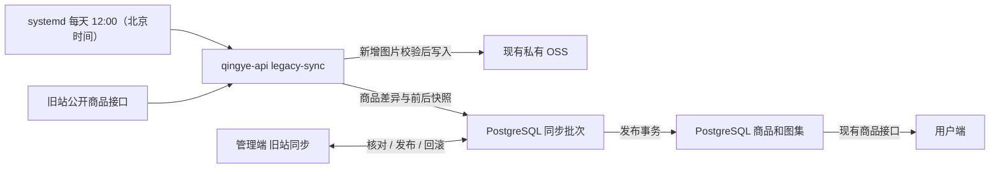

# 旧站商品同步

旧站仍负责日常更新时，新站每天北京时间 **12:00** 读取旧站商品目录。管理员在「日常工作 → 旧站同步」查看每批的计划时间、实际开始及完成时间、旧站最新更新时间、发布及回滚时间。

## 运行方式

沿用现有 Go 后端二进制 `qingye-api`。两个网站分别运行 `qingye-api serve`；systemd 定时器单独启动 `qingye-api legacy-sync`，任务结束后退出。管理端 API 提供查批次、发布、回滚和同步方式设置。用户端沿用现有商品查询，读取 PostgreSQL 中已发布的结果。



## 同步规则

1. 读取旧站公开目录的全部分页，检查总数、重复的旧站商品 ID 和拉取前后的首页顺序。读取失败时批次记为失败。
2. 以旧站商品 ID 匹配原有迁入记录。新商品分类或编号冲突、报价缺失、租期无法确认、图集读取失败时列入待核对。列表中暂时缺失的商品保留当前状态。有明确下架或成交状态的记录才会更新对应状态。
3. 出售价格映射到整号。租赁价格只有在旧站给出明确单位，或标题中的明确租期与接口金额一致时才转换。管理端录入的多时段报价、手工维护的标题、属性和图集会保留。旧站价格变化有差异提示。
4. 已登记可用的图片沿用现有对象。同商品新增图片会限制大小、解码检测、去除元数据并重新编码，再写入现有私有 OSS，回读确认字节与校验值后才进入可发布图集。候选图片还会按同商品的源地址或内容摘要判重。旧站在相同 URL 原地替换图片时，需要人工重新核对。
5. 批次保存商品修改前后的快照和需核对项。首次人工核对并发布后，可在管理端开启自动发布。整批缺失商品、变价、状态变更或异常图集集中出现时转为待人工核对。
6. 发布前再次比对商品当前版本及快照。可发布的变更用同一个数据库事务提交。发布后 **7 天** 内可回滚，既有商品恢复原资料、报价、状态和图集，本批新增的商品转为草稿并保留商品 ID。碰到后续编辑或图片失效时，整批停止回滚。回滚成功后定时同步暂停。

## 首次启用

1. 发布后端及管理端构建前，按正式部署流程备份并执行 `0021_legacy_catalog_sync.sql`。校验现有媒体配置和私有 OSS 权限。
2. 使用同版本二进制检查旧站接口。此命令只读取旧站目录，输出记录数量和最新更新时间。

   ```sh
   /opt/qingye-production/current/qingye-api legacy-sync --check-source
   ```

3. 系统管理员可以立即生成首批预览。该命令写入批次记录，校验并暂存新增候选图片，商品需要经过发布才会生效。

   ```sh
   systemd-run --wait --collect --unit=qingye-production-legacy-preview \
     -p User=qingye-production -p Group=qingye-production \
     -p WorkingDirectory=/opt/qingye-production/current \
     -p EnvironmentFile=/etc/qingye-production/app.env \
     /usr/bin/env DB_MAX_CONNS=2 MEDIA_WORKERS_ENABLED=false \
     /opt/qingye-production/current/qingye-api legacy-sync --manual-preview
   ```

4. 在管理端核对首批新增、价格、上下架和图集变化，发布已确认的批次。确认启用每日任务后，将同目录的 unit 文件安装到 `/etc/systemd/system/`，回读下次运行时间。初始模式为每天生成预览，可由管理员改为自动发布。

   ```sh
   install -m 0644 qingye-production-legacy-sync.service qingye-production-legacy-sync.timer /etc/systemd/system/
   systemd-analyze verify /etc/systemd/system/qingye-production-legacy-sync.{service,timer}
   systemctl daemon-reload
   systemctl enable --now qingye-production-legacy-sync.timer
   systemctl list-timers --all qingye-production-legacy-sync.timer
   ```

同一日的计划时刻只生成一次批次，补跑会使用上一次应执行的中午时刻。需要重跑当天失败的读取时，使用手动预览命令。正式切换到新站维护商品时，在管理端暂停，并执行 `systemctl disable --now qingye-production-legacy-sync.timer` 停止触发。

## 查问题和回退

- 在「旧站同步」根据时间找到批次，先查看失败或待核对原因，再对照价目、状态和图片数量。服务日志可用 `journalctl -u qingye-production-legacy-sync.service` 查询。
- 在 7 天内打开相应的已发布批次，选择「回滚本批次」。需要保留后续人工改动而系统提示冲突时，从明细中核对受影响商品，进行人工修正。需要继续同步时先重新生成预览，核对差异再选择同步方式。
- PostgreSQL 保存批次元数据和 JSON 快照，图片保留记录指向已有媒体 ID。替换的图片在回滚期内保留，期满回到现有清理流程。
