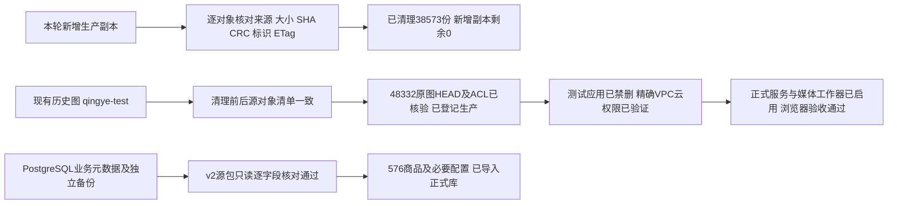

# 清叶正式环境部署说明

更新：2026年11月15日。本目录提供8.140.230.149上的独立正式部署模板，复用主机已安装的Nginx程序，保留既有宝塔项目。模板及本地验证完成不代表已上线；实际版本、数据数量、证书、协议发布和公网验收以发布回执为准。

## 当前状态：正式服务已启动，浏览与管理员入口验收通过

正式库已导入576件商品、48,332条商品图片关联、48,349条必要媒体、10个头像库条目和1个独立正式管理员；17份头像/客服支持素材共2,051,687字节已落生产私有目录。48,332张历史原图已完成真实只读HEAD/ACL复核并登记原OSS路径，存储写入为0。双API和双网站已于北京时间2026-11-15 00:07:35成功启动，媒体工作器已开启；可信TLS、双API健康、576件公开目录、协议HTTP、入口隔离、UDP监听及既有站点保持通过，证书续期timer已启用。12张真实原图HTTPS内容及暂存清理、18组公网浏览器和管理员登录/退出均已通过；外部Turnstile配置及真实短信仍未完成。

| 项目 | 最后可核实状态 |
| --- | --- |
| 8.140基础服务 | PostgreSQL16.16独立5433、Redis6.2独立6383、SeaweedFS4.53已运行 |
| 可信IP证书 | 已签发，有效期至`2026-11-21 04:46:25 UTC`；续期dry-run通过 |
| 独立HTTPS端口 | 5179/5181正式HTTPS入口已启动，可信TLS及18组公网浏览器通过 |
| 既有站点 | HTTPS200；两个既有Nginx配置散列保持不变，仅新增IP的ACME vhost |
| 正式应用与数据库 | 数据及独立管理员已导入；四服务于北京时间2026-11-15 00:07:35启动，`MEDIA_WORKERS_ENABLED=true` |
| Cloudflare | 重新安装并授权后连接仍返回`Reauthentication required`及`challenge-widgets.read` scope错误；生产IP尚未加入现有widget，外部配置未完成，短信与真实验证码不能标记通过 |
| OSS容量与复制撤回 | 容量约束40G；`qingye-production/media/*`的PutObject Deny及复制CLI禁用保留，禁止恢复整套二次复制 |
| 新增副本清理 | 38,573份本轮新增副本已精确清理，回收21,424,318,469字节；剩余0、错误0，源前缀完整inventory保持 |
| 历史商品图接管 | 48,332张`qingye-test/media/legacy/`原图已HEAD/ACL核验及生产登记；保留原路径、不复制不重命名，云权限已验证，历史受控读取、12张真实图内容及暂存清理、浏览器样本图通过 |
| 测试删除隔离 | 152双业务API于北京时间2026-11-14 23:44:24发布删除禁用版，`MEDIA_LEGACY_OSS_DELETE_ENABLED=false`；测试继续本地读，云端精确VPC策略已实测：生产内网删除不存在对象204，测试公网403，两端Put403；未删除真实图 |
| 后端检查 | 专项206、全量692、race692，均0失败0跳过；vet、API/登记器构建、源码及实际API二进制govuln通过；隔离HTTP功能418→并发55→安全168通过 |
| 迁移工具验证 | 本地20项及8.140专用5433验证库7组真实SQL通过；正式v2包已在152只读逐字段复核并导入生产库，未迁测试会员、聊天或统计 |
| 协议 | 正式用户协议与隐私政策均已发布第3版，回读正文SHA256均与已授权材料一致；公开HTTP及三个视口浏览器正文逐字/SHA均与授权材料一致 |

生产按自身业务引用保护和精确对象键清理独占图片；shared guard仅供迁入过渡，不能作为永久只读方案。新图继续写`r20/production/objects/`，APP_ENV及MEDIA_R20_ENVIRONMENT保持production。源OSS图片清单不等同完整PostgreSQL备份；数据库、私有密钥、原对象映射与恢复材料分别保存并核验。协议、样本图、公网浏览器及管理员登录/退出均已验收，实际源码与最终Git提交以发布回执核对。

## 1. 独立入口与资源

| 组件 | 位置或端口 | 边界 |
| --- | --- | --- |
| 用户站 | `https://8.140.230.149:5179` | 独立Nginx，静态根`/var/www/qingye-production/public/current` |
| 管理站 | `https://8.140.230.149:5181` | 独立Nginx，静态根`/var/www/qingye-production/admin/current` |
| public/admin API | `127.0.0.1:5180` / `127.0.0.1:5182` | 同一版本Go程序，独立入口、Origin及会话密钥 |
| WebTransport | UDP5179 / UDP5181 | Go独立监听；URL分别为对应HTTPS入口加`/chat` |
| PostgreSQL16 | `127.0.0.1:5433`；socket `/run/qingye-production-postgres` | 独立集群和库`qingye_production`，不复用原5432业务 |
| Redis | `127.0.0.1:6383` | 独立认证及持久目录，禁止操作其他实例 |
| 私有暂存 | SeaweedFS4.53，S3回环8333 | 专用身份和桶`qingye-production`；管理接口不开放公网 |
| Nginx程序 | `/www/server/nginx/sbin/nginx` | worker用户`www`；MIME文件`/www/server/nginx/conf/mime.types` |
| API版本 | `/opt/qingye-production/releases/<release>`及`current` | 二进制由root维护，业务用户只读 |
| 私有配置 | `/etc/qingye-production/app.env`、`admin.env` | root0600；不进入Git或静态网站 |
| 业务文件 | `/var/lib/qingye-production/media` | `qingye-production`可写；禁止Nginx直接alias |
| 暂存对象 | `/var/lib/qingye-production/storage` | `qingye-production-storage`独立管理 |

双Nginx分别使用`/run/qingye-production/{public,admin}`、`/var/log/qingye-production/{public,admin}`和`/var/lib/qingye-production/nginx/{public,admin}`。各自`-p/-c`和PID明确，不调用共享`nginx.service`替换既有站点。

该主机宝塔Nginx编译了Lua模块，独立`-p`不能继承主站http配置；两份模板均显式设置`lua_package_path "/www/server/nginx/lib/lua/?.lua;;"`。首次启动因缺少此路径自动回滚四服务和环境配置，补正后本地9项证书/模板控制检查通过；于北京时间2026-11-15 00:07:35真实启动成功，四服务正常，证据见生产启动回执。

## 2. 模板与初始化

| 文件 | 用途 |
| --- | --- |
| [provision-services.py](provision-services.py) | 核验暂存二进制SHA256，创建独立PG/Redis/暂存服务和私有配置；不创建管理员、不启动API |
| [nginx.conf](nginx.conf)、[admin-nginx.conf](admin-nginx.conf) | HTTPS静态入口、同源API及WebSocket；覆盖XFF，访问日志省略查询参数 |
| `qingye-production-*.service` | 两个API、两个独立Nginx单元 |
| [acme-vhost.conf](acme-vhost.conf) | 加入既有宝塔Nginx的专用IP验证入口，仅提供ACME文件，其余444，无`default_server` |
| [deploy-certificate.py](deploy-certificate.py) | 检验证书、原子切换证书对、更新四个清叶服务及失败恢复 |
| [certbot-renew.service](certbot-renew.service)、[certbot-renew.timer](certbot-renew.timer) | 专用短期IP证书续期及部署重试 |

维护脚本使用**Python3.11**；主机系统`python3`可能仍是3.6，不能直接依赖它。初始化前核对现有监听、目录、磁盘空间、工具版本及配置文件，保存既有项目配置摘要。`provision-services.py`只允许重用内容完全一致的已有配置，差异会停止，不自动覆盖。

`/etc/qingye-production`与`/var/lib/qingye-production`为0755以允许服务身份穿越，私密文件和各服务数据目录分别保留0600/0640及0700/0750。API加入暂存组，仅用于对暂存容量路径执行容量探测；暂存文件仍受0077 umask保护。

初始化配置为`APP_ENV=production`、安全Cookie和精确HTTPS Origin，媒体环境固定`production`。两入口共用商品私密资料密钥，独立会话密钥。首次导入期间`MEDIA_WORKERS_ENABLED=false`、注册短信和短信登录均关闭。生产短信使用明确的`SMS_ACCESS_MODE=public`，不能通过空测试白名单推定开放。

## 3. 正式构建

用户端构建环境：

```dotenv
VITE_DATA_MODE=api
VITE_API_BASE_URL=/api/v1
VITE_ENVIRONMENT_LABEL=
```

管理端构建环境：

```dotenv
VITE_API_BASE_URL=/api/v1
VITE_PUBLIC_SITE_URL=https://8.140.230.149:5179
VITE_ENVIRONMENT_LABEL=正式管理环境
```

在各项目执行锁文件安装、测试和`pnpm build`。检查进程环境、`.env.local`和`.env.production.local`，避免旧地址覆盖。Vite参数是构建时配置，不因服务端环境文件变更而自动更新；不得放入密钥。

部署版本化静态目录，核对tar及每个文件SHA256后切换`current`。本轮两端已完成正式参数构建及本地包内散列核对；产物清单位于私有发布材料，仓库不存dist或tar。Go构建沿用`-tags=nomsgpack`，实际工具链和二进制SHA256记入回执。

## 4. 数据与媒体迁移：原整套复制方案已撤回

**用户已明确OSS容量只有40G，不允许在该OSS内再存整套第二份历史图。独立整套复制方案已撤回，禁止重新运行`copy_production_media.py --apply`，也不能按原独立副本登记指南启用生产读取。**

已对`qingye-production/media/*`新增精确的PutObject Deny，真实写入仍返回403；复制CLI的`--apply`也已禁用，相关7项单测通过。从8.140逐批确认源/目标大小、SHA元数据、CRC、媒体标识及ETag后，按核对清单精确删除本轮新增目标对象。清理时原`qingye-test`对象与权限保持；后续接管的权限切换另行验证。

**清理完成：`removed_copies=38573`，`reclaimed_bytes=21424318469`（约21.42GB），`remaining_new_copies=0`，`errors=0`。** 这仅表示本轮新增副本已撤销，不表示正式迁入、所有权接管或网站上线完成。

源前缀`qingye-test/media/`在清理前后均为48,340个对象、26,844,996,534字节，完整inventory SHA256均为：

`59bf568d3abe80d360b968ea08c7ad66ef08452fa22c6a78869a75e0e07e6c04`

| 源对象类型 | 数量 | 字节数 |
| --- | --- | --- |
| 历史原图 | 48,332 | 26,841,243,424 |
| `images/`图片 | 8 | 3,753,110 |
| 其他类型对象 | 0 | 0 |
| 合计 | 48,340 | 26,844,996,534 |

上述清单核对证明本轮清理前后源前缀记录一致，不等于重新下载每张图完成逐字节验收，也不证明PostgreSQL业务库已备份。该前缀没有数据库备份等其他类型对象。



用户已确认由生产接管现有OSS商品图，保留`qingye-test/media/legacy/`的原路径，不复制、不重命名。测试站仅保留本地图片用于测试，并从应用删除器和云权限两层禁止其删除接管的legacy OSS对象；生产完成接管后，继续按本库有效引用、退役键和持久清理任务精确删除独占图片，不能以永久共享只读使生产无法释放空间。现有shared guard只是迁入过渡保护；在测试删除隔离、生产接管登记及验证完成前不能提前解除，最终替换为测试删除Deny和生产受控清理。新上传仍写`r20/production/objects/`，草稿及上传过程使用服务器私有暂存。`APP_ENV`与`MEDIA_R20_ENVIRONMENT`继续为production，原对象路径中的test字样不改变生产运行环境。

数据层以PostgreSQL为业务事实来源。正式v2包已在152只读分批逐字段核对商品、媒体、关联、报价及运营配置，并重新核验17份支持素材；内部payload SHA256为`e72ba63e59c2ae0fd80869ef53b15f481ba93224ca7374f7630b62d41abfd789`，有序图片关系文件SHA256为`ba777e849765b91f6fa9cfd117cc4b6a8434992aed69bdf06e8903664f013e50`。这些选择性迁入材料不等同源站全库或异地恢复证明，数据库和图片证据应分别保管。

`prepare_production_data.py`已选择性导入576件可见且批准版本一致的商品（出售45、租赁531）、48,332条有序图片关联、48,349条必要媒体及头像库、客服、字典和指定运营配置。所有权映射到目标独立正式管理员；实际数量是本轮导入核对值，不是未来固定库存。

不迁测试会员、管理员、密码、会话、短信、聊天、收藏、浏览、咨询统计、推荐运行状态及媒体任务。商品/媒体归属和头像库创建者已映射到独立新建的正式管理员，保留业务编号、报价、原始商品资料及有序图片；加密私密字段需源目标密钥指纹一致。

导入工具默认只读预览，核对全新目标库、独立管理员、迁移版本、初始字典/审计/序列、事务锁和重复导入；现已通过7组真实SQL验证并完成正式v2包导入。验证覆盖预览不变、脏目标拒绝、末尾错误后表与编号序列回滚、完整导入、同包幂等、修改后拒绝及数量归属。原快照错误来自对序列执行`to_jsonb(s)`（SQLSTATE42809），已改为显式序列字段；后续采用有界流式SQL。源使用5432，正式及专用验证目标固定独立5433和`/usr/pgsql-16/bin/psql`。

48,332张legacy原图已通过只读`HeadObject`/`GetObjectAcl`核验并在生产库登记，`storage_mutations=0`；完成manifest SHA256为`6058465469cf95f52c41f20edc6f489a28f5c82bd8523035db8a0d8e995ffd2c`。17份支持素材已复制到生产私有本地目录，未复制legacy原图。正式双API与双网站已于北京时间2026-11-15 00:07:35启动、媒体工作器开启，测试云删除Deny已实测通过；12张真实原图及18组页面、管理员登录/退出和协议正文验收通过。

云策略于北京时间2026-11-15 00:00:04实测通过：legacy Delete仅允许生产精确VPC；8.140内网不存在对象删除探针204，152公网相同探针403，两端Put403，bucket versioning disabled。没有删除真实图片、复制或新建对象；策略SHA256为`4879a396c3649129dcfae418ff16fb464d9f5158e7ec94afce2decf1bce530c7`。

### 精确对象范围的OSS权限示例

以下三个Deny语句对应已实测的策略结构。先替换桶名和生产VPC占位值，再与现有策略合并；不得覆盖桶内其他项目的Statement。`acs:SourceVpc`限定生产内网来源，不使用`acs:SourceIp`。第一条只约束legacy删除，生产身份仍须具有必要的最小Allow；后两条禁止覆盖历史原图以及恢复已撤回的整套生产副本写入，不限制`r20/production/objects/`正常新图路径。

```json
{
  "Version": "1",
  "Statement": [
    {
      "Effect": "Deny",
      "Principal": ["*"],
      "Action": ["oss:DeleteObject", "oss:DeleteObjectVersion"],
      "Resource": ["acs:oss:*:*:<BUCKET>/qingye-test/media/legacy/*"],
      "Condition": {
        "StringNotEquals": {
          "acs:SourceVpc": ["<PRODUCTION_VPC_ID>"]
        }
      }
    },
    {
      "Effect": "Deny",
      "Principal": ["*"],
      "Action": ["oss:PutObject"],
      "Resource": ["acs:oss:*:*:<BUCKET>/qingye-test/media/legacy/*"]
    },
    {
      "Effect": "Deny",
      "Principal": ["*"],
      "Action": ["oss:PutObject"],
      "Resource": ["acs:oss:*:*:<BUCKET>/qingye-production/media/*"]
    }
  ]
}
```

实际验证使用同一精确不存在对象键：生产北京内网Delete返回204、测试公网Delete返回403；两端Put均403，因此未创建或删除真实对象。原图只读HEAD/ACL与业务引用保护继续保留。桶版本控制已核对为disabled，回执绑定最终策略SHA256；不要用对真实商品图片的删除作为权限探针。

实测结论绑定当前凭据身份、VPC和策略。OSS对无Condition的`Principal: ["*"]`桶策略存在bucket owner例外；未来改用bucket owner或更换身份/VPC时须重新验证，不能仅据通配Principal推断所有身份永远无法覆盖。

## 5. TLS与续期

ACME文件根为`/var/lib/qingye-production/acme`，验证路径为`/.well-known/acme-challenge/<token>`。只有[专用vhost](acme-vhost.conf)加入既有Nginx；安装前检查同IP的`listen/server_name`冲突，不设置默认服务器、不改其他项目入口。验证文件路径需允许`www`读取。

Certbot虚拟环境为`/opt/qingye-production/certbot`；配置、工作、日志目录分别为`/etc/qingye-production/letsencrypt`、`/var/lib/qingye-production/letsencrypt`、`/var/log/qingye-production/letsencrypt`。证书lineage为`/etc/qingye-production/letsencrypt/live/qingye-production-ip`。首次签发应核对所安装Certbot版本支持的IP短期证书参数，并记录签发命令与结果；不能复用其他项目的lineage。

使用Python3.11执行部署hook。首次仅安装时用`--install-only`，然后再启用四个清叶服务。证书复制为root:qingye-production 0640，以`/etc/qingye-production/tls/current`原子指向成对材料；检查剩余有效期、IP、信任链及公私钥配对。普通续期先校验独立Nginx配置，再重载双站、重启双API并检查本机健康。失败恢复旧证书及清叶服务，不操作其他项目。

续期源文件必须安装为`qingye-production-certbot-renew.service/.timer`，避免覆盖系统Certbot任务。每天00/12点检查，随机延迟最多30分钟，适配六天IP证书。`ExecStartPost`会补试此前签发成功但部署失败的材料；材料未变化时不会重启服务。证书已签发，续期dry-run通过，专用timer已启用；最终运行核对的下次触发时间为北京时间2026-11-15 12:14:39。四个应用服务及三个基础服务均active/enabled，静态25+7文件及8份配置/单元与候选逐SHA一致；双API实际二进制与回执一致。

## 6. 协议及功能开放

经营方已确认河南清叶网络科技有限公司与广州淞株商贸有限公司共同负责本站服务及个人信息请求，统一由站内客服受理，并授权发布正式用户协议与隐私政策。

两份正式协议已通过受控事务发布第3版，发布后回读正文SHA256均与已授权材料一致。内容页按纯文本保留换行显示，发布正文不含Markdown表格、内部发布说明或技术附录。公开HTTP及1440/390/320三个视口的浏览器正文已逐字核对，正文SHA256均匹配。

Turnstile主机匹配、短信供应商方案、预算和实际能力接口分别验收。无需把关闭的密码重置伪装成可用功能；页面提供实际可用的短信登录或站内客服。不得因生产部署完成便把未实际执行的验证码发送、收信或注册标记为通过。

## 7. 验证与回退

正式HTTPS抽样12张历史原图全部200，逐字节SHA256、长度和MIME匹配，无OSS重定向，共6,490,732字节、14.505秒；每张完成后r20-tmp、相关fd及Nginx proxy_temp清空，最终0残留。本地legacy文件0、17份支持素材不变，6类暂存/清理表前后均0。

正式Chrome在正常TLS下18组检查通过（1440/390/320各覆盖首页、集市、真实详情、管理登录及两份协议）；桌面3列/手机2列、可见样本图解码、无横向溢出、v3协议逐字及SHA一致，页面错误、5xx和非预期4xx/控制台/请求失败均为0。管理员登录成功，退出200且随后me401；3次浏览统计POST与1次聊天票据POST被拦截，没有创建会员、发短信或修改商品。完成于北京时间2026-11-15 00:11:18，共24张未登录截图，已目视核对代表视口。

当前证据包括：用户端199项、管理端160项测试与双正式构建；登录能力及未发布协议8组mock回归；1440/390/320布局9组；两份协议6组纯文本页面检查；证书与模板9项检查。迁移工具20项本地单测及真实SQL7组、只读媒体证据工具19项通过。接管版后端专项206、全量692、race692均0失败0跳过，vet及两种构建通过；源码和实际API二进制govuln均为`No vulnerabilities found`，隔离HTTP功能418→并发55→安全168通过。正式站18组只读浏览器及管理员登录/退出已通过（退出200、复查me401）；这些已通过证据不能代替真实短信、第三方验证码或正式服务验收。

最终回执补充实际部署时间、源提交、API/静态产物散列、PG迁移与数据摘要、撤回复制的清理回执、源对象和元数据备份证据、生产接管、测试删除隔离及生产引用清理验收、证书有效期及续期状态、协议版本与正文散列、双API健康、两端浏览器和媒体/聊天验证、旧项目配置及监听保持情况。真实收信和注册若未执行，应单列未完成。

发布前备份新正式环境的数据库、配置、密钥、版本链接及本次清单。常规回退只切换本项目版本和对应配置，不删除源站数据或其他站点。本轮撤回复制产生的新增目标副本仅按已核对清单精确清理，不进行源前缀或整桶删除；有数据库或媒体状态变化时须按对应备份和任务状态恢复，不能仅切回旧二进制声称数据已回退。
