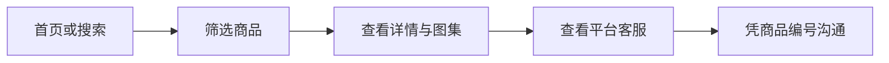
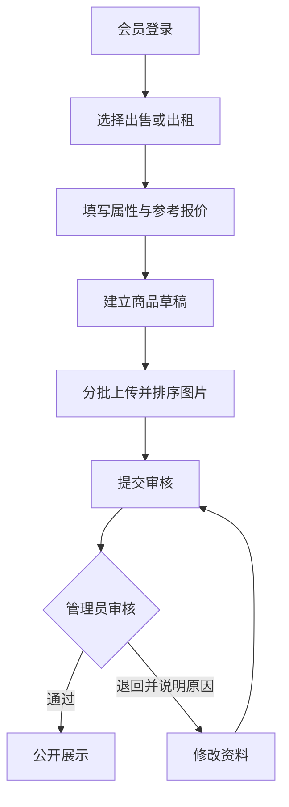

# 业务流程

## 1 浏览与咨询

浏览及联系平台客服不要求登录。收藏时要求登录，成功后返回原商品。网站只展示参考报价，具体成交条件由客服联系确认。

筛选条件保存在页面地址中，返回列表时恢复。商品接口失败时显示重试；下架商品显示状态说明，不使用模拟数据补位。

## 2 联系客服上架

1. 用户进入上架页面，选择联系客服。
2. 页面展示上架客服二维码及资料说明。
3. 客服收集资料，管理员在后台录入。
4. 管理员核对资料与图片后发布。

管理员录入商品使用与会员投稿一致的公开内容标准。后台可以将校验与发布合并为一次操作，无需增加多人审批；发布人和内容版本应留记录。

## 3 会员自主发布

### 3.1 提交资料

| 字段 | 业务要求 |
| --- | --- |
| 交易类型 | 出售或出租，独立保存，不由标题推断 |
| 分类 | 与交易类型和报价单位一致 |
| 标题 | 必填，说明账号主要特点 |
| 区服、性别、XVIP、特色 | 按分类配置填写 |
| 报价 | 可填写参考价格或选择联系客服报价；币种和旧数据口径待确认 |
| 租赁单位 | 小时、天、周、月；仅用于报价说明，不生成自动档期 |
| 图片 | 至少一张，不设固定总张数上限；分批上传和编辑，可排序，第一张作为封面 |
| 介绍 | 说明账号亮点，不收集登录密码、验证码或证件 |

默认使用注册手机号供管理员内部联络，前台使用平台客服。是否允许直接联系发布人列为待确认事项，不在首期默认开放。

商品草稿先保存，再分批关联已上传图片。每批结果即时保留，用户可继续补充或修改。已选择但尚未完成上传、处理或关联的图片应有明确提示，不在用户不知情的情况下漏图提交。

### 3.2 审核要求

管理员核对标题、分类、属性、图集、参考报价及介绍是否完整且一致。退回必须填写原因。用户应能从“我的发布”直接看到意见并重新提交。

审核仅证明发布资料经过平台内容检查，页面不得据此表述为游戏账号真实性、归属或交易安全的保证。

## 4 商品状态

| 状态 | 含义 | 可进行的操作 |
| --- | --- | --- |
| 草稿 `draft` | 尚未提交，不公开 | 保存、编辑、提交 |
| 待审核 `pending` | 已提交，等待管理员处理 | 等待、撤回、编辑后重新提交 |
| 退回 `rejected` | 未通过，附原因 | 修改、重新提交 |
| 已展示 `published` | 审核通过，前台可见 | 收藏、咨询、编辑、下架 |
| 已下架 `offline` | 停止公开 | 修改、重新提交 |

建议采用以下处理方式，确认状态见[待确认事项 R02](09-review-items--需求确认与审阅记录.md)。

- 待审核商品被编辑或撤回后回到草稿。
- 已展示商品被编辑后停止公开并回到草稿，用户重新提交审核。
- 用户主动下架后停止公开，重新上架需要提交审核。
- 商品下架后立即退出列表、详情公开查询和推荐候选。

修改时增加内容版本号。管理员提交审核结论时，若资料已被修改，系统拒绝该次审批并要求重新查看，不能把新内容当作旧版本通过。

## 5 收藏与推荐

会员对同一商品只保留一条收藏关系。取消收藏后不计入有效收藏统计；再次收藏恢复有效状态，不刷新首次收藏时间，不形成多条加分记录。失效商品在个人收藏中保留状态提示，不通过收藏列表泄露未公开资料。

推荐由两部分组成：人工精选由管理员配置，自动热门由系统计算。两者均要求商品当前处于已展示状态。无可用热度数据时，使用新发布商品补齐，不伪造浏览数或收藏数。

## 6 主要异常处理

| 场景 | 处理方式 |
| --- | --- |
| 未登录提交或收藏 | 进入登录，成功后返回原操作位置 |
| 上传失败 | 保留已填写内容，允许重试失败文件 |
| 图片不属于当前用户 | 拒绝绑定，不返回他人素材地址 |
| 必填项缺失 | 标明具体字段，保留其余填写内容 |
| 审核时版本变化 | 返回冲突，刷新资料后重新处理 |
| 商品已下架 | 显示状态，不保留可误导用户的咨询报价入口 |
| 客服未配置或已停用 | 明确提示暂不可联系，不使用假二维码 |

## 7 业务规则与参数

商品图片不设固定总张数上限已确认。审核后的修改方式、推荐权重、单文件大小和联系方式展示方式仍有待确认项，以[待确认事项](09-review-items--需求确认与审阅记录.md)中的结论为准。
