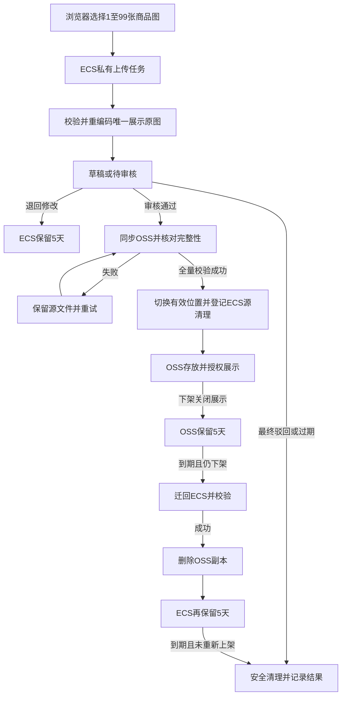

# R20 商品图片上传、存储与展示需求

最新实施口径：单次选择或拖入1—99张，100张及以上整批拒绝且不发送上传请求；300张按99＋99＋99＋3分四批追加，不设商品总张数上限。隔离测试使用每张1—10KB的合成图片。用户端只展示上传进度和“上架中”等业务状态；对象键、存储位置、迁移/清理阶段与技术错误仅在管理端授权接口展示。已授权实现、隔离验收后部署152测试环境并推送GitHub；未有实际回执前不得标记已上线。

日期：2026年11月13日。状态：已实现、隔离验收并部署152测试环境；文档随本次提交更新。R20聚焦商品图片的批量上传、存放位置、自动留存、展示速度和异常访问防护；本轮已授权实现、在隔离环境验证后部署152测试环境并同步GitHub；不切换8.140生产站，不接管历史原图。

最新确认：每张R20新商品图只持久保存一张经过安全验证、重编码的展示原图，取消独立720px预览和其他持久派生规格，浏览器本地blob预览保留。单原图后端隔离验收已有结果，见[当前架构](../开发产出文档/MEDIA-R20--媒体生命周期架构与故障一致性.md)和[验收记录](../业务验收与审查记录/MEDIA-R20-ACCEPTANCE--商品媒体隔离验收记录.md)。

当前正式测试入口已部署R20，回执见[发布记录](../计划/RELEASE--测试环境发布记录.md)；8.140生产站不变。此前提交的[OSS读取预备模块](../开发产出文档/OSS-READ-PREP--OSS原图读取预备与启用边界.md)仍未装配，不能把模块测试通过视为R20已实现或浏览器已直连OSS。现有历史图片复制是否完成，须重新核对服务器最终回执；本文件不报告实时进度。

## 1 已确认范围

- 会员商品图片从本地拖入或选择至浏览器，再上传ECS私有暂存。1—99张指一次拖入/选择的批量，一件商品可多次追加累计200—300张及更多，不是商品总张数上限；提供批量任务续传、上传队列排序和上传后图集排序。
- 上架商品图片长期放OSS；ECS与OSS不同时长期保存同一套图片。可靠迁移时允许短暂双副本，目标校验成功后删除源文件。
- 下架后的最新规则是“OSS保留5天，再迁回ECS保留5天，再删除”，覆盖此前“下架立即迁回ECS”的讨论。
- 草稿、待审核、审核中、退回修改使用ECS五天留存；过期草稿、最终驳回不继续留图。退回修改与最终驳回必须是不同操作。
- 确认恶意上传时停止该账号上传权限，仅清理该账号的服务器暂存图片；不涉及其他账号、OSS已上架图片或历史迁移原图。
- 图片展示文件由浏览器直接向存储或分发服务获取；Go负责业务鉴权、状态和访问地址，不代理正常商品展示图字节。CDN加速与访问防刷纳入本轮方案，具体接入方式仍待选型。
- 当前展示使用同一展示原图、缓存、按需加载及有限预取，不生成独立小图。此前“小图优先”降级不在本轮实施；实际下载入口的异常限制和严重时暂停仍待边缘能力接入，不能宣称已完成。
- 增加[Go安全模块设计](../开发产出文档/SECURITY-R20--Go安全模块设计.md)：在现有Gin分层、会话和限流基础上，统一入口防护、资源授权、上传停权与撤销、清理权限及审计；Go与图片分发入口分别防护。
- 用户明确暂不讨论、修改现有2 GiB额度；不将“账号总存储额度改造”纳入R20，也不移除已有防护或恢复固定的商品图集总张数上限。

“单份”包括每张新图仅保存一张展示原图，以及ECS和OSS之间不长期双存；迁移允许短暂双副本，浏览器缓存不属于第二份业务存储。备份、旧审核图集和历史数据的清理范围见待定事项，不能借此自动删备份。

## 2 商品状态与留存

| 状态或事件 | 存放位置 | 留存和动作 |
| --- | --- | --- |
| 草稿、待审核、审核中 | ECS私有区域 | 5天；到期仍未完成有效上架则清理，页面必须明确显示图片已过期 |
| 退回修改，可重新提交 | ECS私有区域 | 5天；与最终驳回分开显示和处理 |
| 审核通过，等待图片同步 | ECS为源，OSS为迁移目标 | 全套图片同步校验后才切换有效位置并公开；旧源进入持久清理，删除失败重试，不能误报单份收敛完成 |
| 已上架 | 私有OSS，经选定的授权链路展示 | 上架期间保留 |
| 下架后前5天，包括下架修改 | OSS继续私有保存 | 立即停止公开展示及新公开授权，不立即搬图 |
| 下架达到5天 | OSS迁回ECS | 下载、完整性校验成功后删除OSS源文件；失败不删除唯一有效副本 |
| 迁回ECS成功后 | ECS私有区域 | 从迁移成功时起再保留5天；正常约为下架后共10天，传输失败会延长实际迁移时间 |
| ECS阶段到期且仍未重新上架 | 清理该商品对应媒体 | 删除符合条件的业务文件，记录清理结果，重新上架需补齐图片 |
| 过期草稿、最终驳回 | 不再保留对应图片 | 安全清理任务执行删除，不增加新的留存窗口；失败记录重试 |
| 恶意上传处置 | 仅该账号ECS暂存图片 | 先停权、撤销上传授权和取消任务，再清理；删除过程不得被后台任务重新写回 |

五天期限使用服务端固定截止时刻。当前从有效上传纳管开始计算暂存期，普通文字保存、刷新、重复提交或关联不续期；真正退回修改从退回事件起保留五天；下架OSS五天和成功迁回后ECS五天分别计时。状态约束以媒体架构为准，不能重复调用无限延期。

下架期间修改既有图片时，原有OSS图仍按下架窗口保留；新增图片上传ECS。允许一件商品的不同图片临时分布在两处，但同一媒体不因此长期双写。编辑预览必须同时正确定位两处图片；普通保存和重复关联不重置窗口，不恢复整套图集双副本。

OSS保留阶段重新上架：重新校验商品及媒体状态，取消迁回任务，复用已有对象。已迁回ECS后重新上架：重新同步OSS并校验，切换有效位置并登记ECS源清理。源删除失败继续持久重试，不表示单份收敛完成。清理或迁移任务执行前必须重新检查商品版本，防止旧任务误处理已重新上架商品。

## 3 上传与迁移流程

图中流程已接入R20持久任务；具体状态、补偿与租约以媒体架构及0012迁移为准，测试站是否启用以发布回执为准。

批量上传需提供逐张进度、总进度、暂停、继续、取消、失败原因和重试。服务端保存任务ID、媒体ID、文件指纹、已确认字节或分片及图片顺序；重新连接先对账，只续传缺失内容，重复请求不能重复关联图片。界面单次只接受1—99张，100张及以上整批拒绝；服务端仍小批处理，不能一次开99个并发请求。

图片顺序以用户排列及服务端持久结果为准，不以并发上传完成先后决定。队列中的本地文件使用稳定临时ID，完成后关联媒体ID，重试不改变位置；支持跨批次调整。上传后的排序只修改关系顺序，不重新上传或复制文件；封面及详情预览跟随保存后的顺序。并发追加、排序与删除使用版本冲突处理，失败不静默丢弃用户排列。手机端提供可操作的移动/设封面入口，不能只依赖桌面拖拽。

300张图采用小尺寸显示、按需加载和受控渲染，及时释放本地预览URL；小尺寸显示仍使用同一展示原图，不持久生成缩略文件，也不能将懒加载直接称为虚拟列表。不同时把全部原图解码进内存。已有本地旧版支持拖入、保持选择顺序与上传后前后移动，不能将其当成最新环境已具备完整队列拖拽和300图验收的证据。

已实现持久分片会话和页面内暂停、恢复、重试，先对账服务端偏移；已保存图集刷新保留。刷新或重开浏览器后重选文件并恢复未完成队列仍是后续项，不能声称已实现跨浏览器恢复，更不能承诺无权限读取本地文件。

媒体迁移记录必须持久化，包含来源、目标、对象键、版本、大小、校验值、尝试次数和清理结果。先验证目标，再切换有效位置并删除源文件；源删除失败仍是待完成任务，不能宣称已经单份存储。重启、重复回调和并发执行不能产生重复关联或错误删除。Redis不作为迁移与清理状态的唯一记录。

R20清理覆盖唯一展示原图、上传raw、处理中间文件和未完成分片，新图没有独立预览文件；历史R19缩略图保持旧规则。清理前检查有效业务引用、活动上传、迁移和当前商品版本；不能递归删除整个账号目录来替代检查。过期图集应在页面和API中明确显示，不继续提供失效链接。保留必要商品编号、图片摘要及操作记录，不把文字审核快照当作无限期保图理由。

## 4 图片展示、缓存与防刷

推荐商品展示链路为“浏览器→CDN→私有OSS”，具体边缘产品与接入方式尚未确定，不能把“只走CDN”当作用户已经确认的限制。若采用此方案，正常展示不再暴露可绕过CDN防护的OSS直连地址；若先采用OSS授权直出，则需另行评估访问限制与费用风险，不能把Go授权接口限流视为图片下载防刷。Go仍参与资料、商品可见性和签发地址的校验；聊天附件、头像和客服二维码保持R19各自权限，本轮不将它们一并公开或改成商品五天留存。

- 卡片、详情和图集共用安全验证、重编码后的展示原图，不另存720px预览或其他派生规格。这里“原图”是业务展示图，不保证与输入字节相同；历史迁移原图保持原字节和旧读取规则。
- 首图优先加载，屏幕外图片延后加载，图集分页，邻近图片有限预取；不能一次下载整个原始图集。
- 上传完成时受控重编码，不在每次请求现场重新处理；封面、详情和图集共用同一展示原图。
- 当前缓存键包含媒体和内容版本；后续经用户同意新增规格时再将规格纳入键。采用CDN时应先校验访问授权，再按规范缓存键复用图片；不能因每次签名不同导致全部回源，也不能错误忽略决定图片内容的参数。
- 下架立即停止新公开授权，执行缓存失效流程；已有短期链接、浏览器缓存的撤回窗口须明确，不能承诺已下载图片被收回。
- Go限制授权接口，实际下载入口实施频控与异常拒绝。联合考虑重复请求、并发、累计流量及可信身份/IP等信息，不将正常看100张图、网络重试或共享IP直接判恶意。
- 取消独立小图后，本轮不实施小图优先降级。后续下载入口可限制异常访问，严重时暂停；接入边缘保护后不能自动退回裸OSS/ECS绕过保护。当前OSS授权直出仍有签名可重复下载的限制。
- 上传停权和图片访问限制是两套处置。明确命中的账号后才执行该账号暂存清理，不能仅凭共享IP直接删除资料；阈值、证据和恢复方式待设计。

阿里云普通CDN的频次控制已暂停新申请，所需边缘限频能力需单独选型，例如评估ESA/WAF。不能只购买CDN下行包就宣称具备防刷；如果改选ESA，资源包适用范围也须重新核对。访问授权或防盗链不能保证攻击费用为零。

## 5 环境与启用边界

生产ECS与OSS均为阿里云北京区，迁移使用同地域内网Endpoint；该段不产生外网流量费用，请求和存储仍按规则计费。152是腾讯云测试服务器，不能套用阿里云同地域内网免费条件。

ECS私有暂存本轮首选SeaweedFS，经S3适配对接Go；依据、磁盘回收约束和腾讯云先测试方案见[存储选型](../开发产出文档/STORAGE-R20--ECS存储选型与测试环境方案.md)。新适配与隔离往返已实现、验证，不能原样恢复此前暂停的存储代码；正式测试站发布仍要核对版本、数据和资源。测试和生产隔离数据、凭据、任务与清理规则。

CDN接入需可控制解析的域名，中国内地加速需满足备案要求。现有域名不能新增或修改解析的限制仍有效；图片域名和边缘服务落实前，不标记生产展示链路就绪。CDN下行流量包与OSS回源流量包抵扣不同链路，容量应按实际用量及缓存命中率选择，HTTPS请求、存储等另计；不预设月预算或自动购买。

本次历史图片复制按已授权方式继续由152直传OSS，原路径保留。它不是R20的单份迁移上线：未核对最终清单、完整性、当前商品状态和旧数据纳管范围前，不自动启用读取、不开始追溯删除。新方案最终启用前须解释历史保护规则如何收敛，不能永久让全部legacy绕过规则，也不能按旧文件日期一次清空。

## 6 待落实事项与明确排除

| 事项 | 实施前需明确的内容 |
| --- | --- |
| 五天计时事件 | 按媒体架构中上传纳管、真实退回、下架与迁回事件处理；生产前再复核运营流程，文字保存不续期 |
| 下架修改混合存放 | 既有OSS图和新增ECS图的显示、各自截止时间及替换图清理 |
| 回收站、已售出、出租中 | 与下架留存是否相同；原可恢复回收站与永久清图的兼容方式，不能自行类推 |
| 审核结果 | 明确“退回修改”和“最终驳回”的界面、后端操作及图片过期后状态 |
| 存储与续传 | SeaweedFS首选方案的版本/资源验证、续传协议、目录/对象规范、分片参数、磁盘回收及任务失败告警 |
| 新上传原图 | 已明确安全重编码后的唯一展示原图，不生成独立预览；仍需实机核对截图清晰度与按需加载体验，历史原图保持原字节 |
| Go安全策略 | 新增异常规则、停权证据与恢复权限、审计保留期及策略版本；已存在的会话/授权不重写，2 GiB口径不改 |
| 边缘访问 | 域名、CDN或ESA/WAF能力、签名与缓存时限、防刷阈值及解除限制方式 |
| 旧资料与备份 | 历史商品纳管、审核快照图片、共享物理文件及备份保留范围；不自动扩大删除授权 |
| 恢复策略 | 单份业务存储降低冗余后的恢复安排；存在已清理图片时如何兼容回退，不能仅退二进制 |

R20不改2 GiB额度，不扩展支付或订单，不将聊天/头像改成商品保留策略，不购买云产品，不因需求文档提交而部署或清理生产站。开发与测试按[实施与验收清单](../计划/MEDIA-R20--实施与验收清单.md)推进。

## 7 依据

- 用户2026年11月13日确认的本轮对话规则；下架OSS五天再ECS五天是最终优先口径。
- [同地域ECS与OSS传输](https://help.aliyun.com/zh/ecs/user-guide/transfer-files-to-an-instance-using-object-storage)：内网链路和计费边界。
- [CDN加速OSS计费](https://help.aliyun.com/zh/cdn/product-overview/billing-of-oss-content-acceleration/)：下行与回源资源包分工。
- [CDN频次控制](https://help.aliyun.com/zh/cdn/configure-rate-limiting)：普通CDN频控申请状态，选型时再次核实。
- [CDN URL鉴权](https://help.aliyun.com/zh/cdn/user-guide/configure-url-signing)：缓存与签名边界。
