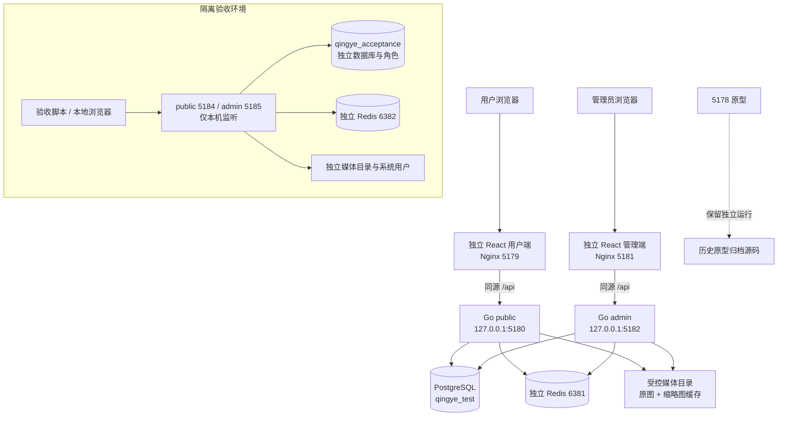
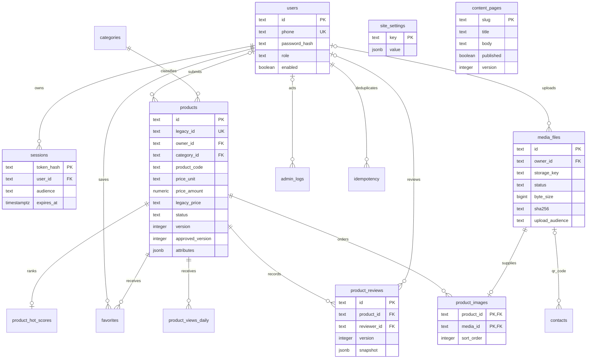
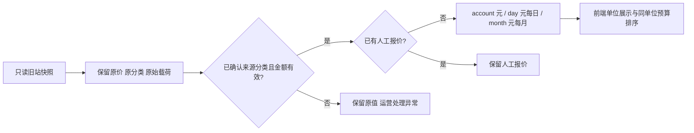
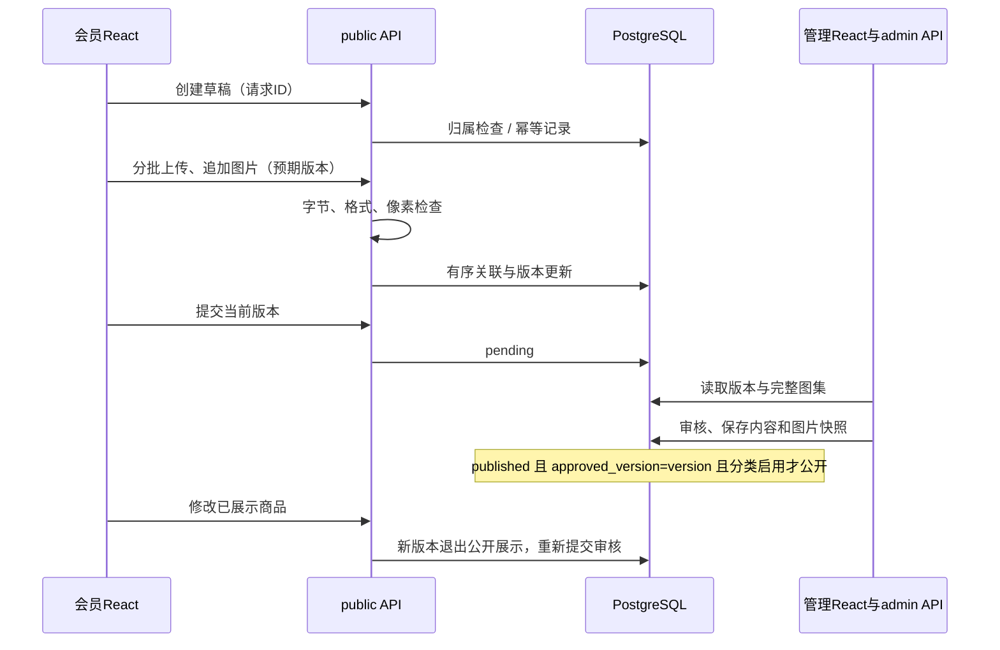
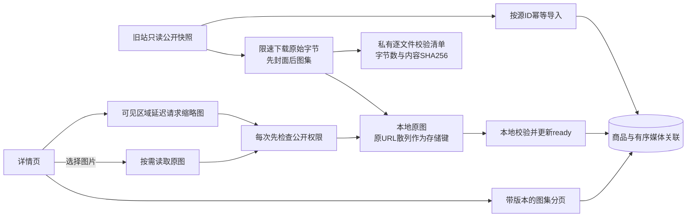
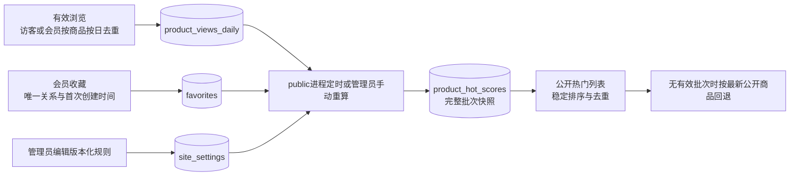
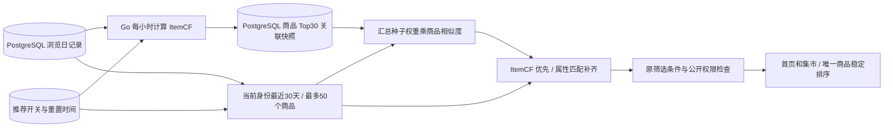
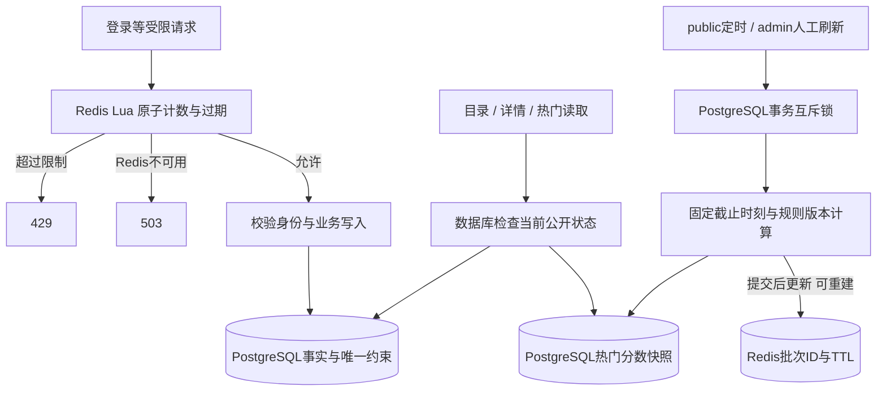
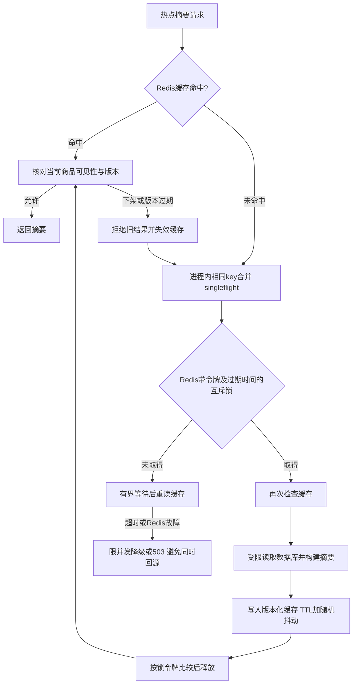

# 测试版架构、E-R 与数据流

> 当前数据库关系请先看[R17数据库E-R图与核心字段](DATABASE-R17--数据库ER图与核心字段.md)。该文按基础schema及0001—0009迁移覆盖27张持久表，补齐单会员主会话、ItemCF、共享字典、媒体清理和商品回收站。下方E-R图保留为早期核心关系概览，不是当前完整数据库清单。

本轮源码更新：采用Gin1.12.0与Go1.27.4构建工具链，将后端拆为领域、应用服务、基础设施、传输及启动装配。业务E-R关系和既有迁移内容不变；详细依赖图、HTTP安全流、媒体事务流及资源预算见 [Gin分层与安全性能设计](ADR-GIN-LAYERS--Gin分层与安全性能设计.md)。本节只确认源码结构，部署完成与否以本轮发布记录为准。

> 历史R11（2026-11-11）：修复管理端WebSocket票据参数遗漏，补齐管理端咨询商品详情；首页与集市拆分热门、为你推荐、最新上架，新增个人推荐偏好开关与重置。三端当时发布 `20261111-personal-chat-r11`。SeaweedFS接入与相关代码按用户最新要求暂停，不迁移图片；原工作区暂停改动不在此次提交内。用户79、管理37、Go85项检查通过；隔离HTTP功能107、并发28、安全67项通过，实际双端聊天适配器经Clash完成WSS与心跳验证。当时浏览器工具故障，Chrome实机点击与视觉待复核。详见[R11验收](../业务验收与审查记录/PERSONAL-CHAT-R11--推荐分区与咨询修复验收.md)。这些数字保留为历史证据，不是本轮测试结果。

本文初版对应 `0.7.0-test.1`，现按实际源码更新于2026年11月11日。服务地址、实际部署版本和验收结果另见部署及测试记录。

## 部署与隔离

用户端不打包管理模块，public API 不注册管理路由；admin API 的业务读取、配置和媒体均要求管理员身份。两个进程使用不同Cookie名称及服务端会话 `audience`，上传票据也绑定入口。管理员不能在 public 入口登录。验收脚本拒绝对5178—5182业务端口执行写测试。

管理与用户进程共享业务数据库和媒体，这是业务协作边界，不是物理隔离。历史R5的IP测试使用HTTP，R7已接入IP HTTPS和Secure Cookie；本轮分层不据此声明完成新版本部署。同一IP不同端口不是不同Cookie域，入口权限仍由服务端检查。数据库、Redis及HTTP API端口只监听本机；既有WebTransport使用用户端和管理端对应的公网UDP端口，不能把它描述为仅本机监听。

## 代码边界

| 目录 | 职责 |
| --- | --- |
| `代码/前端/用户端` | 用户React项目，API模式用于测试部署，演示模式显式区分 |
| `代码/前端/管理端` | 独立管理React项目、依赖锁、入口、构建与部署 |
| `代码/前端/共享` | 纯类型及展示配置，不共享登录状态或管理路由 |
| `代码/后端/internal/domain` | 业务类型、纯规则和领域错误，不依赖HTTP、Gin或数据库 |
| `代码/后端/internal/application` | 身份、商品、会员、管理、媒体、聊天、推荐用例，以及仓储和外部能力端口 |
| `代码/后端/internal/infrastructure` | PostgreSQL完整事务、Redis原子操作、媒体文件及密码/令牌适配 |
| `代码/后端/internal/transport/httpapi` | Gin路由、Cookie与Origin、输入输出以及HTTP/WS/WT适配 |
| `代码/后端/internal/config`、`bootstrap` | 私有部署参数校验、构造依赖、进程启动和资源关闭 |
| `代码/后端/internal/maintenance` | schema、有序迁移、测试开户、旧数据幂等导入和媒体核验 |
| `代码/后端/cmd/qingye` | API进程及受控维护命令 |
| `代码/部署/qingye-test` | systemd、Nginx及环境初始化脚本 |
| `代码/工具` | 原图迁移、隔离验收、内容配置与恢复校验工具 |
| `文档/原型代码` | 原型设计与开发历史文档；旧HTML、React代码从Git历史查阅，不作为当前测试部署源码 |

当前Go后端是分业务模块的单体架构，用户和管理入口运行于两个进程。请求经传输层进入应用服务，服务通过端口访问基础设施，纯规则归领域层。事务型仓储方法保持行锁、版本检查和写入的完整提交边界；不能因为拆分文件而拆开事务。

业务配置来自数据库，系统凭据与资源预算来自环境。HTTP请求内可以复用一次身份查询结果，跨请求不缓存身份；长连接每条命令重新认证。历史 `internal/app` 集中实现作为演进背景保留在旧提交中，不再代表活动代码目录。后续扩展项包括媒体存储适配、正式短信供应商及监控；SeaweedFS接入仍暂停。

## E-R 图

以下沿用核心业务关系概览，本轮分层未改变E-R关系。完整字段、索引和约束以 `代码/后端/internal/maintenance/schema.sql` 及 `migrations/` 有序迁移为准；聊天、个人推荐及ItemCF等后续表由迁移补齐。`product_images.media_id` 唯一，一份媒体不能同时关联两个商品；图片顺序单独保存。

`site_settings`、`content_pages` 是独立配置实体；`schema_migrations`以版本文件名和应用时间记录已执行有序迁移；`sms_challenges` 为供应商接入预留，本轮未发送真实短信。旧商品业务编号可能重复，因此使用唯一源ID导入，不把编号设为唯一键。

## 已确认报价的数据流

用户2026年11月11日确认：出售按元、时日租号按元/日、周月租号按元/月。数据库业务单位依次为`account`、`day`、`month`。`legacy_price`、`legacy_category`和原始载荷保持来源值；有序迁移只将已确认来源分类的有效金额回填至尚未人工定价的业务字段，不进行租期换算。后续导入使用同一规则，异常数值保留待人工处理。R4确认前的`unknown/null`为历史导入状态，R5迁移及发布证据见[联调说明](16-test-integration--测试联调说明.md)与[发布记录](../计划/RELEASE--测试环境发布记录.md)。

## 商品与审核流

所有写操作服务端验证归属、角色和版本。并发冲突返回409，前端保留草稿供刷新核对；不能通过客户端指定 `owner_id`、来源或审核状态越权。

商品写入与分类规则校验共享事务及分类行锁，避免规则在校验后被并发替换。公开商品采用字段白名单；卡片SQL不读取长说明，首页三个栏目跳过无需返回的总数查询。SQL排序只选固定表达式，搜索、筛选和推荐权重均通过参数传入。

## 原图迁移与完整图集

详情显示真实总张数，自动连续加载图片元数据，保留手动重试；没有200张总量截断。分页串行，页面切换后旧图集响应不会写入新商品界面，版本冲突重新获取完整商品后重建图集。缩略图延迟解码，远离视口区域使用 `content-visibility`；原图只在需要查看时读取，不一次下载所有原始文件。

缩略图是额外缓存，不覆盖原图；媒体不直接挂载为公开静态目录。下架或分类停用后，旧媒体地址仍需通过权限检查。

新上传的网络字节先有界写入暂存文件，再开事务锁定上传记录、重新验证票据和状态。网络接收期间不持有数据库连接；完成阶段的图片重新编码仍在受控事务内进行，提交后再清理本次上传暂存文件。该流程不删除旧站迁移原图，完整步骤和文件/数据库原子性边界见 [媒体事务流](ADR-GIN-LAYERS--Gin分层与安全性能设计.md#5-媒体上传与数据库连接)。

## 热门数据流

默认7个北京时间自然日：有效浏览×1、首次有效收藏×5。R11起所有商品均不加新品分。完整规则、边界和依据见[推荐算法](10-recommendation-design--热门推荐算法.md)。

## R12 个性化推荐数据流

ItemCF不增加Redis职责，不新增消息队列或独立算法服务。全局快照原子替换，2小时过期；读取失败或没有有效关联时使用现有属性匹配，没有个人浏览或关闭推荐时回退热门。每次读取仍检查公开状态，不因预计算结果暴露下架商品。历史浏览明细不在本轮删除。

## Redis职责与缓存击穿边界

当前没有把全部商品或热门响应缓存到Redis，所以不存在“商品缓存失效后所有请求同时重建整份Redis榜单”的现有流程。公开目录、详情和热门读取PostgreSQL，热门使用预计算分数表；公开可见性在每次查询时检查，避免缓存让已下架商品继续展示。

| 职责 | 当前实际实现 |
| --- | --- |
| 请求限流 | Redis Lua原子执行`INCR`与首次`EXPIRE`；按入口/IP/账户等键限流，Redis不可用返回503，不静默放行 |
| 聊天票据、租约与通知 | 短时单次票据绑定会话、入口、Origin和传输类型；连接租约控制数量，Pub/Sub只通知重读，消息仍存PostgreSQL |
| 推荐批次提示 | Redis保存有TTL的批次ID，可重建；不是完整商品、榜单或业务事实缓存 |
| 浏览、收藏去重 | PostgreSQL唯一约束；浏览按商品/访客/日期，收藏按会员/商品，取消再收藏保留首次时间 |
| 写操作幂等 | PostgreSQL `idempotency`记录、事务锁与请求体散列；不依赖Redis键存活 |
| 推荐重算互斥 | PostgreSQL事务级advisory lock；只有public进程定时触发，admin可人工触发 |
| 登录会话与失效 | PostgreSQL会话、audience、账户角色/启用状态；Redis没有保存会话令牌 |

数据库连接池每进程默认上限5，Redis连接池默认配置5，均可通过启动参数调整。普通API默认15秒Context预算、媒体60秒；业务请求默认128槽，健康检查独立2槽，bcrypt比较每进程2槽。推荐事务的互斥、定时预计算、陈旧分数回退和图片解码单并发用于控制现有资源开销。这些措施不等于已经实现Redis商品缓存，也不构成无限流量承诺。普通目录不应在每个请求中触发重新计算推荐；完整配置范围及限制见 [资源预算](ADR-GIN-LAYERS--Gin分层与安全性能设计.md#6-资源预算及性能措施)。

若后续实测证明需要Redis热点缓存，可采用下面的防击穿方案。**此图为后续方案，尚未实现，不能作为本轮已通过的安全或性能能力。**

实施时还需覆盖空结果短期缓存、主动失效、锁续期与过期、失败退避、冷启动预热和指标监控。私有会话、审核内容及不同权限的响应不能混入公开缓存；软过期回包也必须先排除下架或停用内容。是否采用Redis锁、缓存粒度和TTL应由新一轮实测决定，不把图中的建议参数或流程描述为现有代码。

R5补充：当前分类若排除目标单位，迁移与后续导入都保留unknown供人工核对，不修改自定义配置；空单位配置表示不限制。152实际576条均符合规则，已回填account 45、day 76、month 455。
