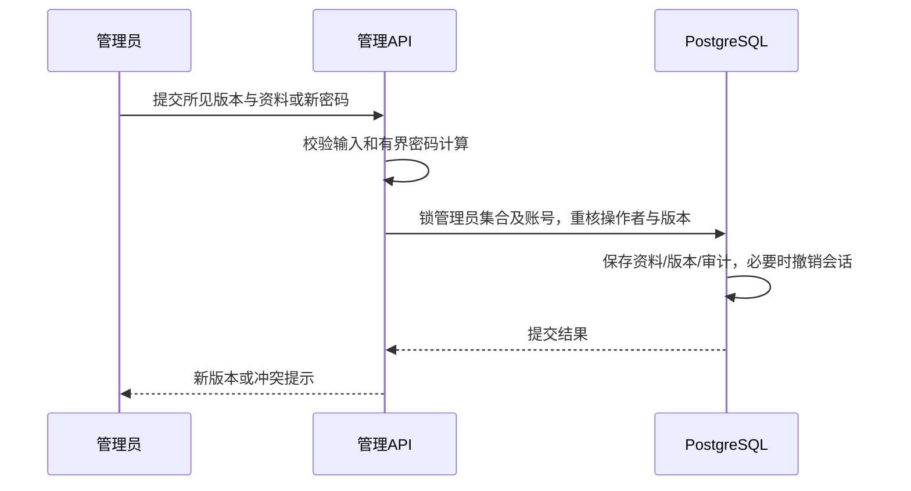

# R22 会员信息与管理员管理

2026年11月14日。用户要求会员管理显示完整手机号，新增管理员管理、创建管理员及维护名称头像；全部管理员同权，不设角色等级。本轮继续完成隔离测试、GitHub同步和152测试部署，8.140生产站不变。

## 管理页面

会员管理只列会员，显示完整手机号并保留搜索、启停及上传限制。完整手机号仅在已有管理员授权接口返回；公开身份、商品和聊天不因此增加手机号字段。

新增“管理员管理”，全部启用管理员均可查看和管理，支持搜索、创建、修改显示名称和头像、启停其他管理员、重置密码。登录账号创建后不修改；管理员名称立即生效，不经过会员昵称审核或30天间隔。头像从现有启用头像库选择或恢复默认，已经使用但后来停用的头像可继续展示，不阻止其他资料修改。没有权限分组或超级管理员。

创建需登录账号、名称和初始密码。新登录账号为6—20位ASCII字母、数字、下划线、点或短横线，首字符为字母或数字；支持手机号。既有短登录名继续可登录。名称1—30个字符；密码保持12—72个UTF-8字节及bcrypt成本12。编辑和重置使用所见版本，冲突后刷新重选，不能自动取新版覆盖。

自己不能停用自己的账号，始终保留至少一位启用管理员；这是避免锁死入口的账户规则，不是管理员分级。停用及改密撤销目标登录会话，重新启用不恢复旧会话。修改自己密码后重新登录。管理页面成功保存自身名称和头像时刷新当前身份及头像展示。

## 接口与数据

| 接口 | 输入与用途 |
| --- | --- |
| `GET /admin/users?role=member` | 管理员读取会员列表及完整`phone`，旧无role列表保持兼容 |
| `GET /admin/administrators` | `q/limit/cursor`；返回`data/total/next_cursor` |
| `POST /admin/administrators` | `login/nickname/password/avatar_id?/request_id` |
| `PATCH /admin/administrators/{id}` | `expected_version`与至少一个`nickname/avatar_id/enabled` |
| `POST /admin/administrators/{id}/password` | `expected_version/password/request_id` |

以上省略统一`/api/v1`前缀。管理员投影只含ID、登录名、名称、头像、启停、版本及时间，不返回密码、bcrypt散列或请求指纹。`avatar_id`沿用媒体ID，空字符串恢复默认，省略保留原值。旧用户启停端点只处理会员，管理员必须走版本保护端点；旧聊天头像修改接口拒绝管理员写入，防止绕过版本。

0019在users增加管理员资料版本，并新增专用管理员请求幂等表；0018及以前迁移不修改。创建和改密的指纹使用服务器已有私钥进行域分离HMAC，不保存明文密码或其裸SHA。成功回放绑定操作者、操作及完整输入；资料、日志和幂等结果同事务保存。审计记录不得包含密码、哈希或手机号明文。

管理员变更共享事务锁，并按稳定顺序锁操作者与目标账号，事务内再次核对操作者仍是启用管理员。头像引用与媒体删除、头像库启停保持一致锁序。登录先验证密码后，在建立会话的事务中锁用户并复核密码散列、启停及入口角色：改密或停用已先提交时，旧验证结果不能迟到创建新会话。

## 验证与发布边界

隔离功能验证完整手机号、会员/管理员分表、新建登录、同权管理、头像库、立即改名、密码重置及会话撤销；并发验证同版本只成功一次、幂等及最后管理员保护；安全验证角色/入口/Origin、字段白名单和旧接口绕过。写入仅在独立验收环境，业务测试站部署后只读核验，不创建真实管理员或修改既有账号。

发布备份数据库、配置及原链接，迁移前后核对原用户、商品和运营资料摘要；新增管理功能不自动修改业务账号。实际验证和发布状态见后续R22验收记录。
