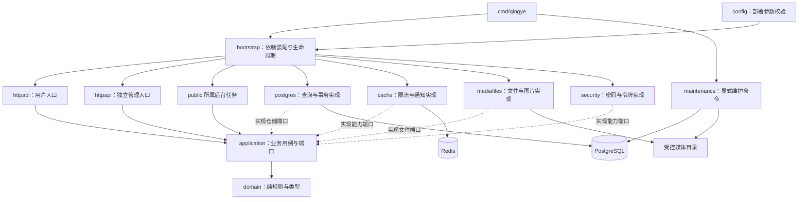
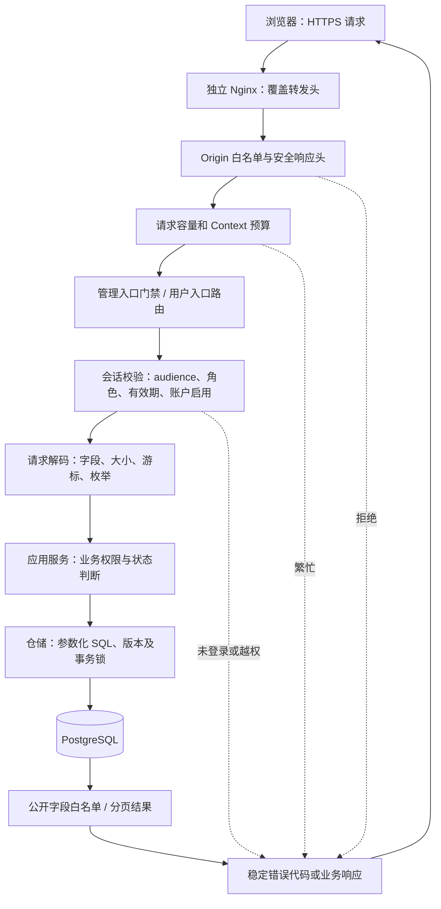
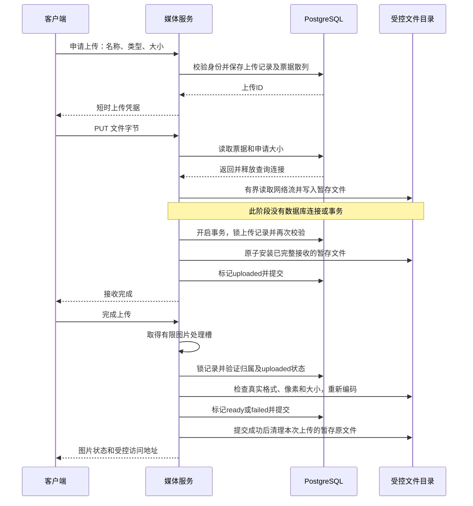
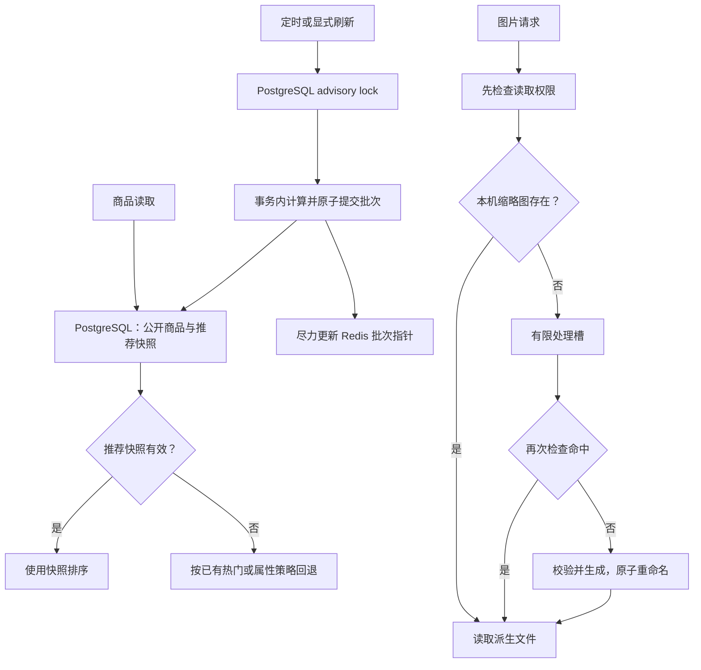

# ADR-GIN-LAYERS -- Gin分层与安全性能设计

日期：2026年11月11日。适用范围：清叶测试环境 Go 后端。本轮采用 Gin 1.12.0；精确依赖以 `代码/后端/go.mod`、`go.sum` 为准。最终测试结果和部署版本由本轮发布记录确认，本文不代表生产切换。

## 1. 决策及边界

采用 Gin 承担 HTTP 路由，按业务拆分领域规则、应用服务和基础设施。继续使用 PostgreSQL、pgx、go-redis、现有 SQL 迁移以及 WebSocket/WebTransport。用户 API 与管理 API 保持独立进程、入口及会话身份范围。

本轮主要解决集中式处理函数难以审查的问题，让权限、业务判断、数据库事务和资源限制有明确位置。Gin 的引入不自动提高安全等级，也不构成性能提升证明；实际收益须通过接口、数据库、并发及浏览器验收确认。

继续保持以下业务边界：

- 商品展示、筛选、发布审核、收藏、推荐和咨询；不增加支付、订单结算或租期排期。
- 生产站仅为已授权资料的只读来源；测试部署不覆盖生产站或5178原型。
- 每个商品可查看全部有序图片；单次分页、单文件和解码资源仍有上限。
- SeaweedFS 接入继续暂停，现有原图及映射保持完整。

## 2. 目录和依赖方向

| 位置 | 职责 | 不应承担的职责 |
| --- | --- | --- |
| `internal/domain` | 商品、身份、会员、审核、聊天、媒体、推荐的类型、纯规则和领域错误 | HTTP 请求、数据库连接、Redis 命令 |
| `internal/application` | 用例编排、身份和规则检查、仓储与外部能力端口 | Gin Context、SQL 拼接、直接访问磁盘 |
| `internal/infrastructure/postgres` | 参数化 SQL、完整事务、锁、版本检查及查询投影 | HTTP 响应和跨入口会话解析 |
| `internal/infrastructure/cache` | Redis 原子限流、聊天通知等适配 | 商品事实、会话事实和审核最终状态 |
| `internal/infrastructure/mediafiles` | 受控路径、暂存文件、图片校验和派生缩略图 | 决定用户能否查看某商品 |
| `internal/infrastructure/security` | 随机令牌、散列、受限并发的密码比较 | 自行决定角色或商品权限 |
| `internal/transport/httpapi` | Gin 路由适配、Cookie、Origin、参数解码、响应和聊天协议入口 | SQL、商品审核规则、持久化事务拆分 |
| `internal/config` | 环境变量读取、默认值和启动校验 | 面向运营的业务配置存储 |
| `internal/bootstrap` | 构造依赖、启动监听和后台任务、关闭资源 | 请求级业务判断 |
| `internal/maintenance` | 显式数据库迁移、测试开户、旧数据导入、媒体核验 | 对外提供 HTTP 管理后门 |

业务模块通过应用层定义的接口使用仓储、限流和文件能力。基础设施实现这些接口，由启动装配提供。应用服务只接收 `context.Context`、明确身份和输入类型，不能依赖 `gin.Context`。事务型仓储方法必须完成整个用例，不能将行锁、校验和写入分散到不同提交。

配置分两类：数据库地址、密钥、连接池和超时来自私有环境配置；分类、首页展示、客服和推荐参数继续来自数据库中的可编辑业务配置。不能把运营配置重新写死到组件或部署脚本中。

## 3. HTTP 安全和数据流

Gin 关闭自动补斜杠及路径修正重定向，显式注册 GET 对应的 HEAD，统一404/405响应。路径参数只按实际原始路径状态解码一次，避免百分号重复解码。服务不采用 Gin 默认的全信任代理策略；真实 IP 仅接受来自回环代理连接的单一合法转发地址，配合 Nginx 覆盖转发头。

上图表示受保护业务请求的主要路径。健康检查、登录以及公开商品读取使用各自的入口规则，不能把图中的鉴权节点理解为所有公开读取都要求登录。

身份和输入处理约定：

- public/admin 使用不同会话 Cookie，服务端继续验证 `audience` 和角色。端口不同本身不构成 Cookie 域隔离。
- Cookie 保持 HttpOnly、SameSite，HTTPS 测试环境启用 Secure。写操作检查精确 Origin；不允许使用通配符或域名后缀匹配放行。
- 身份查询结果只缓存于单次 HTTP 请求，减少管理门禁与处理器重复查库；不跨请求缓存，不延长注销或停用后的会话权限。
- WebSocket/WebTransport 使用短时、单次票据，绑定入口、Origin、登录会话和传输类型。每条命令重新认证，不复用连接建立时的身份结果。
- 结构化 JSON 请求上限1 MiB，拒绝未知字段及尾随的第二个 JSON 值；错误响应不返回 SQL、文件路径或凭据。文件上传使用独立大小约束。
- 排序表达式来自固定枚举；关键词、筛选值、画像权重作为参数绑定。调用方不能传入任意 SQL 或覆盖服务计算的推荐权重。
- 商品公开条件继续要求已发布、审核版本等于当前版本且分类启用。响应采用字段白名单，避免未来内部字段被自动公开。

## 4. 事务与业务一致性

商品写入使用预期版本检查；过期修改返回409，不能静默覆盖。分类规则校验与商品写操作共享事务，读取分类时使用共享行锁；分类修改在锁内完成相关检查与更新，避免校验之后规则被并发替换。

商品图集使用 Repeatable Read 只读事务，将公开状态、商品版本、图片数量和图片分页保持在同一快照。客户端携带 `expected_version`，版本变化返回409，重新获取商品后重建图集。单批最多50张，总量不设置固定上限。

聊天消息在会话行锁内验证归属、状态及 `client_id`，同一幂等键对应不同正文时拒绝。通知只在提交成功后发送，Redis 通知失败不撤销已写入消息。客服分配由 PostgreSQL 事务级咨询锁串行化，并保留容量限制。

推荐批次采用数据库权威时间。热门按有效浏览与首次有效收藏加权，不为新上架增加热门分；ItemCF 快照写入保留事务锁、资源限制及过期回退。后台定时任务归 public 进程所有，管理进程不重复启动。

## 5. 媒体上传与数据库连接

上传分为申请、接收、完成三步。接收网络字节期间不持有数据库事务或连接，避免慢上传占满连接池。文件完整落到暂存区后，才进入短事务重新验证票据和状态并安装文件。

完成阶段的重新编码仍发生在受控事务范围内，并通过图片处理槽限制并发。这里的优化只承诺网络接收阶段不占用数据库连接，不能表述为整个图片处理流程都在事务外。

文件系统与 PostgreSQL 不具备联合原子提交；出现提交失败时依靠记录状态、暂存清理和幂等重试恢复。旧站迁移原图不走新上传的重新编码清理流程，不在本轮删除或替换。

图片访问先验证公开或所有者权限，再读取原图或缩略图。缩略图命中不能绕过权限。派生文件以受控路径写入，使用临时文件及原子重命名，生成前后检查是否已有有效文件。页面仍按需加载图集，不一次下载全部原图。

## 6. 资源预算及性能措施

下表为启动默认值，按进程生效。扩大并发限制或连接池前须结合152服务器资源重新测试。

| 资源 | 当前配置 | 目的与限制 |
| --- | --- | --- |
| 普通 API Context 预算 | 默认15秒，`REQUEST_TIMEOUT` 可配置1至60秒 | 约束支持取消的查询和等待；不能抢占任意 Go 计算 |
| 媒体与上传请求预算 | 60秒 | 配合网络层超时和文件大小限制 |
| 业务请求槽 | 默认128，`MAX_CONCURRENT_REQUESTS` 可配置1至2048 | 普通 API 和媒体共用；满时快速返回503及重试提示 |
| 健康检查 | 独立2槽；依赖检查共用2秒 Context | 避免与普通业务请求争抢请求槽 |
| WebSocket/WebTransport | 独立聊天租约及每命令预算 | 不占用普通请求槽；保留账户连接数和命令频率限制 |
| bcrypt 比较 | 每进程2槽，成本12 | 限制 CPU 消耗；已开始的 bcrypt 比较不能中途抢占 |
| PostgreSQL | `DB_MAX_CONNS` 默认5，可配置1至50 | 每进程连接上限；两个 API 进程需合计评估 |
| Redis | `REDIS_POOL_SIZE` 默认5，可配置1至100 | 客户端连接池配置；不等于整个服务器的连接总上限 |
| 上传大小 | 默认10 MiB，可配置，启动校验最大64 MiB | 网络字节、实际文件格式与像素分别校验 |
| 图片解码 | 有限处理槽，保留像素及输出大小限制 | 降低同时解码大图导致的内存压力 |

已实施的查询调整：商品卡片 SQL 不读取长说明；首页三个商品栏目不执行无用总数统计，每次默认首页减少三条 count 查询。精选内容仍保留所需说明，列表分页仍返回总数。

本轮没有为追求框架基准成绩取消鉴权、审查版本、限流或图片权限检查。性能验收须使用相同数据量、SQL、连接池和安全规则，对照延迟分位数、吞吐、错误率及资源占用。

## 7. Redis、派生数据及防击穿边界

目前没有全商品列表缓存，也没有新增通用的 Redis 缓存读写层。数据库仍是商品、会话、审核和推荐快照的事实来源。

| 已有用途 | 实现与失败行为 |
| --- | --- |
| 业务限流 | Redis Lua 原子计数和首次过期；Redis 不可用时受限操作明确失败，不放开限流 |
| 聊天票据和租约 | 短时票据单次消费；连接租约和数量限制；失效后重新取得凭据 |
| 聊天更新通知 | Redis Pub/Sub 提醒客户端重读；消息本体存 PostgreSQL，通知不是持久消息队列 |
| 热门批次指针 | 数据库批次提交后尽力写 Redis；指针失败不回滚已提交批次 |
| 推荐快照 | 保存在 PostgreSQL，过期或 ItemCF 读取失败按既定策略回退 |
| 图片派生缓存 | 保存在本机媒体目录；权限检查后读取，限制生成并发并二次检查命中 |

上述锁与槽分别保护推荐刷新和派生图片生成，不等于已经实现全站缓存防击穿。图片生成槽按进程生效，不是跨进程分布式锁。

如果未来加入商品缓存，需要单独设计缓存键、审核版本、权限范围、失效顺序、热点合并、过期抖动及故障回源预算。未通过该设计和测试前，不应声称系统已具备通用缓存击穿防护。

## 8. 验收与记录

本轮检查范围与结果如下；完整过程见[R14验收记录](../业务验收与审查记录/GIN-R14--Gin分层与安全性能验收.md)，部署以[发布回执](../计划/RELEASE--测试环境发布记录.md)为准。

| 验收范围 | 最终记录 |
| --- | --- |
| 接口契约：路径、HEAD、404/405、JSON上限、错误代码 | 已覆盖于最终185项Go回归，0失败、0跳过 |
| 业务：身份、发布审核、版本冲突、分类并发、全部图集 | 真实DB/Redis集成回归及107项独立HTTP功能断言通过 |
| 聊天：两种传输、注销失效、重分配权限、幂等重试 | 集成回归通过；新增池占满后的订阅、服务退出与租约释放检查 |
| 媒体：慢上传不占连接、大小与格式限制、并发完成、权限 | 代码边界审查及上传/权限/并发集成回归通过；没有将此解释为长时间慢客户端压测 |
| 并发与性能：相同数据和请求组合的基线及重构后对照 | 独立28项并发断言通过；20/50并发短测0错误，最终P95约105/267ms，见性能报告 |
| 安全：依赖扫描、越权、Origin、上传路径及资源耗尽边界 | 独立67项安全断言通过；vet和源码/二进制govuln通过，见安全报告 |
| 至少三轮审查、GitHub版本与实际部署产物核对 | 缺陷、复测、最终构建散列和部署边界见R14验收及私有receipt |

测试须在隔离数据库、Redis和媒体目录中执行，不将写入压测指向生产或共享业务环境。安全措施和本轮测试结果不能证明绝对无 BUG、无漏洞，也不能直接外推到更大数据量或并发容量。
