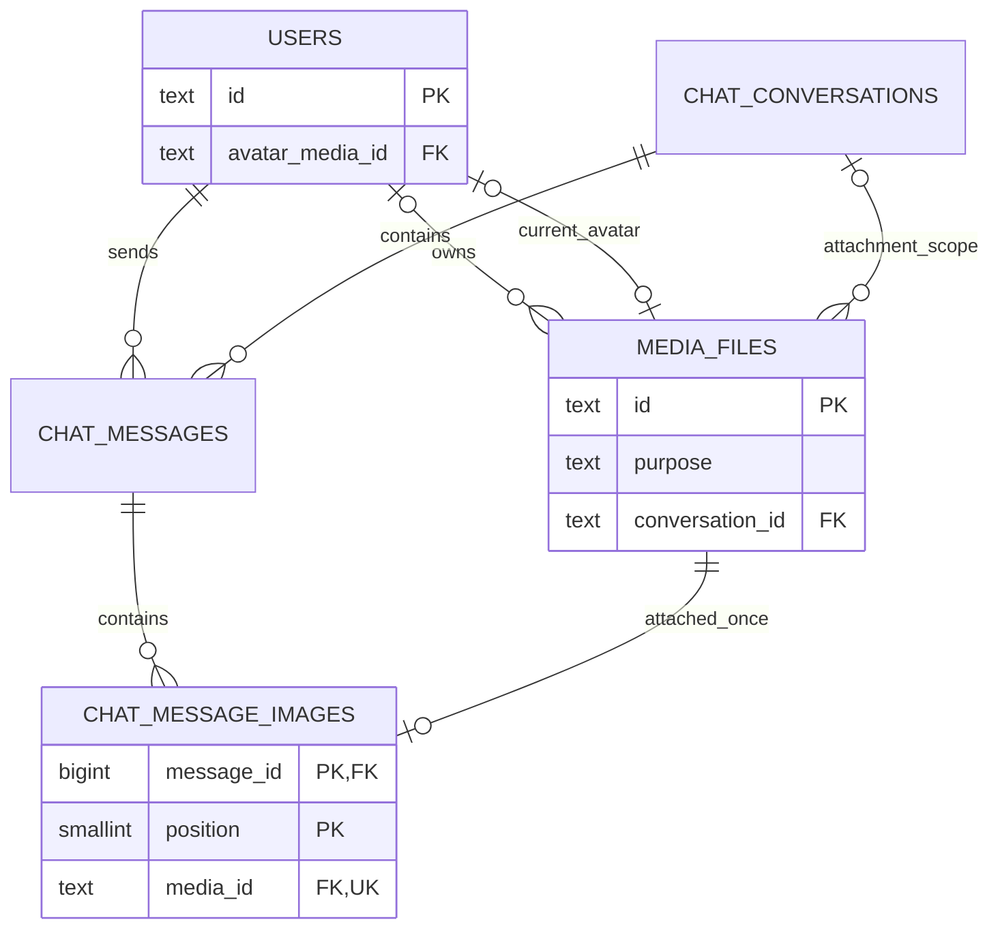

# R19：图文聊天与头像设计

日期：2026年11月12日。范围：用户端消息页、管理端在线咨询、聊天附件与头像。需求来源见[R19需求记录](../前期设计文档/CHAT-R19--聊天界面与图文消息需求.md)。发布状态以[开发进度](../计划/14-development-progress--开发进度.md)为准。

## 1. 页面与操作

两端沿用各自界面风格，统一聊天结构：会话列表、当前接待信息、咨询商品入口、消息区、输入区。用户端继续支持深浅主题与既有金线背景；管理端使用浅色工作界面。

- 消息按本人和对方左右排列，显示头像、昵称、时间及客服身份。间隔超过5分钟显示时间分隔；“已发送”表示服务端确认，不表示对方已读。
- 点击输入区“图片”选择文件，也可在文本框粘贴截图。选中后先上传并显示预览、进度；上传成功后可配文字一起发送，也可发送纯图片。
- 一次发送生成一条消息，正文与有序图片引用一起保存。上传未完成或失败时不能发送；失败项可重试或移除。
- 点击消息图片打开沉浸式预览，支持关闭、左右按钮、方向键切换与读取失败重试。
- 点击会话列表顶部的相机头像更换本人头像；“恢复默认”解除当前头像关联。无头像或读取失败时显示昵称首字。
- 手机选择会话后进入单列对话，通过返回按钮回到列表；输入框随可视区域调整。未发送草稿保留在当前页面内，刷新或离开消息页会清除，不能作为离线持久草稿使用。

## 2. 图片限制

| 项目 | 本轮规则 |
| --- | --- |
| 消息正文 | 最多2000个Unicode字符；纯图片消息允许正文为空 |
| 单条消息图片 | 最多9张，保留选择顺序；超过时分次发送 |
| 聊天单图 | JPG、PNG、WebP，最大10 MiB，同时受部署上传上限约束 |
| 头像单图 | 同上三种格式，最大2 MiB，同时受部署上传上限约束 |
| 图片校验 | 沿用实际解码、1600万像素限制、重新编码及原始上传清理；不接受SVG或仅改扩展名的文件 |
| 配额 | 沿用每人2 GiB资料额度，计入未公开商品图片、聊天图片及头像；未关联图片最多1000张。已关联聊天图片和当前头像不计入“未关联张数” |

这些是本轮实现采用的资源边界，不是商品图集总量限制。已公开商品图集仍无固定总张数上限。

## 3. 数据库增量

迁移：`0011_chat_images_and_avatars.sql`。新增一张表，持久表总数由27变为28；继续使用PostgreSQL。图片二进制保存在受控媒体目录，数据库保存引用和权限范围，Redis不保存图片或消息正文。

| 对象 | 变化 |
| --- | --- |
| `media_files.purpose` | `product`／`chat`／`avatar`；旧资料默认`product` |
| `media_files.conversation_id` | 只有`chat`图片填写，绑定当前规范会话ID；数据库CHECK约束用途与会话字段一致 |
| `users.avatar_media_id` | 当前头像引用，可为空；增加反向引用索引 |
| `chat_messages.kind` | 保留`text`、`product`，新增`image`表示有图片，可同时带正文 |
| `chat_message_images` | `(message_id, position)`主键，位置0—8；`media_id`唯一，单次上传只能关联一条消息 |

旧文字和商品快照不改写。消息分页仍每次50条，仅查询当前消息的附件和发送者头像；会话列表继续使用R18游标与摘要查询，图片消息摘要显示“[图片]”及部分正文。

## 4. 接口与传输

| 操作 | 接口／命令 | 新增内容 |
| --- | --- | --- |
| 申请图片上传 | `POST /api/v1/uploads` | 增加`purpose`；聊天图片同时传`conversation_id`，头像不传会话编号 |
| 上传、校验 | 既有PUT上传地址及`POST /api/v1/uploads/:id/complete` | 复用短期上传票据与校验过程 |
| 发送图文 | 既有消息POST接口及WebTransport／WebSocket的`send`命令 | `{ body, client_id, image_ids }`；`image_ids`为有序数组，可省略 |
| 读取消息 | 既有消息分页接口及`messages`命令 | 增加`images`、`sender_name`、`avatar_url` |
| 会话列表／详情 | 既有接口 | 增加`member_avatar`、`admin_avatar` |
| 本人聊天资料 | 用户`/api/v1/chat/profile`、管理`/api/v1/admin/chat/profile` | GET读取昵称与头像；PATCH传`{ avatar_id }`，空字符串恢复默认 |

二进制通过同源HTTPS上传，实时连接只传图片ID。保留WebTransport优先、同源WebSocket兼容以及现有通知机制。更换头像后本人界面立即更新，对方会在后续刷新资料或读取消息时获取新头像。

## 5. 权限、重试与清理

1. 申请聊天上传时校验当前会话归属和未关闭状态。历史会话别名解析到规范会话后再绑定。
2. 发送时锁定会话和附件，只接受本人、当前会话、已校验完成且未被使用的聊天图片。插入消息、附件和更新时间处于同一事务。
3. 幂等比较包含正文和图片顺序。相同`client_id`重试返回原消息；内容或顺序不一致返回409。切换传输不会创建第二条消息。
4. 未发送图片仅发送者可预览；已发送图片允许当前会员和当前分配的客服读取。客服转接后，原客服连自己发送的附件也不能继续读取。缩略图和原图执行同一权限判断，响应禁止共享缓存。
5. 头像仅能绑定本人已完成上传的头像素材。当前头像可供已登录用户展示；已解除关联的头像只有素材所有者可预览，之后进入未引用资源清理流程。
6. 商品图片追加和客服二维码配置拒绝聊天／头像素材，防止私密附件进入公开展示链路。
7. 已关联消息图片、当前头像均受GC引用保护。废弃上传和旧头像沿用72小时未引用清理规则；聊天上传不延长商品草稿寿命。

## 6. 发布与回退

先在独立验收环境迁移和验证，再备份测试业务库、应用0011并发布三端。迁移后核对旧字段数据摘要；新增列的默认值不算旧业务数据变化。

**已有R19聊天图片或头像后，不能直接退回R18后端。** R18不认识新用途与引用保护，可能放宽管理员读取范围或错误清理附件。出现问题优先修复R19；必要时可先回退前端并保留R19后端、数据库和媒体。只有确认没有新用途资料、没有新消息附件时，才可按发布脚本恢复旧后端。不得为了回退直接删除新消息或新图片。
