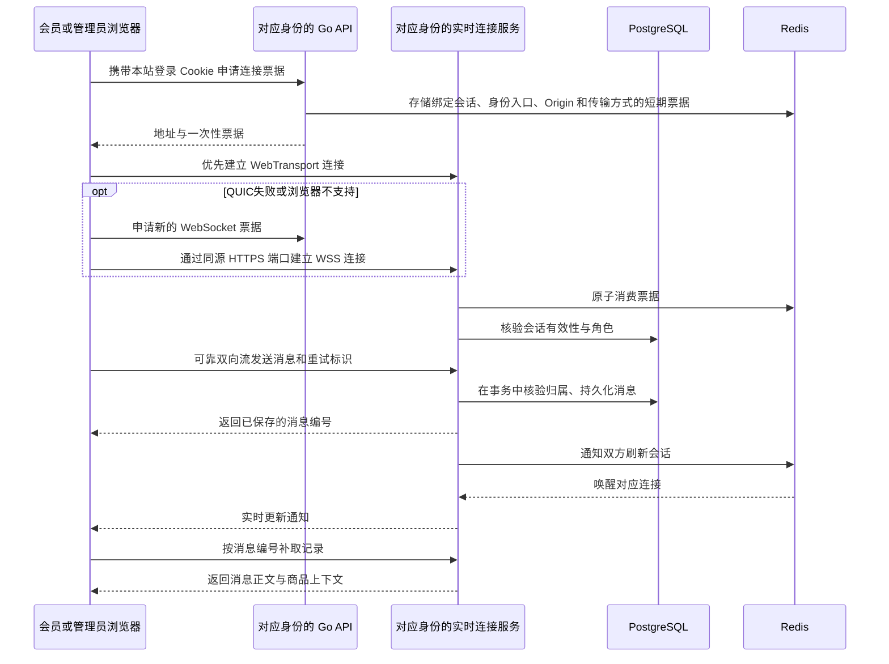

# 商品咨询：WebTransport 优先与代理兼容

> R11（2026-11-11）：修复管理端WebSocket票据参数遗漏，补齐管理端咨询商品详情；首页与集市拆分热门、为你推荐、最新上架，新增个人推荐偏好开关与重置。三端发布 `20261111-personal-chat-r11`。SeaweedFS接入与相关代码按用户最新要求暂停，不迁移图片；原工作区暂停改动不在此次提交内。用户79、管理37、Go85项检查通过；隔离HTTP功能107、并发28、安全67项通过，实际双端聊天适配器经Clash完成WSS与心跳验证。浏览器工具仍故障，Chrome实机点击与视觉待复核。详见[R11验收](../业务验收与审查记录/PERSONAL-CHAT-R11--推荐分区与咨询修复验收.md)。下方R10及更早段落为历史记录。

R10（2026-11-11）：首页恢复的R9背景保持不变，探索图标改为双下箭头，首屏轻微下滑自动完成进入内容区。聊天按最新用户要求保留WebTransport优先，连接失败自动获取新票据并切换同源WebSocket；兼容Clash代理，不自动重发未确认消息。用户站、管理站与API统一部署为`20261111-chat-proxy-r10`。用户79、管理34、后端81项检查通过；双端经本机Clash代理完成WSS连接、只读RPC和心跳验证，公网WebTransport复验通过。浏览器工具故障，实机视觉与Chrome页面收发仍待用户复核。

更新：2026-11-11，R10 / `0.8.0-test.1`。

## 1. 用户怎么使用

1. 商品详情主按钮打开两种方式：在线咨询客服、联系QQ客服。在线方式需登录并保留商品ID；QQ方式无需登录，弹窗一次显示一位客服，支持切换、复制号码与图片失败重试。
2. 系统建立会话，将商品标题、编号、封面、当时报价放入聊天窗口。重复点击同一个商品会进入已有的未结束会话。
3. 从在线、开启接待且有空余接待位的管理员中随机分配一人。暂时没有可接待管理员时显示“等待接待”，会员仍可留言。
4. 管理员在“在线咨询”点击“开始接待”，选择会话并回复。顶部显示当前接待数量；“暂停接待”只停止分配新咨询。
5. 沟通完成后结束咨询，保留历史记录并释放接待位。再次咨询该商品会创建新会话。

本版默认每位管理员同时接待 3 个会话，会员最多保留 10 个未结束会话。这是当前实现参数，后续可按实际客服人数调整。管理员每 20 秒更新接待心跳，超过 75 秒未更新视为离线；后台每 15 秒检查待分配会话，离线会话重新排队。

双方都有导航未读数、页面标题未读数和站内新消息提示。桌面通知由用户主动授权，且要求浏览器支持；页面关闭后的离线推送不在本次范围内。

## 2. 通信与存储



- 浏览器优先使用原生 WebTransport；Go 使用 `webtransport-go v0.13.0` 与 `quic-go v0.62.0`。兼容通道使用浏览器原生 WebSocket 和 Go `github.com/coder/websocket v1.8.15`，共用原有聊天业务处理器。
- WebTransport使用一条可靠双向流；WebSocket使用文本消息承载相同的UTF-8 JSON Lines。聊天正文不使用不可靠数据报，禁止二进制帧。
- 已连接时，会话列表、详情、消息读取、发送、已读、结束和接待心跳都使用该连接。登录和连接票据使用原有 HTTP API。
- WebTransport连接失败或4.5秒内未就绪时，关闭该连接，重新申请WebSocket票据并自动切换；不支持WebTransport的安全上下文直接使用WebSocket。兼容连接就绪超时10秒。当前页面后续重连沿用WebSocket，避免反复尝试受阻QUIC。
- 登录失效或鉴权失败不会用另一通道绕过权限。两种通道均未就绪时，仅通过原有鉴权HTTP接口只读历史，写操作保持禁用并保留输入；不使用SSE或HTTP自动发送，不自动重放已提交但未确认的消息。
- 票据申请沿用`POST /api/v1/chat/transport-ticket`及管理端对应路径，新增可选参数`transport: webtransport | websocket`；省略时仍为WebTransport，兼容原客户端。WSS地址由服务端返回相对路径，前端强制校验同源。
- PostgreSQL 保存消息事实；Redis 负责通知、连接票据、频控和连接数量。Redis 通知不是消息存储，断线后按数据库记录补齐。Redis Pub/Sub 的交付语义参见[官方文档](https://redis.io/docs/latest/develop/pubsub/)。
- 消息发送成功以数据库提交和服务端确认结果为准。确认丢失后重试原内容，`client_id` 唯一约束保证不重复落库。

## 3. 协议约定

WebTransport连接后浏览器先发送一个空行，使服务端能够接收双向流；WebSocket无需该握手空行。服务端回复 `{"type":"ready"}`。此后不接受空白心跳，用服务端定时更新帧维持连接检查。

命令示例：

```json
{"id":"17","op":"send","conversation":"会话ID","payload":{"body":"想了解这个账号","client_id":"同一次发送的稳定标识"}}
```

`id` 对应一次请求和响应；`client_id` 对应一条业务消息的重复提交检测，重试同一内容时必须保留。消息编号使用字符串传输，避免 JavaScript 数值精度损失。

| 操作 | 参数 | 作用 |
| --- | --- | --- |
| `list` | `offset` | 当前身份可见的会话和未读总数 |
| `detail` | `conversation` | 单个有权访问的会话 |
| `messages` | `conversation`、`before` 或 `after` | 每页最多 50 条，历史翻页或断线补页 |
| `start` | `product_id` | 会员发起商品咨询 |
| `send` | `conversation`、`body`、`client_id` | 保存并通知双方 |
| `read` | `conversation`、`through` | 只标记实际已看到的消息编号 |
| `close` | `conversation` | 结束会话 |
| `presence` | 可选 `accepting` | 管理员接待状态或心跳 |

响应为 `type=result`、同一 `id`、HTTP 语义的 `status` 和业务 `body`。`type=update` 表示应补取数据；不包含其他会员的消息内容。

单帧上限 16 KiB；正文上限 2,000 字；单个浏览器实例最多 16 个等待响应的命令；确认等待上限 12 秒。浏览器断线后退避重连，最大间隔约 30 秒，不自动重复提交未经确认的写操作。用户仍可保留原内容重试。

## 4. 数据库变更

迁移文件：`代码/后端/internal/app/migrations/0002_product_chat.sql`。

| 表 | 用途 | 关键约束 |
| --- | --- | --- |
| `chat_presence` | 管理员接待开关、最近心跳、对应登录会话 | 管理员主键；会话删除时清除接待记录 |
| `chat_conversations` | 会员、商品快照、接待管理员、状态、双方已读位置 | 同一会员和商品最多一个未结束会话；活动会话必须有管理员 |
| `chat_messages` | 发送人、角色、消息内容、重试标识、创建时间 | 会话＋发送人＋重试标识唯一；编号为 bigint |

商品快照只包含公开展示资料，不复制原站私有载荷、账号凭据等字段。商品后来修改时，聊天仍显示发起时的资料，界面有明确说明。

## 5. 权限与连接边界

- public/admin 各自运行 HTTP/3 服务，各自使用准确的 Origin 白名单和会话 audience；客户端不能通过协议指定角色、发送者或任意接口路径。
- 票据有效期 30 秒，只能使用一次，绑定登录会话、身份入口、Origin和传输方式，不能跨通道重用。WebSocket握手额外核对登录Cookie与票据的会话摘要一致。Redis 只保存票据摘要和会话摘要；连接 URL 不携带登录 Cookie 或持久令牌。
- 同一账号在同一入口两种传输合计最多4个连接，共用Redis租约计数。额外流、超长帧和突发滥发会被拒绝或关闭。
- 每次操作核验当前会话；持续连接也定期复核。管理员只能访问分配给自己的会话，会员只能访问自己的会话。重新分配后原管理员失去读取和发送权限。
- Redis 发送的是刷新通知；真正读取数据时仍执行数据库归属条件。
- 服务端只把消息当普通文本返回，前端使用 React 文本渲染，不解析消息中的 HTML。

## 6. 本地运行与测试部署

WebTransport 需要安全上下文和 HTTPS 的 HTTP/3 地址。普通远程 IP/HTTP 页面不能直接启用；`localhost` 本地开发可配合短期证书指纹。相关约束见 [MDN 构造器说明](https://developer.mozilla.org/en-US/docs/Web/API/WebTransport/WebTransport) 和 [quic-go 服务端说明](https://quic-go.net/docs/webtransport/server/)。

本地证书生成器不覆盖已有文件，证书有效期 13 天；输出目录必须放在仓库外：

```sh
go run ./代码/工具/chat-dev-cert/main.go --out /private/qingye-local-tls
```

配置样例在 `代码/部署/qingye-test/chat-webtransport.env.example`。本地 public 使用 `127.0.0.1:5443/UDP`，admin 使用 `127.0.0.1:5444/UDP`；这只是本地开发示例，测试部署使用下述同端口TCP／UDP配置，公网双端连接已实测通过。

前端Vite开发与预览代理已开启`ws: true`，分别代理各自的HTTP API和WebSocket。用户端 `ALLOWED_ORIGINS` 只填写用户前端地址，管理端只填写管理前端地址。两个 Go 进程各自配置 `CHAT_WT_ADDR`、`CHAT_WT_URL`、`CHAT_WT_CERT`、`CHAT_WT_KEY`。

本地可设置 `CHAT_WT_PIN_CERTIFICATE=true`；代码限制此模式只能使用 loopback 地址、短期 ECDSA 证书。公网使用可信 CA 证书且关闭指纹开发模式，不关闭浏览器证书校验。

R7已使用可信IP证书：TCP5179/5181由Nginx提供HTTPS，UDP5179/5181由对应Go进程直接提供HTTP/3，连接地址为同源 `/chat`，CSP仅允许本站以及本站对应端口的显式`wss://`来源。内部HTTP API仍只监听5180/5182回环。参见 `chat-webtransport-test.env.example`，不能用普通Nginx HTTP proxy_pass代替WebTransport。Caddy原有443站点不变，仅HTTP80增加本IP的ACME验证路径。自动续期timer每日两次检查证书，部署hook原子更换证书对、重载本项目Nginx并重启两个API，现有聊天会短暂重连。

### 代理兼容入口

- 用户端：`wss://152.136.252.204:5179/api/v1/chat/socket`。
- 管理端：`wss://152.136.252.204:5181/api/v1/admin/chat/socket`。
- Nginx仅对上述精确路径开启HTTP/1.1 Upgrade转发，保留Origin；读超时75秒，服务端20秒更新心跳。无需新增公网端口或关闭Clash。
- 访问日志继续只记录`$uri`，不记录携带临时票据的查询字符串；前端和探测脚本不输出票据或Cookie。
- 兼容能力取决于代理节点可达本站且允许WebSocket；不承诺所有代理规则和企业网关均可用。代理实现参考[NGINX官方说明](https://nginx.org/en/docs/http/websocket.html)，Go实现使用[coder/websocket](https://github.com/coder/websocket)。

## 7. 本次未包含

聊天图片和附件、撤回、语音、离线 Push、客服质检、工单、自动机器人、支付结算。暂不引入额外大型 IM 平台；后续有实际需求再扩展。
