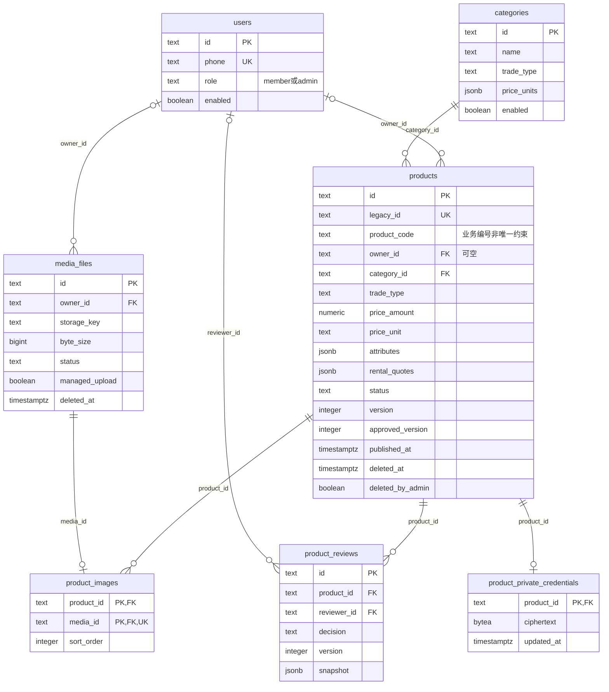
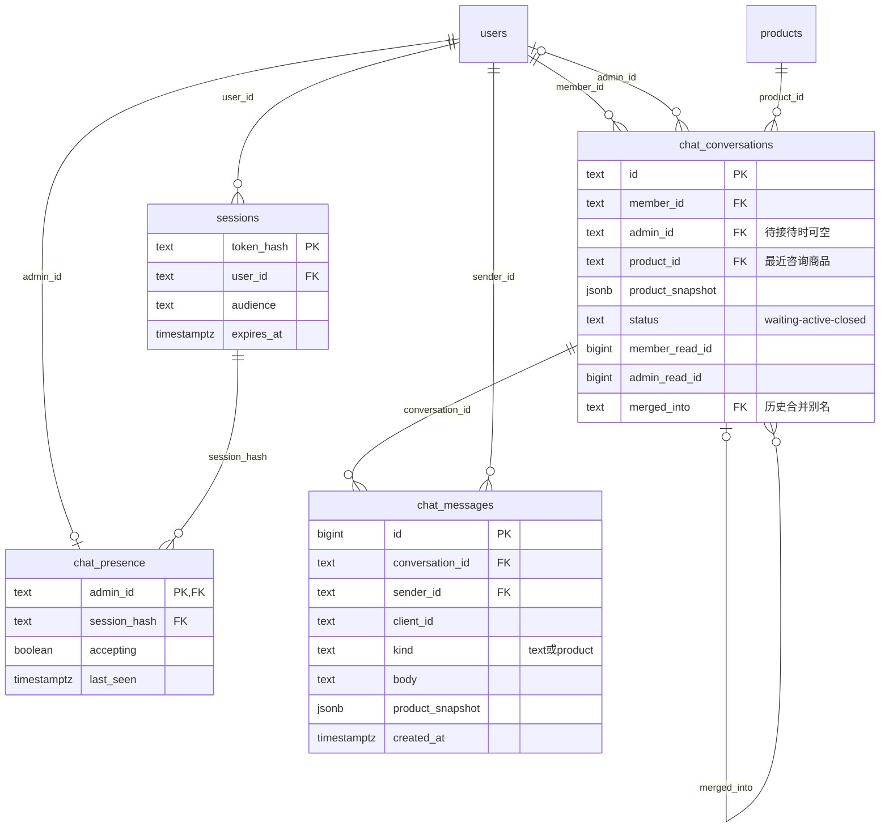
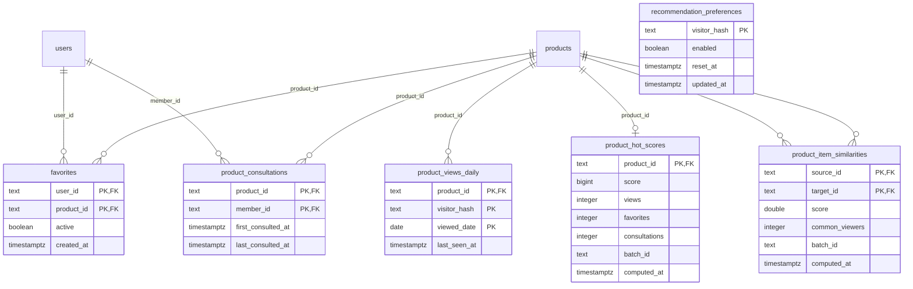
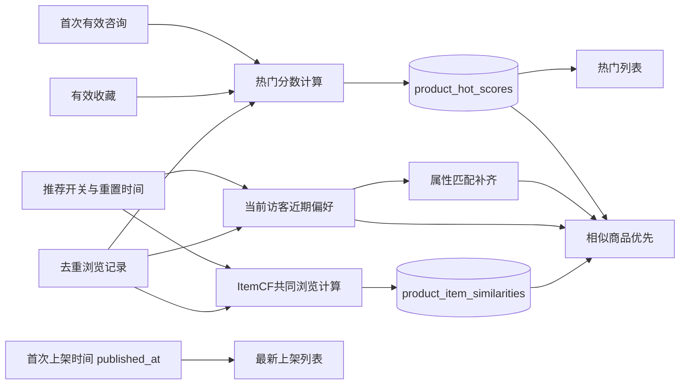
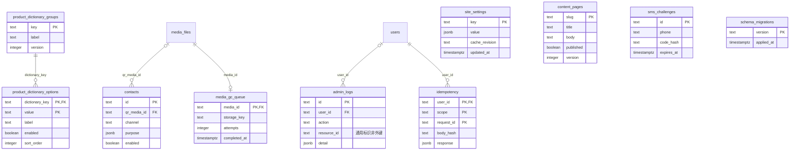
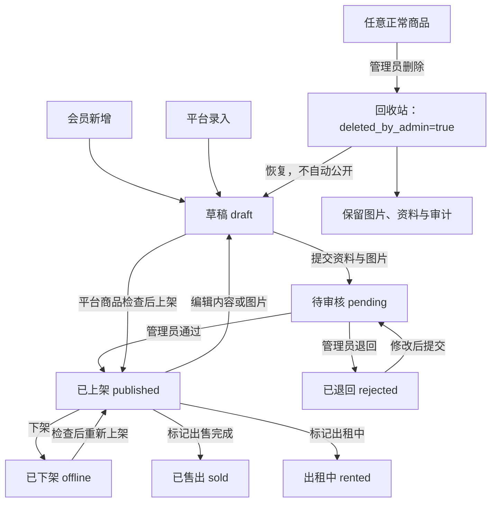
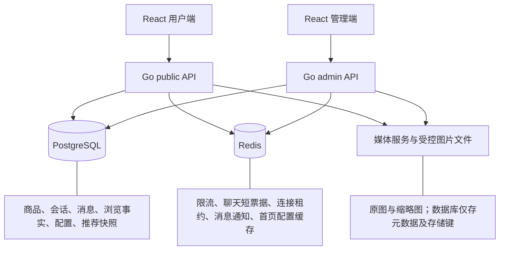

# 数据库 E-R 图与核心字段（R17）

> R19增量：当前28张持久表。0011新增`chat_message_images`，为`media_files`增加purpose/conversation_id，为`users`增加avatar_media_id，消息kind增加image。完整增量E-R图、字段和权限见[R19图文与头像设计](CHAT-R19--图文聊天与头像设计.md#3-数据库增量)。下方27张表与关系图保留为R17基础版本。

> R18增量：0010只新增4个聊天查询索引，持久表仍为27张，本文E-R关系与字段不变。会话列表改为同一SQL快照内统计和游标分页，详见[R18查询优化](../业务验收与审查记录/CHAT-QUERY-R18--聊天查询优化与规模验证.md)。

更新：2026年11月12日。依据提交`ecb059f`的`schema.sql`、0001—0009迁移与当前查询代码整理。以下描述已实现结构，不把早期支付、订单等设想画成现有表。本次仅整理文档，没有执行数据库迁移或修改业务数据。

当前有 **27张持久表**，含迁移记录表和短信预留表；临时计算表不计入。图中的PK为主键，FK为数据库外键，UK为唯一约束；`||`表示一个，`o|`表示零或一个，`o{`表示零到多个。字段框选取主要字段，完整SQL在[数据库源码](../../代码/后端/internal/maintenance/schema.sql)和[有序迁移](../../代码/后端/internal/maintenance/migrations)。

## 1. 表总览

| 模块 | 表 | 用途与主要键 |
| --- | --- | --- |
| 身份 | `users` | 会员与管理员共表，`id`主键、`phone`唯一，`role`区分角色 |
| 身份 | `sessions` | 登录会话，`token_hash`主键，`user_id`外键，`audience`区分用户/管理入口 |
| 身份 | `sms_challenges` | 短信验证码挑战记录，当前预留；建表不代表已开通短信 |
| 商品 | `categories` | 交易分类、出售/租赁归属、可用报价单位 |
| 商品 | `products` | 商品主档，归属、报价、属性、状态、版本与日期 |
| 商品 | `product_images` | 商品图片关系与顺序；联合主键`product_id,media_id`，`media_id`还单独唯一 |
| 商品 | `product_reviews` | 每次审核的决定、原因、版本及资料快照 |
| 商品 | `product_private_credentials` | QQ等交接资料密文，`product_id`同时是主键与外键 |
| 字典 | `product_dictionary_groups` | 区服、性别、VIP等级、账号结构四组字典 |
| 字典 | `product_dictionary_options` | 选项编码、名称、启用与顺序；联合主键`dictionary_key,value` |
| 媒体 | `media_files` | 文件元数据、存储键、上传归属、状态与删除标记 |
| 媒体 | `media_gc_queue` | 受控文件清理队列，`media_id`主键/外键，记录重试与完成时间 |
| 行为 | `favorites` | 收藏；联合主键`user_id,product_id`，取消收藏修改`active` |
| 行为 | `product_views_daily` | 商品/访客/日期去重浏览；联合主键`product_id,visitor_hash,viewed_date` |
| 行为 | `product_consultations` | 商品/会员去重咨询；联合主键`product_id,member_id`，保存首次及最后咨询时间 |
| 推荐 | `product_hot_scores` | 商品热度快照；`product_id`主键/外键 |
| 推荐 | `product_item_similarities` | ItemCF商品相似度；联合主键`source_id,target_id`，两个字段都关联商品 |
| 推荐 | `recommendation_preferences` | 访客推荐开关与重置时间；`visitor_hash`主键，无用户外键 |
| 聊天 | `chat_conversations` | 主会话、当前接待人、最近咨询商品、双方已读位置、历史合并关系 |
| 聊天 | `chat_messages` | 消息正文或商品快照；`id`自增，客户端消息键防重复 |
| 聊天 | `chat_presence` | 管理员接待开关、最近心跳、所属登录会话；每管理员至多一行 |
| 运营 | `contacts` | 客服联系方式、二维码、用途、服务时间 |
| 运营 | `content_pages` | 协议、帮助等内容页，`slug`主键 |
| 运营 | `site_settings` | 首页轮播/文案、推荐配置等JSON配置；`key`主键，`cache_revision`控制缓存版本 |
| 系统 | `admin_logs` | 管理操作审计；`user_id`外键，`resource_id`是通用资源标识而非外键 |
| 系统 | `idempotency` | 重复请求处理；联合主键`user_id,scope,request_id`，保存请求摘要与响应 |
| 系统 | `schema_migrations` | 已执行迁移文件名与时间，防止重复执行 |

另有出售、租赁两个业务编号序列：`product_sale_code_seq`、`product_rent_code_seq`。它们不是业务表。聊天消息的`bigserial`也使用底层序列。

## 2. 商品、图片与审核 E-R 图

一个商品可以有多张图片；同一条`media_files`记录最多关联一个商品。这里不是任意多对多：数据库对`product_images.media_id`有唯一约束。文件内容不存进PostgreSQL，库里存元数据与`storage_key`；物理图片由媒体服务读取。多个媒体记录是否指向同一物理路径，另由存储路径和清理逻辑检查。

会员投稿通过`owner_id`关联会员；平台录入和历史导入商品允许为空。私密交接资料单独使用AES-256-GCM加密，密钥来自服务器配置；商品说明、公开接口、聊天快照不包含这些明文。

### 商品主表关键字段

| 字段 | 含义 |
| --- | --- |
| `id` | 数据库内部主键，关联其他表使用它 |
| `product_code` | 页面显示的编号，如QYCH/QYZH；新编号由序列生成，历史重复值保留，因此不是全表唯一键 |
| `legacy_id` | 旧站来源ID，唯一且可空，用于幂等导入 |
| `source` | `member/platform/legacy`，与商品归属分别记录 |
| `trade_type` | `sale/rent`；已有商品不直接变更租售类型 |
| `price_amount/price_unit` | 当前展示主报价；金额可空，空值显示联系客服 |
| `rental_quotes` | 多档租期报价JSON，不存在独立报价表 |
| `attributes` | 区服等原编码、导入标签和自定义标签；不是任意表单定义 |
| `description` | 完整商品说明 |
| `status` | `draft/pending/published/rejected/offline/sold/rented` |
| `version/approved_version` | 当前资料版本/获准公开版本；修改与审核用版本检查避免覆盖 |
| `created_at/updated_at/published_at` | 创建、最近更新、首次公开；重新上架不刷新首次公开时间 |
| `deleted_at/deleted_by_admin` | 删除时间/是否管理员移入回收站，删除不是新增status值 |
| `draft_expires_at/last_media_upload_at` | 会员新草稿期限与有效上传时间 |
| `legacy_price/legacy_category/legacy_payload` | 原价、原分类、原始快照，保留迁移依据 |

公开商品的共同查询条件：`deleted_at IS NULL`、`status='published'`、`approved_version=version`、所属分类启用。仅把status改成published，并不足以公开。

## 3. 客服聊天 E-R 图

物理外键允许一位会员对应多条历史会话；部分唯一索引`chat_one_customer(member_id) WHERE merged_into IS NULL`限定每位会员至多一条主会话。旧会话通过`merged_into`指向主会话，不再按每个商品新开一条主会话。

`chat_conversations.product_id`记录最近咨询商品。每条商品消息另存`product_snapshot`，因此同一会话中可以保留多件商品当时的标题、价格与封面。快照中的商品ID不是`chat_messages`上的独立外键。`member_read_id/admin_read_id`是已读位置数值，也没有外键约束。

消息唯一约束是`conversation_id,sender_id,client_id`，用于防止重复写入。消息正文先落PostgreSQL，再通知两端；Redis Pub/Sub只传“发生变化”，不是消息历史库。连接优先WebTransport，兼容WebSocket，传输选择不会改变数据库结构。

## 4. 浏览、收藏、咨询与推荐 E-R 图

`visitor_hash`由应用生成，兼容登录会员和匿名访客；它不是`users.id`的数据库外键。推荐偏好与浏览记录通过相同hash做业务关联，不要求每条浏览先有一条偏好记录，所以图中不伪造两表外键。

当前没有`user_profiles`画像表。分类、租售、区服、同报价单位价位段等权重由近期浏览计算，在请求处理时组合；数据库持久保存浏览事实、开关/重置时间、热门快照及ItemCF相似度。

- 热门默认7个北京时间自然日，浏览、收藏、咨询权重为1、5、8；运营配置可调整。新品不加热度分，历史`new_bonus`字段只作兼容。
- ItemCF使用最近30天浏览，每访客最多50件不同商品，至少2个共同访客形成候选，每商品仅保留前30个相似商品。A→B和B→A按有向记录保存，截断后不保证互相都在Top30。
- 推荐先按ItemCF分数，再按属性匹配、热门等规则排序；无浏览或相似度不足时使用既有补齐/回退。不是为所有用户预存一份巨大推荐列表，也没有把整张相似度图放进Redis。
- 最新上架按首次公开时间排序，与热门、个人推荐独立。

## 5. 字典、运营与维护 E-R 图

四组字典名称是`server/gender/level/kind`。商品在`attributes`中保存选项编码，后台改显示名不会改商品编码；`attribute_labels`是接口查询投影，不是商品表新列。由于编码存在JSON里，这部分通过应用规则校验，没有从products到字典选项的数据库外键。

首页轮播保存在`site_settings`的`home_presentation`配置中，没有独立`banners`表；配置里的商品和图片ID也是业务引用。后端读取轮播时重新核对商品可见性和图片关联。`cache_revision`由数据库触发器在配置值更新时重建，避免旧缓存覆盖新配置。

## 6. 商品审核与回收站数据流

图为主要路径：出售完成/出租中也可按原管理规则重新上架；上架仍检查资料、图片、分类与批准版本。`sold/rented`是运营标记，当前不存在与之对应的在线订单、支付或结算表。

回收站复用products，不是另一张复制表。会员删除或到期清理的新草稿会擦除内容并保留编号/幂等墓碑；其`deleted_by_admin=false`，不能由管理员回收站恢复。删除和恢复使用原行版本校验、事务锁和操作日志。

## 7. PostgreSQL、Redis与图片文件的分工

PostgreSQL是业务事实来源，包括登录会话和聊天消息。Redis负责短时协调与部分缓存；它不保存商品主档、唯一聊天历史、图片二进制或ItemCF全图。公开媒体访问仍通过业务权限与可见性检查，不把数据库中的存储路径直接当作浏览器URL。

## 8. 依据与阅读入口

- [基础建表](../../代码/后端/internal/maintenance/schema.sql)及[0001—0009迁移](../../代码/后端/internal/maintenance/migrations)：实际列、外键、唯一索引与数据演进。
- [商品公共查询](../../代码/后端/internal/infrastructure/postgres/catalog.go)、[回收站事务](../../代码/后端/internal/infrastructure/postgres/management_trash.go)：公开条件、字段投影和删除恢复。
- [聊天存储](../../代码/后端/internal/infrastructure/postgres/chat.go)：会员主会话、逐消息商品快照、已读与归属检查。
- [推荐计算](../../代码/后端/internal/infrastructure/postgres/recommendation.go)、[推荐排序](../../代码/后端/internal/infrastructure/postgres/catalog_search.go)：ItemCF、热门、属性补齐的实际实现。
- [R17验收](../业务验收与审查记录/ADMIN-PRODUCTS-R17--商品分页与回收站.md)：本轮迁移与测试环境发布依据。
