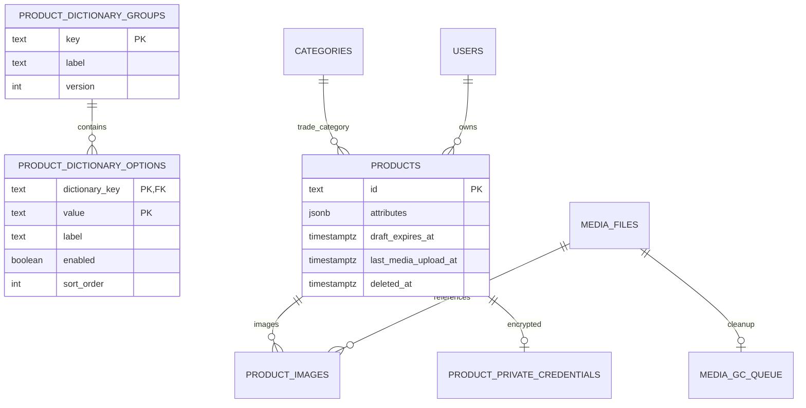
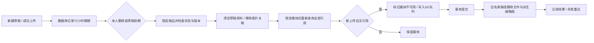
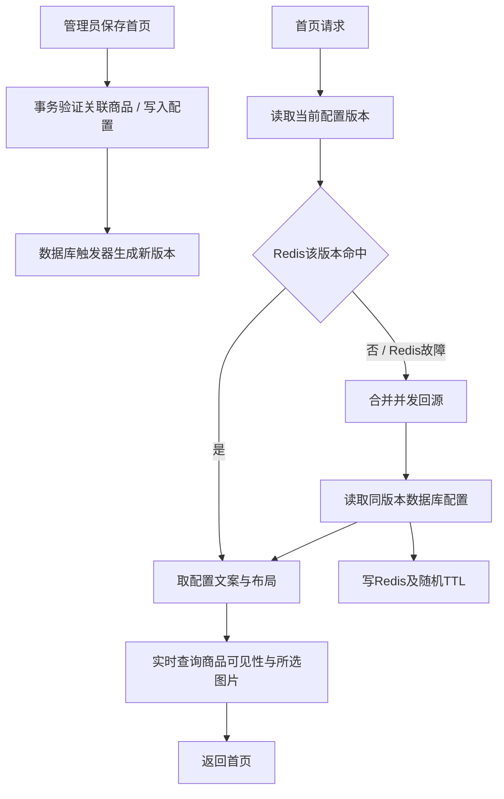

# R16 固定表单、共享字典与轮播配置

用户确认撤回自定义表单设计器。本轮恢复固定发布字段，保留 R15 的自动商品编号、私密交接资料、租赁多报价和单会员咨询会话。删除页面上的编号规则说明，不回退编号分配逻辑。

## 固定表单与共享字典

| 字段 | 发布方式 | 运营维护 |
| --- | --- | --- |
| 出售／租赁 | 单选；已保存商品不直接改交易类型 | 交易分类 |
| 区服、角色性别 | 单选；新资料提交必填 | 全局字典 |
| VIP 等级、账号结构 | 单选、可选 | 全局字典 |
| 租赁报价 | 小时／日／周／月可多选，分别填写价格 | 交易分类可限制报价单位 |
| 自定义标签 | 最多 20 项，每项最多 5 个 Unicode 字符 | 固定校验，不提供任意字段设计器 |
| 标题、介绍、图片、私密 QQ 资料 | 固定表单 | 私密资料不进入公开投影和预览 |

字典从现有各分类选项与已保存商品属性合并初始化，不凭空编造区服清单；运营可继续补充。出售、时日租赁、周月租赁均读取同一套启用区服。买家筛选可以同时选择多个区服，与单件商品只能属于一个区服区分开。

字典更新带 `expected_version`，冲突返回 409。商品写入与字典编辑共享行锁，避免校验后选项被并发删去。已引用选项须停用并保留编码；历史商品保留原值，新选项必须存在且启用。旧 `publish_form` 配置不再驱动界面或业务校验。

商品属性仍以 JSONB 保存字典编码；字典不是每商品复制一份，也不是通过标题猜测。应用事务校验提供跨表约束，历史兼容不会静默重写旧商品。

## 草稿与上传清理

从未公开、非历史导入的会员新草稿支持本人删除，必须携带商品版本。新建后 72 小时到期，成功关联新上传图片可续期至图片成功上传时间加 72 小时；仅修改文字或重复关联旧图不无限续期。

清理任务仅由 public API 运行，启动后和每 5 分钟执行，单轮限量 100、预算 45 秒。数据库事务锁和商品行锁协调提交审核、上传关联与清理。历史商品、已公开商品、待审核商品以及正在有效上传的草稿受到保护。

上传票据、上传完成与自动过期复用会员额度锁。清理取得锁后重新查询，不能只依赖最初选中候选时的快照；图片刚完成但前端尚未关联时保留15分钟衔接窗口。手动删除仍按本人确认处理。孤儿候选在批次截断前排除审核快照、客服和共享存储引用，防止受保护文件反复占据所有名额。

删除先清空草稿资料、关联和私密信息，保留编号与幂等所需的墓碑记录。仅可追踪的新上传图片进入回收流程；清理前重新检查商品、客服、审核快照及共享存储引用。旧站原图和迁移目录不参与物理删除。

新会员上传在服务器端预留额度，未公开资料合计 2 GiB、待关联文件最多 1000 个、未公开草稿最多 20 份。配额不是已上架商品图集总张数限制。清理周期只解决保留时间，配额与现有限流共同防止在三天窗口内持续灌入文件。

两端上传共用 `共享/ordered-uploads.ts`：文件可并发传输，关联按用户选择顺序提交。保留当前页面会话的顺序锚点，失败文件跨批重试插回原位；已关联图片在排序或刷新失败后重试不重复追加。原图文件与对象URL不长期保存在顺序锚点中。

## 轮播编辑与 Redis

关联商品通过搜索卡片选择，文案独立维护。数量上限可在 1～30 内调整，降低上限不能静默删除已有轮播。提供左右图文、叠加模板、文字自由定位、图片焦点、字体、字号和颜色。字体使用本机字体白名单，颜色只允许十六进制；不接受任意 CSS 或外部字体资源。

管理端与用户端使用同一个轮播渲染器。自由坐标限制在内容安全边距内，长文字撑开容器，手机重排为正常图文流。按钮统一为“查看详情”。

PostgreSQL `site_settings` 持久化内容，每次更新由数据库触发器生成新的随机 `cache_revision`。Redis 保存 `qingye:home:presentation:<revision>`，有效期随机 270～330 秒。读取先取得当前版本，再取 Redis；同进程并发未命中通过 singleflight 合并，Redis 异常回退数据库，数据库失败不会缓存空成功结果。

不缓存商品上架状态、权限或私密资料。旧请求最多写入自己的旧版本键，不会覆盖新版本；下架商品会从实时商品查询结果排除。管理员明确清空轮播时不会用热门商品自动补位。
