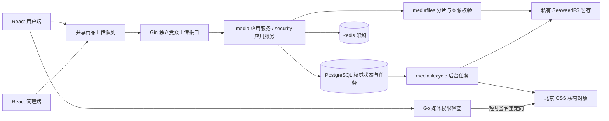
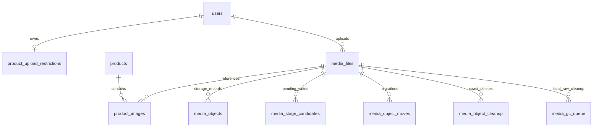
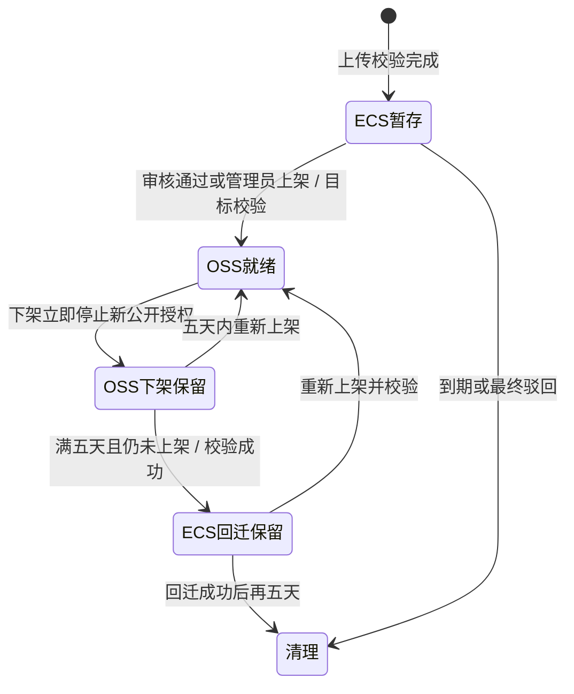

# R20 媒体生命周期架构与故障一致性

更新：2026-11-13。三端已部署152测试环境20261113-media-r20；文档随本次提交更新，实际部署见发布回执。新规则只覆盖显式标记 `lifecycle_managed` 的商品图片，不能套用到历史原图、聊天、头像及客服二维码。

最新确认：R20新商品每张图片只持久保存一张经安全验证、重编码的展示原图，取消独立720px预览小图；浏览器本地blob预览保留。迁移校验期间允许源与目标短暂双副本，成功后清理源文件。此前双variant测试只作中间版本证据；单原图版本已完成后端隔离全量/竞态及真实300图往返，浏览器7个核心流程及390×844手机视口已通过，三端测试部署已完成，文档随本次提交更新，见[验收记录](../业务验收与审查记录/MEDIA-R20-ACCEPTANCE--商品媒体隔离验收记录.md)。

## 操作与进度

两端共用商品上传组件。每次选择或拖入 1—99 张，先进入本地队列，支持排序；点击“开始上传”后先保存有效草稿，再上传图片。100 张及以上整批拒绝，不发送上传请求。商品可分多批累计 300 张及更多，不增加固定图集总量上限。

浏览器上传显示单张与整批真实进度。传输完成不等于图片可用：服务器还需格式校验、重编码、暂存校验及数据库关联。失败项保留重试入口，不计作图集保存成功。已成功关联的图片可删除、调整顺序，删除封面后按剩余第一张展示。

用户点击“提交审核”进入待审核；管理员自己创建商品可直接检查后上架，无须再审核自己一次。管理端上架进度按已经迁移并校验的展示原图对象计算，不虚构网络字节或剩余秒数。用户端只显示“上架中”等业务状态。后台任务独立于页面，全部对象验证就绪后才公开。

分片会话与服务端偏移持久化；当前浏览器页面内支持暂停、恢复和重试。刷新后已保存图集保留，但未完成的本地 File 队列不会自动恢复；不得将此表述为跨浏览器续传。

## 分层与数据流

- `domain`：受众、用途、状态和安全处置规则。
- `application/media`：上传申请、分块、完成、取消、权限检查；不接受 Gin Context。
- `application/medialifecycle`：对象迁移/验证/删除接口与任务协调。
- `application/security`：管理员停权用例。一次 429、网络失败或共享 IP 不自动触发封禁及删除。
- `infrastructure/postgres`：短事务、所有权与版本检查、任务租约及一致锁序；拆分登记、迁移和清理实现。
- `infrastructure/mediaobject`：受限 S3/OSS 精确对象键、SHA-256 校验、短签名和临时文件。
- `bootstrap`：连接池、私有存储与后台任务装配；只有 public 进程运行生命周期任务，独立数据库池最多 2 个连接。

新对象键为 `r20/{environment}/objects/{media_id}/{generation}/original`。每轮迁移创建新 generation，旧清理任务不复用新键；测试使用 acceptance 前缀及专用 SeaweedFS 桶。阿里云生产可配置北京内网写入，浏览器签名始终使用可达的外网地址。腾讯云测试走公网。

原始上传先做图片格式/尺寸验证并安全重编码；业务“原图”指校验后的唯一展示图片，不额外生成720px JPEG或其他独立预览文件。成功落库后原始上传raw进入持久清理队列，处理中间文件不长期保留。上传前的blob预览只存在浏览器内存。历史迁移原图不重编码、不接管删除，R19旧缩略图机制不由本轮取消。

## E-R 增量

迁移 `0012_product_media_lifecycle.sql` 增加：

| 数据 | 职责 |
| --- | --- |
| media_files | 受众、用途、上传偏移/票据、处理租约、是否 R20 纳管；未验证文件不能 ready |
| media_objects | 每图片展示原图的有效位置、键、大小、散列、期限、强制清理、重试状态；新图不生成独立preview对象 |
| media_stage_candidates | 外部写入前登记目标，处理失败或进程退出后仍能追踪孤立对象 |
| media_object_moves | 网络传输前登记来源/目标、租约及完成状态 |
| media_object_cleanup | 精确旧键清理、重试及异常写入对账；不可删除前缀或整桶 |
| product_upload_restrictions | 持久停权、原因及乐观锁版本；解封不复活旧票据 |
| products | 新增 publishing、rejected_final；最终驳回不可重新恢复为可编辑状态 |

PostgreSQL 是持久业务事实来源，Redis 不保存唯一的上传进度、图片位置或删除任务。Redis 失效时安全限频不可被当作无限放行；已写入的停权状态不因 Redis 重启消失。原有首页缓存的随机 revision、TTL 与 singleflight 机制不变。

0012在R20开发期曾用于私有验收schema，验收环境需要核对最终函数定义与源码一致；这种开发期受控刷新不能照搬到业务数据库。**R20正式测试站部署后，0012即为不可原地修改的已发布迁移，后续结构或函数变更必须新增迁移文件。** 不得因为已有环境记录了迁移号就假定它自动获得修改后的SQL。

## 期限与并发

草稿/待审五天从有效上传纳管开始，普通文字保存、重复提交、重复关联不能无限续期；真正退回修改可从退回事件起保留五天。最终驳回、删除新草稿直接进入清理，不再新增保留窗口。已售出、出租中和管理员回收站保留原有保护，未借 R20 擅自推断额外删除规则。

网络 I/O 不占数据库事务：领取租约并提交 → 传输且读取目标校验 → 再锁定并核对商品/媒体状态 → 切换有效位置与登记旧键清理。竞态下旧目标进入清理，不覆盖已变更的商品。允许校验期间短暂双副本，不在失败时删除唯一有效来源。

对于不确定是否仍可能迟到写入的异常目标，持久清理墓碑设置 reconcile，首次删除后每 24 小时精确重删该旧键；会产生持续的少量存储请求。普通已验证迁移的源键不执行此重复对账。活动键不能进入该清理范围。

## 失败一致性与空间保护

| 故障 | 必须保持的结果 |
| --- | --- |
| 上传申请前磁盘不足 | 拒绝上传票据；有效文字草稿允许保留并显示错误，不得误报商品已上架 |
| 预检后磁盘变满、分块写入失败 | 偏移只推进已提交部分；失败尾部回退/覆盖，重试不重复追加 |
| 重编码成功、暂存写入或校验失败 | 不标记ready；预登记候选可追踪并清理，不公开未验证图片；无独立预览写入步骤 |
| 图片暂存成功、数据库提交失败 | 保留可对账候选与原始会话；不产生有效图集关联，不将数据库错误显示为成功 |
| 完成或关联响应丢失 | 重试先对账、使用既有媒体 ID；不得重复上传、重复关联或卡死取消 |
| OSS 写入成功、切换事务失败 | 来源仍有效；重试检查不可变目标，过期目标进入补偿清理 |
| 源文件删除失败 | 目标已校验后才登记清理，任务可重试；不谎称两份已经合并为一份 |
| 删除与上架/上传并发 | 依照统一锁序、版本及租约核对，不能把新 generation 当作旧键删除 |
| 管理员停权 | 撤销商品票据，只按明确选择清理该会员 R20 暂存；不清其他用户/聊天/头像/历史/OSS 已上架对象 |

空间保护默认保留 2 GiB 可用磁盘，写入前、接收分块及提交阶段再次检查；可配置 `MEDIA_R20_MIN_FREE_BYTES` 和实际 SeaweedFS 数据挂载路径 `MEDIA_STAGE_CAPACITY_PATH`。这是准入快照，不是跨进程硬磁盘预留。删除和读取不因低水位被一并禁用。SeaweedFS 对象删除与物理卷回收不同，维护办法见[存储选型](STORAGE-R20--ECS存储选型与测试环境方案.md)。

## 安全、展示及交付边界

新增 Go 安全专项使用真实隔离 PostgreSQL/Redis，模拟正常批量上传、重试、共享 IP 和用途隔离，并分别采样规则、Redis、数据库、HTTP 与图像处理耗时。小尺寸合成素材验证业务正确性，不能当成真实大图吞吐或生产容量承诺。

发布图通过授权接口取得最长 60 秒签名，浏览器随后从 OSS 读取；下架阻止新授权，但已经发出的签名/浏览器缓存存在短时窗口。当前没有 CDN 或边缘统一防刷；Go 授权限频不能限制拿到签名后的所有 OSS 直接请求。只允许精确 OSS 域名通过两端 CSP。

旧 `mediafilesoss` 读取预备仍由 `oss_read` 构建标签隔离，旧迁移读取不启用。新 R20 存储适配使用普通构建中的 SDK，由显式配置启用；不能再笼统声称普通程序不链接 OSS SDK。

出现 R20 数据后禁止仅回滚 R19 二进制：旧程序不认识对象位置、生命周期与新状态。发布前保留数据库备份、环境配置及版本产物；回退要停写、核对任务和新对象并选择兼容版本，不能删除迁移表假装恢复完成。
