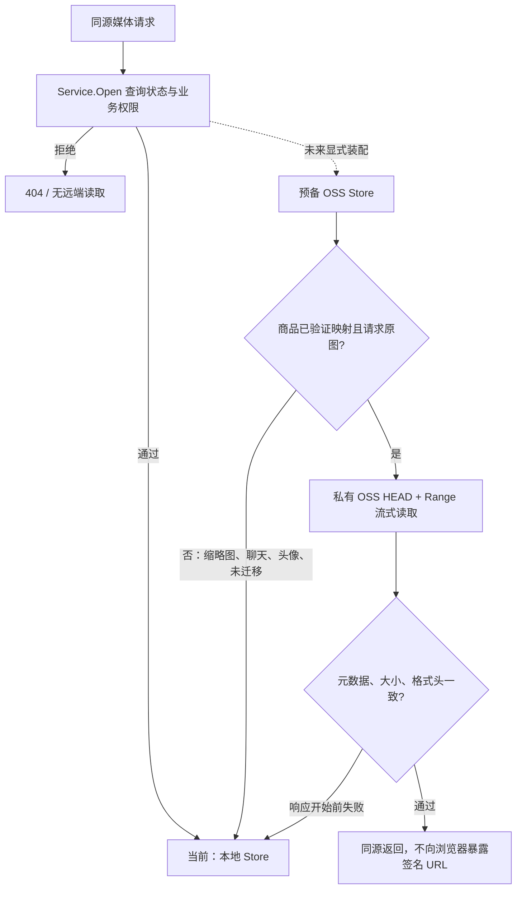

# OSS 原图读取预备与启用边界

更新：2026年11月12日。**预备实现，未启用、未部署业务服务。** 用户明确要求照片未传完，接入代码先注释保留。网站仍使用本地媒体文件；服务器到 OSS 的后台复制独立运行。

## 已核验的存储形式

| 项目 | 结果 |
| --- | --- |
| Bucket / 地域 | `qingye-images-20261` / `cn-beijing` |
| 类型 | 标准存储 Standard，本地冗余 LRS |
| 原图快照 | 48,345 个文件，26,845,180,398 字节；商品图片顺序关联 48,337 条 |
| 对象键 | `qingye-test/media/` + 原数据库 `storage_key` |
| 历史原图 | `qingye-test/media/legacy/<64位散列>`，无扩展名，按真实 `Content-Type` 识别 |
| 新上传图片 | `qingye-test/media/images/<UUID>.jpg` 或 `.png` 等已有文件名 |
| 权限 | 对象显式 private；匿名 HEAD 抽查返回 403 |
| 实际授权 GET | PNG、JPEG、GIF 各一张均返回 200，完整字节数和 SHA-256 与服务器原图一致 |

原图保留，没有重新编码。`derived/` 缩略图未迁移，继续由本地生成和缓存。现阶段不能把计划清单当作成功上传结果，也不能把某次进度数字当作最终全量完成证明。

核验和复制均由152服务器执行，不经过用户电脑上传图片。带宽为用户确认的3 Mbps；保持该带宽时，全量原图理论传输约20小时，实际可能更久。

## 预备代码及关闭方式

代码位于 `代码/后端/internal/infrastructure/mediafilesoss/`，使用阿里云官方 Go SDK V2 `v1.6.1`。

1. 所有实现和测试带 `//go:build oss_read`；普通 `nomsgpack` 构建排除该包。
2. 当前 `httpapi.mediaService()` 只增加待启用注释，仍直接构造本地 `mediafiles.Store`。
3. 没有环境变量启用分支、自动探测或 `init()` 网络请求。即使提供 OSS 凭据或添加构建标签，也不会自动替换业务存储。
4. 没有改前端图片 URL、CSP、数据库 `storage_key`、Redis、上传/删除流程或已部署配置。

以下是未来装配示意，**当前保持注释，不得因看到配置而取消注释启用**：

```go
// 迁移完成并经过单独验证后，才在 bootstrap 构造一次并复用；不要逐请求构造。
// local := &mediafiles.Store{Root: cfg.MediaDir}
// verified, err := os.Open(privateVerifiedManifestPath)
// if err != nil { return err }
// defer verified.Close()
// reader, err := mediafilesoss.New(mediafilesoss.Config{
//     Bucket: "qingye-images-20261",
//     Region: "cn-beijing",
//     Endpoint: "https://oss-cn-beijing.aliyuncs.com",
// }, local, verified)
// if err != nil { return err }
// 将 reader 注入 application/media.Service 的 Files，保留所有业务鉴权。
```

配置不含凭据；未来进程通过官方 CredentialsProvider 读取受限环境/角色凭据。读图权限与迁移写入权限分离，前端不得保存 AccessKey、签名请求或迁移清单。

## 读取和权限边界



R19 的聊天图片/头像仍由 `ScopedAccess` 核对，不给管理员增加绕过会话归属的入口。迁移清单仅接受 `purpose=product`，并同时匹配媒体ID和原存储键；清单本身不能代替商品当前可见性与所有权校验。

清单加载拒绝计划状态、非私有对象、跨Bucket或错误前缀、重复ID/键、路径穿越及异常校验值。单行64 KiB、总量10万项、单对象64 MiB是本预备读取器的资源边界，不是商品图集张数限制。支持PNG/JPEG/GIF/WebP；不声称已支持AVIF。

SDK采用可Seek的流式文件，关闭预取，最多8个同时打开的OSS读流，关闭时释放连接/租约；取消请求不再发起回退。对比上传回执中的大小、SHA-256元数据、CRC64元数据和图片格式头，再交给同源响应。SDK以ETag约束Range重读；不一次缓存整张原图。元数据比对不能替代迁移时实际内容SHA-256校验。

远端打开失败或并发额度已满时，只在响应开始前回退同一个已授权本地文件。响应中途失败不能拼接本地字节；客户端需重新请求。SDK内部请求错误会转换为固定错误，不回显请求信息。

## 启用前的必要工作

- 在服务器私有目录确认 `SUCCESS`、`completion-receipt.json` 及 `media-object-map-verified.jsonl`，核对全量成功、原图保留和图片顺序。
- 检查迁移快照之后新增/删除的媒体。新图片没有OSS复制回执时仍本地读取；这份预备实现没有自动双写或OSS删除同步。
- 使用最终已验证清单构造并复用只读客户端，完成public/admin权限、商品下架、聊天转交、头像变更、Range读取和失败回退测试。
- 再单独修改装配、配置并部署；当前线上保持R19本地读图，不自动切换。

当前实现是后端代理读取OSS，响应仍经过152的3 Mbps公网出口，**不等于前端直连OSS或图片加速**。浏览器直连、独立图片域名/CDN需另外处理域名、CSP、签名有效期及权限撤回；本轮未开通或改变这些设置。

## 验证证据与交接

服务器迁移记录：`/root/qingye-private/oss-migration-20261112/`；独立预备代码验证：`/root/qingye-private/oss-read-prep-20261112/`。凭据、原图、实际对象映射和原始测试日志不进入Git。

本轮已恢复GitHub连接，核对远端R19基线 `d3d7dc07e89994b3c471c08ba3a48e119d86ccd0`，通过最新树的增量提交保留R17—R19变更；不使用旧工作树整体覆盖远端。152的R19后端源码归档用于隔离兼容验证。本机原工作树仍以R16为基线，后续开发须先同步最新main，不能直接从旧目录部署；禁止强推覆盖他人更新。

| 检查 | 实际结果 |
| --- | --- |
| 预备包单元测试 | 63项通过，0失败、0跳过（含子测试） |
| 预备包竞态检查 | 63项通过，0失败、0跳过 |
| R19默认构建后端全量回归 | 247项通过，0失败、0跳过；隔离验收库 |
| `go vet -tags=nomsgpack,oss_read ./...` | 通过 |
| 默认 `nomsgpack` 构建与依赖检查 | 通过；二进制依赖不含本预备包和OSS SDK |
| 新Go读取器真实OSS读取 | PNG 506,773字节、JPEG 430,690字节、GIF 591,862字节，全部SHA-256一致；探针禁止本地回退 |

工具链为Go1.27.4。真实读取从152执行，只输出格式、字节数和校验结果；原图不经本机中转。私有证据为 `checks-summary.json`、`go-real-read-validation.json` 与对应日志。单元测试覆盖非法清单、错误元数据/类型、Range与Seek、取消、并发额度、失败回退及错误脱敏；本轮不代表全量对象已经复制成功。

**尚未执行**：业务应用OSS装配、线上切换、浏览器直连OSS及全量迁移完成验收。保持当前R19应用和本地读图，不将隔离探针或代码提交描述为已部署OSS。

参考：[官方 Go SDK V2](https://www.alibabacloud.com/help/en/oss/developer-reference/manual-for-go-sdk-v2/)、[OSS 元数据](https://www.alibabacloud.com/help/en/oss/user-guide/manage-object-metadata-10)。
