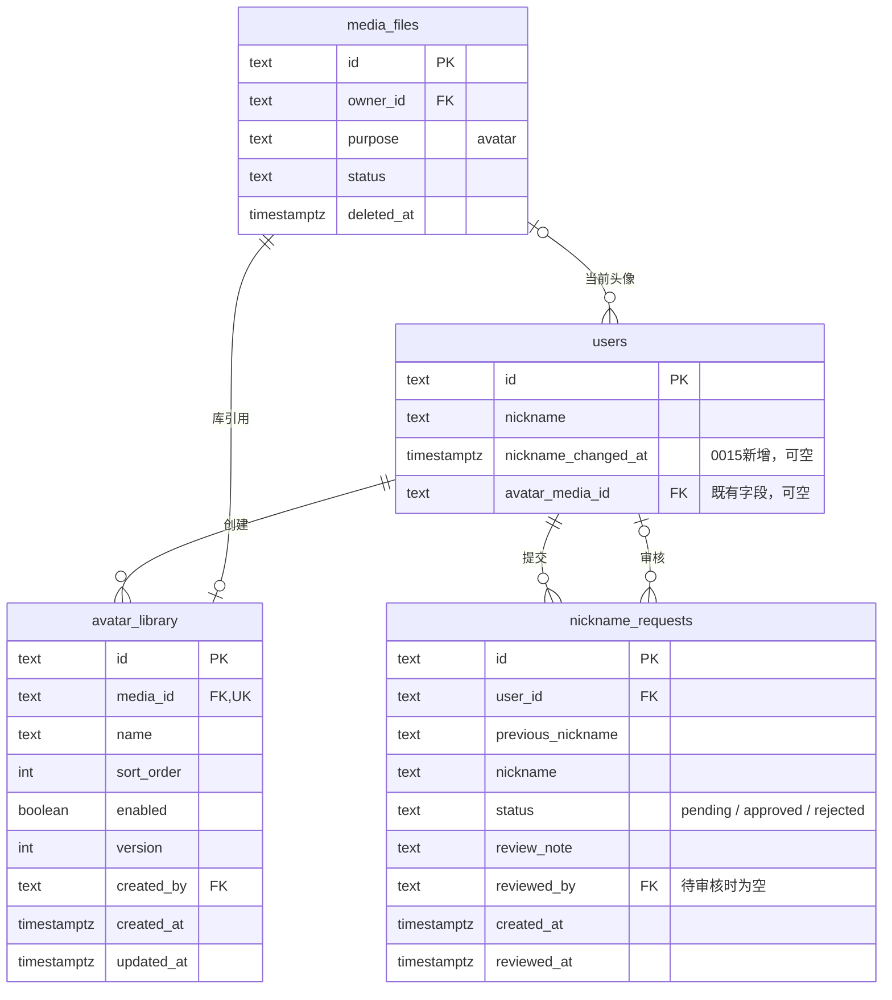
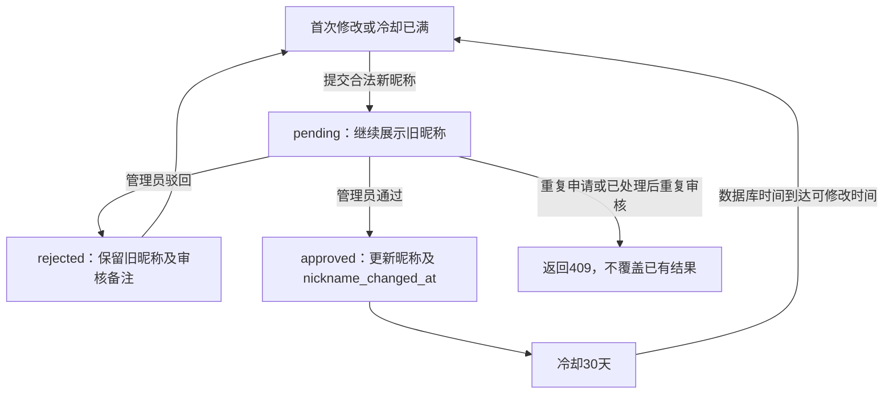

# R21-1 筛选与会员资料设计

2026年11月13日。本记录说明本轮源码、接口与数据边界；实际验证及发布状态以本轮验收记录和服务器发布回执为准。

## 1 范围与入口

- 用户端游戏区服按“一舞时光、拾忆光阴、十年之约、其他”展示，VIP按“星钻、银钻、金钻、彩钻、王钻”展示。数据库保留原选项编码；`其他大区`只将展示名称改为“其他”。
- 从用户筛选界面及公开分类的筛选配置中移除账号结构。已有商品资料、发布字段和字典继续保留；用户端清除旧链接携带的账号结构筛选，避免隐藏条件继续限制结果。
- 热门筛选由管理员在“商品设置 → 共享字典 → 热门筛选”管理。初始23个词及顺序来自用户补图，记录于0016迁移。
- 会员在“我的 → 基本资料”申请昵称修改、选择头像。新注册会员昵称由服务端生成“清叶会员＋手机号后四位”；客户端提交昵称不能覆盖该默认值。
- 登录页移除底部装饰图；用户端首页与账号集市手机商品卡片每行两张，电脑每行三张。

主要源码位于后端 `application/profile`、`infrastructure/postgres/profile.go`、`transport/httpapi/profile.go`，并复用现有身份、字典、聊天资料和媒体接口。前端分别使用用户端资料组件、`CatalogPage.tsx`及管理端`AdminProfiles.tsx`、`DictionarySettings.tsx`。

## 2 数据增量

0015新增`nickname_requests`和`avatar_library`两张表，以及`users.nickname_changed_at`可空时间字段。`users.avatar_media_id`和`media_files`沿用R19结构。0016扩展现有字典组约束，新增`keyword`组和初始词，更新区服/VIP排序，不新增筛选专用表。



每位会员最多有一条`pending`申请，由部分唯一索引保证。审核列表按状态、创建时间和ID分页；总数及页内数据由单条SQL读取。头像库的`media_id`唯一，同一素材不能重复登记；排序相同时按库ID稳定排序。头像库只提供停用，不提供删除媒体功能。

## 3 昵称申请与审核



昵称为1至30个有效Unicode字符，去除首尾空白，拒绝控制字符。申请入口按用户限频，每小时最多10次；通过审核前，登录信息、聊天与公开资料继续使用原昵称。

申请与审核统一按`users → nickname_requests`顺序加锁。申请在用户行锁下检查启用状态、会员角色、原昵称、30天冷却及已有待审申请；审核通过时再次检查这些状态与申请记录中的原昵称。只有仍为`pending`的申请能被处理，并发审核只有一个成功。

通过审核时，在同一事务内更新昵称、`nickname_changed_at`、审核记录和`admin_logs`。冷却起点是审核通过时的数据库`now()`，可再次申请的条件是`nickname_changed_at + interval '30 days' <= now()`，不使用浏览器时钟。驳回不更新冷却起点，可重新申请；修改后的昵称仍需走审核。

## 4 头像库与媒体权限

管理员先通过现有受控上传接口上传`purpose=avatar`素材，单图上限2 MiB，继续执行现有类型、解码及重编码校验。登记头像库时，只接受当前管理员本人上传、用途为头像、处理完成且未删除的媒体。登记与媒体检查在同一事务和媒体锁下完成。

会员不能申请任意头像上传，应用层及存储适配均拒绝该用途。选头像沿用`PATCH /chat/profile`，其中`avatar_id`传的是库条目的`media_id`，不是头像库条目ID。服务端锁定用户后检查该媒体仍有启用的头像库引用，并锁住库与媒体记录，避免与管理员停用发生校验后竞态。空字符串恢复默认头像；聊天页面仅展示头像，修改入口仍在个人中心。

头像读取继续走受保护媒体接口和既有图片访问预算。未登录不能读取头像库；登录用户可读启用库素材。停用后不再允许新选用；已有会员当前使用的头像继续展示，管理员仍可读取停用库素材。历史已设置头像保留展示，重新选择必须来自启用库。

取消上传、孤立素材统计、GC入队和清理候选均检查`avatar_library`引用，包括停用条目，避免无人选用的库图片被误清理。停用不会删除文件或清空会员头像。头像保持R19媒体规则，不进入R20商品生命周期迁移。

## 5 热门关键词与筛选语义

热门词复用`product_dictionary_groups/options`中的`keyword`组及现有管理员保存接口。可新增、改名、删除、启停和排序；保存整组时携带`expected_version`，在组行锁内校验版本、写入选项并记录审计。保留每组500项、编码及名称1至80个有效字符等边界，拒绝非法UTF-8和控制字符。编码固定，改名只改变展示与实际匹配文字。

用户请求示例：

```json
{"keyword":["包子","永夜头"],"server":["一舞时光"]}
```

以上对象作为`GET /api/v1/products`的`filters`查询参数进行URL编码。热门词组内满足任意一词即可，与区服、VIP、性别、租售、预算和普通搜索条件取交集。后端先验证所选编码存在且启用，查询时再按当前启用状态及名称匹配，防止管理员停用后仍使用旧允许值。

匹配范围是公开商品标题、简介、商品编号、区服编码、历史标签及自定义标签。使用不区分大小写的字面子串匹配，百分号和下划线不作为通配符。现有商品标签已保存“300外搭以上”等关键词，本轮不额外从描述推断或计算外搭数量。原商品公开状态、审核版本与分类可用性约束继续生效。

## 6 接口约定

以下路径均以`/api/v1`为前缀。管理接口仅在admin入口注册，沿用独立管理员会话、Origin和角色校验；新增头像选择未引入匿名媒体权限。

| 方法与路径 | 身份与主要输入 | 行为 |
| --- | --- | --- |
| `GET /me/profile` | 普通会员 | 返回当前昵称、最近申请、`next_nickname_change_at`和`can_request_nickname` |
| `PATCH /me` | 普通会员；`nickname` | 创建申请，响应仍返回原昵称的用户资料 |
| `GET /admin/nickname-requests` | 管理员；`status`、`page`、`limit` | 默认pending、第1页、每页20条，最多50条；手机号脱敏 |
| `POST /admin/nickname-requests/{id}/review` | 管理员；`decision=approved/rejected`、`note` | 备注最多300字符；已处理返回`REVIEW_CONFLICT` |
| `GET /avatar-library` | 当前入口的已登录用户 | 按排序返回启用且可用的库条目 |
| `GET /chat/profile`、`GET /admin/chat/profile` | 分别为会员、管理员 | 保留独立的本人头像读取 |
| `PATCH /chat/profile`、`PATCH /admin/chat/profile` | 分别为会员、管理员；`avatar_id` | 选择启用库的`media_id`，或空字符串恢复默认 |
| `GET /admin/avatar-library` | 管理员 | 返回可用媒体对应的全部库条目，包含停用项 |
| `POST /admin/avatar-library` | 管理员；`name`、`media_id`、`sort_order`、`enabled` | 新增库条目，名称1至30字符，排序0至1000000 |
| `PATCH /admin/avatar-library/{id}` | 管理员；`name`、`sort_order`、`enabled`、`version` | 改名、排序、启停；不允许替换`media_id`，版本不符返回`AVATAR_CONFLICT` |
| `GET /categories` | 公开 | 筛选配置包含keyword，移除kind |
| `GET /dictionaries` | 公开 | 继续包含发布所需的四组字典及启用热门词 |
| `GET /admin/dictionaries` | 管理员 | 返回含停用项的字典及版本 |
| `PUT /admin/dictionaries/keyword` | 管理员；`expected_version`、`options` | 整组保存关键词；各选项为`value/label/enabled/sort_order` |
| `GET /products` | 公开；`filters`及已有搜索条件 | 筛选后查询可公开商品，再排序分页 |

## 7 迁移、发布与回退

先备份，再依序执行0015和0016；不得原地修改已部署的0011至0014。默认头像素材通过管理员受控API登记，不能仅复制文件到静态目录便声称头像库已初始化。

旧API可直接改昵称、允许个人任意上传头像，且不认识头像库GC引用。0015启用后不能只回切旧API二进制，否则会绕过审核与冷却并带来误清理风险。优先前向修复；必要时回退静态页面仍须保留本轮权限、审核、媒体引用保护及数据库增量。旧静态页面可能提示接口拒绝，需单独核验。

0016扩展字典组及种子后，旧筛选实现也不理解keyword的搜索语义。应用回退不能以删除新表、移除库引用或改写历史商品编码代替恢复方案。发布应核对迁移记录、运行产物、API健康及实际前端行为；验证数字不在本设计中预记。
