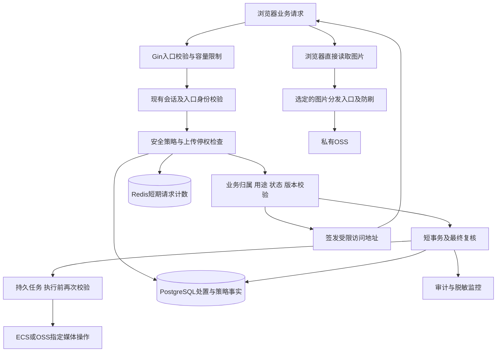

# SECURITY-R20 -- Go安全模块设计

后续更新：2026年11月13日记录[R20-1图片防刷与验证加固计划](../计划/SECURITY-R20-1--图片防刷与验证加固计划.md)，覆盖异常访问的人机验证、图片下载入口和相关代码补强。该计划尚未开发，下列R20“已实现/未实现”边界不因新增计划而改变。

最新实施口径：单次选择或拖入1—99张，100张及以上整批拒绝且不发送上传请求；300张按99＋99＋99＋3分四批追加，不设商品总张数上限。隔离测试使用每张1—10KB的合成图片。用户端只展示上传进度和“上架中”等业务状态；对象键、存储位置、迁移/清理阶段与技术错误仅在管理端授权接口展示。已授权实现、隔离验收后部署152测试环境并推送GitHub；未有实际回执前不得标记已上线。

日期：2026年11月13日。状态：Go安全模块及商品媒体防护已实现，后端隔离全量/竞态已验证；核心浏览器已复测，三端已部署152测试环境；GitHub同步及其余边界按回执更新。作为[商品图片改造](../前期设计文档/MEDIA-R20--商品图片上传存储与展示需求.md)的安全部分，统一请求校验、资源授权、上传防滥用、停权处置和审计；先接入商品媒体，再供其他业务复用。本文件区分当前实现与后续设计，不改变2 GiB额度、图片留存期限或R19聊天权限。

## 0 当前已实现与后续设计的边界

已实现：既有身份/Origin/受众授权、新增PostgreSQL商品上传停权和版本校验、客户端用途与归属复核、固定窗口限频、既有账号额度、宿主磁盘水位、受控解码、精确对象清理及持久补偿。管理员确认恶意并显式选择清理后，只处理该账号R20商品暂存；一次429、网络失败或共享IP不会自动封禁或删图。

未实现：按实际字节的Redis分布式预算/全局并发租约、自动风险事件聚合和自动停权规则、CDN/ESA实际下载入口防刷。当前按账号请求窗口、PostgreSQL配额及本机有限并发控制，不能称为上述分布式能力。用户取消独立预览小图，因此“小图优先”降级不实施。本文后续提出这些能力时均是设计约束，不是上线声明。

当前代码事实、故障边界见[媒体架构](MEDIA-R20--媒体生命周期架构与故障一致性.md)，测试数字见[隔离验收记录](../业务验收与审查记录/MEDIA-R20-ACCEPTANCE--商品媒体隔离验收记录.md)。

## 1 复用现有能力

沿用[Gin分层](ADR-GIN-LAYERS--Gin分层与安全性能设计.md)以及现有服务端会话、密码处理、上传票据和Redis限流。安全模块是现有Go后端中的逻辑模块，用户API与管理API各自装配；本轮不另开安全微服务，不切换JWT，不增加通用权限引擎。

| 已有能力与入口 | R20处理 |
| --- | --- |
| `application/identity`、`postgres/identity.go` | 复用服务端会话、令牌散列、audience、角色、启用状态和有效期校验 |
| `transport/httpapi/auth.go`、`request_limits.go` | 保留精确Origin、可信代理、请求内身份复用及容量限制 |
| `application/media`、`postgres/media.go` | 扩展上传申请、接收、完成三阶段，保留网络接收不占DB连接及完成前锁内复核 |
| `infrastructure/cache/limiter.go` | 复用Lua原子计数；现有实现不等于已经具备字节预算或分布式并发租约 |
| `infrastructure/mediafiles` | 保留真实图片校验与受控路径，补充续传及迁移的竞态防护 |
| `infrastructure/security` | 继续只承载密码、随机数、签名与加密等能力，不将商品权限塞入密码学工具包 |

本轮从R19基线b5e97dd实施，以上入口已按R20源码复核；提交前仍核对远端变化。尤其不得复制旧版“管理员可读取所有媒体”的判断：聊天转接后的访问权限仍按R19当前会话参与者规则执行。

## 2 模块分层与职责

下列为分层职责；当前实现以媒体架构和源码为准，未启用的策略编辑、边缘适配与Redis租约不得从本表推断为已开发。

| 层与建议位置 | 职责 |
| --- | --- |
| `internal/domain/security` | 安全动作、处置范围、原因码、策略版本与纯判断规则；不访问数据库、网络或磁盘 |
| `internal/application/security` | 编排风险检查、账号上传停权/恢复、撤销上传会话及票据；定义限流、审计、策略存储等端口 |
| `internal/application/media`及其他业务服务 | 检查资源归属、用途、商品状态与当前版本，决定能否上传、读取、关联、迁移和删除 |
| `internal/transport/httpapi` | Gin中间件与处理器：提取可信身份、执行入口限制、校验输入、转换稳定错误码 |
| `internal/infrastructure/cache` | 当前Redis短期计数及频率窗口；分布式并发租约是后续方案，不承载最终处置事实 |
| `internal/infrastructure/postgres` | 停权、策略版本、任务和审计的持久化；事务、统一锁顺序、唯一约束及版本更新 |
| `internal/infrastructure/security`与存储适配 | 签名/密钥、受控文件操作、OSS指定对象操作；边缘适配只同步选定服务的防护配置 |
| `internal/config`、`bootstrap` | 校验部署参数，装配依赖并限制任务资源；public/admin进程及环境隔离 |

应用层接收`context.Context`、服务端认证得到的操作者和结构化动作；不能接收Gin Context，也不接受客户端自报角色、所有者或清理目录。公共策略返回允许/拒绝、原因码、重试时间和策略版本，不能覆盖业务服务的资源授权。每个业务入口与后台任务均执行必要校验，不能只靠中间件。此安排遵循[OWASP逐请求授权与默认拒绝原则](https://cheatsheetseries.owasp.org/cheatsheets/Authorization_Cheat_Sheet.html)。

图中请求鉴权适用于受保护操作；公开商品读取仍允许匿名，但必须检查商品公开状态。CDN/ESA尚未选定，不把图中边缘节点当作已购买或已部署。

## 3 请求和资源授权

| 防护点 | 设计规则 |
| --- | --- |
| 身份与会话 | 保留public/admin不同Cookie与服务端audience校验；失效、注销、停用后拒绝；只在同一次HTTP请求内复用身份结果 |
| 真实IP | 只信任配置中的反向代理并由代理覆盖转发头；不直接相信客户端的`X-Forwarded-For`，接CDN时复核整条代理链 |
| 写请求 | 继续精确Origin与现有CSRF约束，Cookie保持HttpOnly、Secure、SameSite；CORS及不同端口本身不能代替授权或Cookie隔离 |
| 输入与输出 | JSON/请求体/字段/枚举/分页上限在读取时执行；SQL参数化，排序来自白名单；只返回允许公开的字段 |
| 媒体访问 | 按product/chat/avatar等用途、当前归属和业务状态判断；媒体ID不可猜测不能代替授权，管理员身份不能通读聊天附件 |
| 管理动作 | 停权、恢复、策略修改、清理重试分别登记服务端动作权限；复用现有管理身份，记录操作者、原因及预期版本 |
| 出站与路径 | API只接受媒体ID，目标桶、Endpoint和对象键由可信配置与数据库映射生成；不提供任意URL下载、任意目录读写或任意OSS前缀删除接口 |

暂存软件首选及提供方差异见[存储选型](STORAGE-R20--ECS存储选型与测试环境方案.md)。SeaweedFS适配必须拒绝空键、目录键及任意前缀删除，禁用非必要上传解压扩展；S3兼容不能替代精确操作白名单和范围校验。

未知动作默认拒绝。未登录返回401，已认证但无权限按既有接口约定使用403或不泄露资源存在性的404；版本冲突409，超限429并附适当重试时间，依赖不可用503。前端据原因码展示状态，不输出SQL、物理路径、密钥或内部堆栈。

Gin代理配置风险及使用边界见[官方可信代理说明](https://gin-gonic.com/en/docs/server-config/trusted-proxies/)。本模块不通过扩大代理信任范围来修复部署问题，也不以全局正则“过滤SQL/XSS”替代参数化查询和前端安全渲染。

## 4 上传安全与续传

上传仍走ECS私有区域。建议在既有票据上扩展上传会话，绑定用户、入口、用途、媒体/商品、文件序号、声明大小、截止时间和安全版本。票据由服务器生成并保存散列，不携带长期OSS凭据；短期传输凭据失效后，重新认证可为仍有效的任务续签。

1. **申请任务**：先查身份、上传停权与业务归属，再检查现有额度和容量；支持一次拖入1—99张、多批累计200—300张及更多，采用受控文件队列。不得把批次大小当商品图集总上限，频控要允许正常连续追加及排序。
2. **接收文件/分片**：逐请求验证票据范围及任务是否撤销，核对序号、偏移、大小和已有校验信息。重试同一分片应返回确定结果；同一位置不同内容拒绝，客户端声明的散列不作为唯一完整性证明。
3. **限制实际资源**：网络流实际字节受限，不能只信Content-Length；限制分片数量、未完成任务、并发、像素/帧数与解码内存。保留当前账户额度，续传临时占用的计入和释放沿用现有统计范围，不重定义2 GiB口径。
4. **校验完成**：服务器确认文件完整性、真实格式与可解码性后进入短事务，复核当前所有者、用途、上传权限及安全版本，再安装和关联。停权或取消与完成并发时，统一账号→媒体等既有锁序，不能让旧请求重新写回。
5. **中断处理**：网络阶段不持有数据库连接；完成、取消、超时和重试的占用释放必须幂等。进程异常后由持久任务对账，不依赖进程内计数或Redis自然过期当作已删文件。

仅接受业务支持的图片格式，结合扩展名、实际类型、解码及大小验证，SVG/HTML/压缩包等不因改扩展名被接受；新上传名单不得直接破坏历史GIF等兼容读取。文件名与对象键由服务端生成，原始名称仅作为受限展示字段。参考[OWASP上传防护](https://cheatsheetseries.owasp.org/cheatsheets/File_Upload_Cheat_Sheet.html)。

文件操作必须限制在专用媒体根目录，同时验证数据库归属。评估当前Go版本可用的`os.Root`或等价受控目录句柄，避免仅“先检查符号链接再按路径打开”的竞态；目录不可由非受信进程写入。根目录约束不能替代同目录内不同账号的权限检查。依据见[Go受限目录文件API](https://go.dev/blog/osroot)。

当前R20“原图”已明确为经过安全验证、重编码后的唯一展示原图，不保留输入raw作为第二份长期业务文件，也不生成720px预览图。raw在业务文件持久化后进入安全清理队列；不能把重编码结果声称为输入原字节。历史迁移原图及R19缩略图规则不因此覆盖或清理。

## 5 PostgreSQL与Redis职责

| 数据 | 存放与一致性 |
| --- | --- |
| 账号上传限制 | PostgreSQL权威记录，含范围、状态、原因、操作者、版本与时间；不能把账号整体禁用和仅停止上传混为一谈 |
| 安全策略 | 当前停权记录有版本，阈值来自受控配置；通用策略表/编辑器尚未实现。密钥、受信代理与存储凭据只在私有部署配置 |
| 上传与迁移任务 | 持久保存阶段、有效位置、校验结果、租约/执行版本、重试及清理结果；可重启恢复 |
| 安全审计 | 关键处置与审计/待处理事件在同一事务内记录，异步执行通过持久任务重试；不得将Redis Pub/Sub当可靠任务队列 |
| 频控 | 当前Redis按有界动作和服务端身份设置请求窗口及TTL；环境使用隔离实例/配置。短租约不是现有上传字节预算，Redis失效不能解除持久停权 |

当前使用固定窗口Lua限频，商品申请每账号600次/10分钟，状态查询1200次/10分钟；分块窗口按配置的单文件最大字节数计算，允许每块一次丢响应重试，并保护整数溢出。计数与过期原子执行，拒绝不无限续期。短/长双窗口及分布式并发预算是后续增强，不能视为已启用。按次数限流与按实际字节/活动上传量控制是不同能力，不能复用一个计数就宣称全部覆盖。Redis[官方INCR示例](https://redis.io/docs/latest/commands/incr/)说明了分离计数与到期操作的竞态。

Redis键使用固定动作枚举与有界身份标识，不使用任意URL/请求体生成无限维度；TTL不因拒绝请求无限续长。后续如引入跨实例并发租约，必须使用唯一持有者、到期续租和比较释放；过期旧工作者不能继续完成受保护写入，最终仍由数据库版本及状态复核。当前不为此引入Redis Cluster；将来变更拓扑需重新验证多键原子操作。

停权/恢复与任务状态更新沿用数据库统一锁顺序，清理任务按账号范围及图片用途逐项取媒体ID。重查有效引用后标记处理中，关联与重新上架不能抢占已进入删除阶段的媒体；外部删文件不保持长事务，结果持久化后才标完成。失去执行权或商品版本变化的任务停止。迁移遵守“验证目标后删源”，不能仅凭TTL、过期Redis锁或本地路径存在决定删除。

删除请求一旦发出，不能承诺靠租约到期或Context取消撤回。每代媒体使用不可复用的文件名/对象键，任务绑定精确来源对象、代次与验证记录；进入删除阶段的对象不得被重新关联或覆写。在途操作结果不明时先对账，重新上架仅复用已确认未进入删除的对象，否则生成新媒体代次和新键。若已有对象版本支持则绑定精确版本，但不因此默认开启OSS多版本存储。

0012迁移已增加 `product_upload_restrictions`、媒体对象、候选、迁移与清理结构，E-R增量见媒体架构。没有新增通用可执行策略表，也不将客户端策略写入部署配置。

## 6 处置与故障行为

| 情形 | 行为 |
| --- | --- |
| 正常短时高频或网络重试 | 限制并发或429退避，不因此停用账号或清图；批量续传不能被当作100次独立恶意行为 |
| 可疑模式但归属证据不足 | 当前限频并由管理员复核；自动风险聚合尚未实现。共享IP、User-Agent或单次失败不是删除依据 |
| 已确认账号恶意上传 | 持久记录仅上传停权与安全版本，撤销任务凭据、取消活动任务，再清理该账号ECS暂存；先处理在途写入，防止删后又写 |
| 管理员恢复上传 | 有权限、原因和版本检查；发新凭据，旧凭据不复活；已删除图片不会因解封恢复 |
| Redis故障 | 依赖限流/票据的新增上传、高风险写入及受限授权返回503，不当作允许，也不当作恶意账号；公开读取沿用现有已验收故障策略，不自行放开限流 |
| PostgreSQL故障 | 无法验证权限或处置状态的操作拒绝；迁移/删除任务停止，不凭缓存继续不可逆操作 |
| OSS或边缘服务异常 | 返回可重试状态并保留唯一有效文件；迁移失败不删源，防刷后不自动切换裸OSS/ECS地址绕过保护 |
| 审计或通知故障 | 关键处置事务及持久事件必须成功才算接受；普通拒绝日志有限队列与聚合，记录丢弃指标，不让日志风暴拖垮数据库 |

恶意上传清理只覆盖该违规账号的ECS商品暂存，排除其他账号、OSS已上架图、聊天/头像/客服有效引用与历史迁移原图。详细引用冲突转为待处理，不能为了尽快清空而扩大删除范围。本轮只提供管理员确认后的停权、可选暂存清理和恢复，没有启用自动停权/自动清理风险规则。

## 7 Go与图片分发入口的边界

Go决定谁能获得哪张图的授权及授权时限；图片分发入口负责实际下载频控与流量防护。把Go接口限到每秒若干次，不能阻止持有一个有效链接的客户端反复下载。推荐评估CDN/ESA＋私有OSS，具体产品和域名仍按R20选型，不擅自启用新路径。

当前签发范围固定到媒体、内容版本、唯一original对象、用途和短时限，不允许客户端申请任意Bucket/Key或无限图片处理参数。公开商品与私有预览必须区分权限范围；若经过CDN，鉴权在缓存命中路径也要执行。策略与签名不得泄漏长期密钥，管理/私有授权响应不被公共缓存保存。

下架停止新公开授权，配合边缘失效流程；旧链接有效窗口、浏览器已缓存图片和边缘配置传播延迟要如实说明。停权清理不能被解释为立即收回所有已签链接。用户取消独立小图，本轮不实施“小图优先”降级；CDN/边缘防护尚未部署，后续可限制异常下载或严重时暂停。当前不能宣称Go模块实现了完整图片防刷。

## 8 运维、性能与验收

本轮部署配置把两端Nginx `/api/` 的 `proxy_request_buffering` 设为off，让Go在流式接收前检查票据和容量，避免无效请求先写Nginx请求缓冲。11m入口体积限制及Go 1 MiB分块校验仍保留。API和acceptance systemd的 `TimeoutStopSec` 从20改45秒，覆盖HTTP排空15秒、后台最终事务15秒及聊天退出；正式站的语法检查/reload和实际参数生效以最终回执为准。

部署参数必须限定安全取值；运营仅能调整允许的策略阈值，修改带版本、范围和审计，不能上传脚本、SQL或任意正则执行。管理端设计停权原因、恢复入口、迁移失败与清理结果查看，并明确实际影响范围；可复用现有管理页面，避免新建复杂后台系统。

审计包含请求标识、操作者/目标、动作、结果、原因码、策略及资源版本、时间。禁止记录密码、QQ私密资料、Cookie、原始票据、完整签名URL和云密钥。指标按有限路由/动作聚合，不把账号ID或完整对象路径作为监控标签；事件保存期和访问权限在实施时确定。

安全检查设短时限、有限队列及连接池预算，复用单次请求身份；不为每张小图同步写一条数据库审计。解码、压缩和迁移独立限并发，CPU解码无法仅靠Context强制中断，需靠输入限制和处理隔离。上线比较相同安全规则下的延迟分位数、数据库连接等待、Redis耗时、CPU/内存、队列及误封率，不通过关闭鉴权换取性能。

以下是设计核对项，不整体打勾：已执行的后端自动化与真实存储结果见[隔离验收记录](../业务验收与审查记录/MEDIA-R20-ACCEPTANCE--商品媒体隔离验收记录.md)，未开发的边缘能力和分布式字节租约不能以现有单元测试代替。核心浏览器已经复测，最终交付仍以实际发布回执为准：

- [ ] 用户/管理会话互用、伪造转发IP、跨Origin写入、匿名/跨账号媒体和聊天转接越权均拒绝。
- [ ] 票据过期/撤销、跨用途/入口、分片替换、重复完成、取消与完成并发均有确定结果。
- [ ] 伪图片、路径穿越、符号链接竞态、超字节/像素/帧数、慢上传不突破资源预算。
- [ ] 当前固定窗口边界、Redis故障拒绝、PG停权持久性及重复释放；多实例分布式字节租约属于后续能力。
- [ ] 停权/恢复、迁移/重新上架、过期清理并发；旧任务不能删除新版本或把已清理文件写回。
- [ ] 正常99图上传与300图分批浏览、共享IP和网络重试不触发持久停权或清理；取消独立小图后不检查不存在的小图降级。
- [ ] 关键审计与处置事务一致，敏感字段脱敏；DB/OSS异常与日志风暴有明确结果。
- [ ] 隔离集成、Go竞态、必要模糊测试、依赖扫描及三轮审查均对应R20实际提交，不复用旧报告数字。

实施顺序：补齐策略及数据模型 → 接上传停权/续传与安全清理 → 接图片授权和选定边缘防护 → 三轮审查及隔离验证。只读观察可用于调节新的异常阈值，既有鉴权、归属与资源限制不能在观察阶段关闭。所有删除和攻击模拟只在隔离环境执行。
