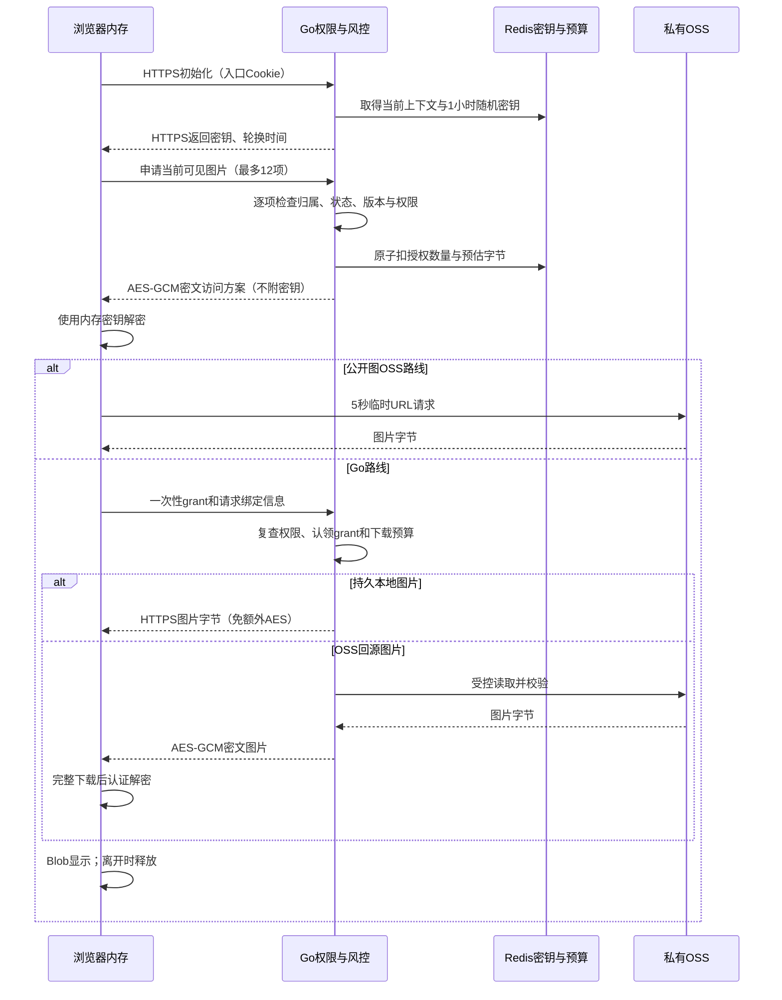

# R24-安全性更新

2026 年 11 月 25 日起，正式站已上架商品的图片统一走 OSS 短签，浏览器在当前授权通过后可从 IndexedDB 复用图片。下文的 20% Go、80% OSS 分流是 11 月 15 日的设计基线。现行参数及实测见[商品图片正式发布记录](../计划/RELEASE--测试环境发布记录.md)。

## 授权与目标

2026年11月15日，用户授权实现、验证并推送GitHub，依次部署152测试环境和8.140正式环境。响应包装密钥自签发起**1小时**轮换，OSS签名链接固定**5秒**。短信业务状态机、额度、开关及供应商调用不改，不发送真实短信。公共传输层统一覆盖短信接口的业务响应。用户随后要求服务器本地图片免额外AES，并实测加解密和实际观看耗时，该例外纳入本轮。

本轮提高直接读取业务响应的门槛，并通过公开商品图片直连OSS改善公网加载；AES不是权限或防刷边界。当前文档描述设计与实现约束，实际启用和测试结果以R24验收与发布回执为准。

## 共用协议与代码边界

- Go统一使用AES-256-GCM封装业务正文，前端双端复用共享解密客户端，不在每个业务接口复制密码逻辑。HTTP使用二进制密文，避免图片Base64体积膨胀；实时聊天适配器共用同一密码原语与密钥服务。
- 32字节安全随机会话密钥、12字节随机且同密钥不重复的nonce、16字节认证标签。时间只用于轮换，不从时间戳生成密钥。AAD绑定协议、当前上下文、请求目标、状态、关联编号和原始类型。
- `/api/v1/response-crypto/init`属于明确的HTTPS控制例外；没有额外AES包装，仍经TLS保护。初始化按来源、会话和频率约束，返回当前密钥或当前上下文保留期内的指定旧密钥。不能借初始化获得业务权限。
- 用户端、管理端及不同会话相互隔离。轮换周期3600秒，旧密钥兼容窗口120秒。前端以响应key ID选择密钥，不能按客户端当前小时推导；密钥只在内存中保留。服务器停止提供旧密钥不会让已保存的密钥失去数学解密能力。
- 缺密钥最多补取一次并重解已有响应；正确密钥仍校验失败则报错。写操作不能因解密失败重新执行。登录、退出、切换身份清除旧上下文，并阻止迟到响应回填新身份。
- JSON成功与业务错误、上传非空响应、Go回源OSS的媒体正文、WT/WS业务下行均纳入。HTTP状态和必要头、页面静态资源、无正文响应、协议控制/握手和最小无业务数据的初始化错误为明确例外。网关自行产生的错误按连接错误处理。
- 本地图片由存储适配器标记`ServerLocal`，授权读取后通过内部上下文声明例外；成功图片正文流式透传，返回`X-QY-Response-Mode: local-image`及匹配的协议/上下文/请求元数据。前端仅在受控媒体路径、合法图片MIME与匹配请求下接受，不放开JSON明文。回源OSS的短时落盘不能被误判为本地持久图片。
- 上行请求保持既有业务协议与HTTPS；不增加UA指纹、请求头密码散列或按IP全局递增序号。服务器开启强制加密后不能由客户端参数请求明文降级。

## 公开数据的压缩

加密后的字节不能继续依靠Nginx有效压缩。浏览器支持`DecompressionStream`时声明`X-QY-Accept-Encoding: gzip`，Go对public入口成功GET的categories、home、products及规范商品详情/图片列表，在JSON正文至少1KiB且压缩后更小时先gzip，再统一AES-GCM。私密资料、管理端、认证、短信、聊天、错误与图片不参与压缩；不支持解压的浏览器继续使用identity AES。

`X-QY-Content-Encoding`只能为identity或gzip，并加入HTTP AAD最后一项，与方法、路径、状态及原MIME一同认证。本地图片例外固定identity。解密后解压上限4MiB，浏览器拒绝不在允许范围的压缩响应；服务器将压缩输入、输出和工作区计入既有128MiB响应缓冲预算，预算不足时使用identity。密钥不随业务响应再次传输。

## 图片分发细节

访问方案接口只接收受控媒体引用和规格，每批最多12项，并限制请求体。每项复用现有商品可见性、图片归属、会话权限及原子预算；不接受任意OSS对象键或外部URL。不得为启用直连关闭`MEDIA_SAFETY_ENABLED`。

公开商品图以约20% Go、80% OSS为目标分流。路由由服务器稳定决定，客户端拆批或刷新不能重抽。单图优先OSS的判断基于真实商品资料，不以客户端提交一项作为强制直连开关。草稿、聊天附件和私密媒体继续走受控Go。

OSS路线只返回精确对象的5秒签名链接，不在签发阶段先下载整张图片；浏览器解密访问方案后立即用原生图片请求读取OSS。签名时间包含传输和解密等待，按可见区临用申请，不提前签完整图集。有限补签继续计额度。

Go路线实际读图仍需复查权限、限制并发，并沿用完整读取校验；内部短时授权记录仅用于衔接预扣预算，不能替代业务鉴权。OSS回源图片密文完整接收并校验后才生成Blob展示。本地源图片跳过AES，但共用的安全fetch组件仍在完整下载后生成Blob，不能宣称恢复原生渐进显示。离开可见区域、换图或退出释放内存，恢复并发和总次数有界。

授权数量及预估字节与Go实际传输指标分开统计。OSS链接在有效期内可以重复/并发使用，Go无法实时控制这些下载；20%的Go路线不监管另外80%的实际流量。5秒过期不保证中止已开始的下载，也不能撤销已下载图片。

旧媒体别名、原图、预览和缩略图入口共用权限与响应封装，不保留静默明文旁路。直接OSS读取不再逐次经过Go的完整SHA/MIME校验，依赖上传/上架校验、精确对象映射与私有存储权限。

## 存储与配置

复用现有`qingye-test/media/legacy/`历史图与`r20/production/objects/`新图。不复制整套OSS、不通过改名前缀制造副本，不扩大云权限或改变生产/测试删除隔离。生产只保持受控短时读取和上传暂存，不增加本地整套历史原图。

初始化和业务响应禁止缓存。日志不写原始密钥、Cookie、完整签名URL和业务正文。OSS原生图片请求与脚本fetch的CSP/CORS要求分别验证，不添加通配来源。保留既有Nginx其他项目、短信配置及5178原型masked状态。

## 验证和发布

三轮审查分别覆盖功能与协议、资源与并发、权限与失败处理。测试包含真实Go/浏览器WebCrypto兼容、跨小时和旧key、跨上下文拒绝、密文/头篡改、业务错误、登录退出、上传恢复、WT/WS顺序、Go Blob释放、5秒链接有效/过期、小批量逐项鉴权及预算。

性能分别记录服务端生产`Seal`路径的纯加密、浏览器WebCrypto纯解密、请求到图片可见总耗时；按64KiB、512KiB、1.4MiB、5MiB、10MiB合成载荷测算密码计算，真实商品图小样本测网络和渲染。测试/生产主机和本机Chrome的结果分开，桌面手机视口及CPU/网络模拟不能冒充真实手机硬件。

后端先执行专项、真实隔离PG/Redis全量及race、vet、构建和漏洞检查。隔离HTTP按functional→concurrency→security执行，启用R24响应协议；前端执行双端测试、正式构建和浏览器检查。测试服务器约2GB内存，重任务串行。

先发布152并核对实际进程二进制、前端资源、配置、健康和浏览器，再发布8.140。发布前保存本项目配置、数据库和版本链接，校验候选产物散列；失败恢复对应前后端与配置，不能仅将图片改回全Go就声称协议回退完成。公开站只读验收与管理员登录/退出不替代生产写入和真实短信验收。

后续ESA以稳定媒体ID与版本对接边缘鉴权/缓存；本轮不购买云服务、不改DNS。
