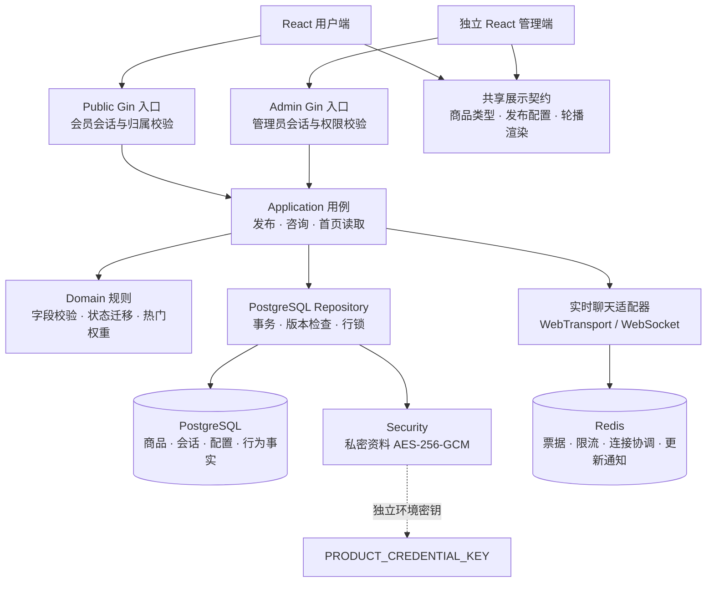
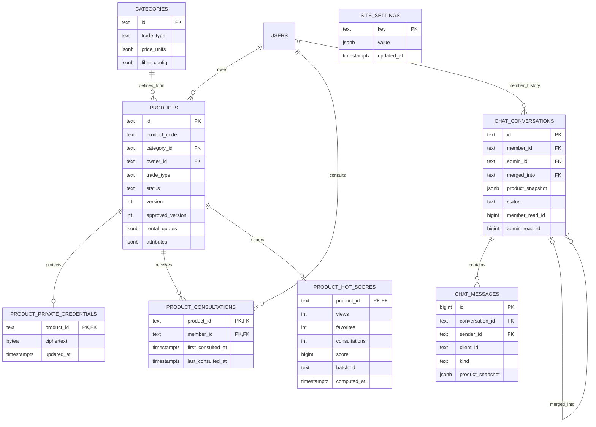
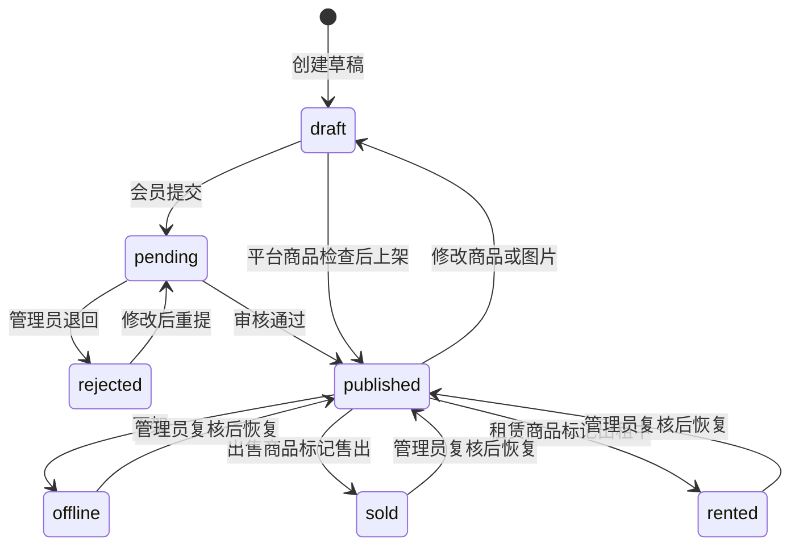
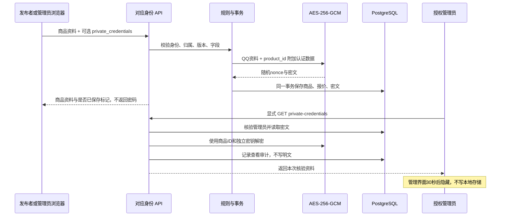
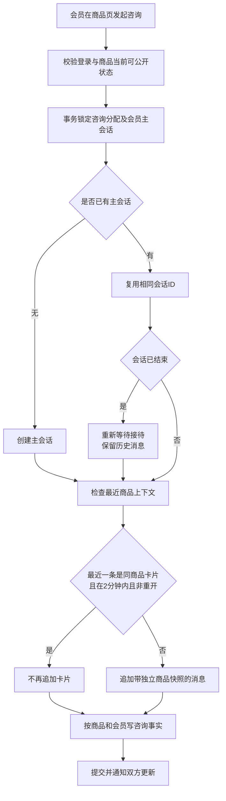
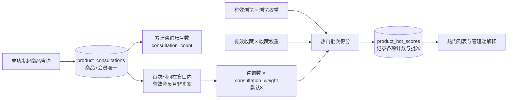
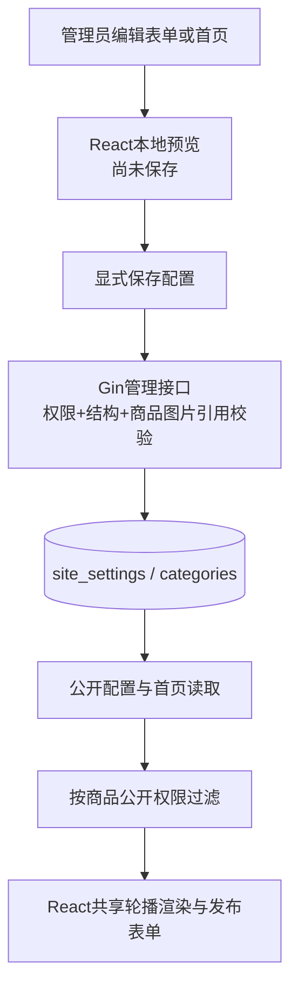

# R15 商品咨询与运营配置设计

本文描述 R15 的代码与数据契约，不作为部署完成或验收通过的证明。测试结果、发布版本与环境信息由本轮验收记录单独维护。

本轮沿用 React 用户端、独立 React 管理端及 Gin 分层后端；图片存储方案不在本轮调整。完整分层约束见 [Gin 分层设计](ADR-GIN-LAYERS--Gin分层与安全性能设计.md)，既有推荐算法见 [热门推荐算法](10-recommendation-design--热门推荐算法.md)。

## 1. 架构增量



- 用户站和管理站保持独立入口与会话 audience，管理界面的隐藏按钮不能替代后端授权。
- 商品保存、状态迁移、私密资料写入与咨询去重由服务端完成；React 负责表单、预览、错误反馈和交互。
- Redis 不保存商品密码或聊天正文。PostgreSQL 保存业务事实，实时通知仅提示客户端重新读取有权限的数据。
- 两端共用 `代码/前端/共享/CarouselSlidePreview.tsx` 与 `home-content.ts`，使管理员预览与公开轮播使用同一布局实现；`publish-form.ts` 提供通用字段配置契约。

## 2. 数据结构与 E-R 增量



图中 `USERS → CHAT_CONVERSATIONS` 包含被合并的历史行。部分唯一索引 `chat_one_customer(member_id) WHERE merged_into IS NULL` 限制每个会员只能保留一条主会话；历史行保留 ID 映射，不出现在普通会话列表中。

`site_settings` 的 `home_presentation.slides`、`publish_form` 和 `recommendation` 为 JSON 配置。轮播中的商品与图片引用在保存时由服务端校验，并非数据库外键。租赁报价最多四项，采用商品行内 JSONB，不另建报价表。

迁移文件：

- `代码/后端/internal/maintenance/migrations/0005_product_workflows.sql`：编号序列、租赁报价、私密资料表、商品状态及已有人工轮播配置迁移。
- `代码/后端/internal/maintenance/migrations/0006_customer_consultations.sql`：主会话约束、历史商品消息快照、咨询事实表、热门咨询计数。

## 3. 商品编号、报价与状态

### 编号和游戏

出售使用 `QYCH` 前缀，租赁使用 `QYZH` 前缀。创建商品时由服务端分别递增对应 PostgreSQL 序列，并与相同前缀的历史最大数字核对；按前缀的事务锁（advisory lock）避免并发创建时重复分配。编号是前缀加数字，不强制补零，不修改旧商品编号。

商品保存后租售类型固定。若要从出售改为租赁或反向变更，应新建资产，避免编号与历史咨询发生歧义。分类模板仍可在相同租售类型下调整。公开游戏属性统一为 `QQ炫舞`，历史来源载荷不因展示名称统一而改写。

### 多租期报价

写入示例仅展示公开报价结构：

```json
{
  "trade_type": "rent",
  "rental_quotes": [
    { "unit": "month", "amount": "450.00" },
    { "unit": "day", "amount": "85.00" }
  ]
}
```

- 租赁支持 `hour/day/week/month`，具体可选单位以所选发布模板的 `categories.price_units` 为准。主报价及每条附加报价均由后端校验；同一单位只能出现一次，金额为非负十进制字符串，最多两位小数。
- 模板 `price_units` 为空数组时保留原有默认语义：租赁可选四种租期，出售使用账号总价；非空数组表示明确限制。
- 第一项同步成为 `price_unit/price_amount`，用于列表主报价和排序。管理编辑器将主报价放在第一项，避免附加报价覆盖管理员填写的主价。
- 出售使用总价 `account`，不接受租赁报价。日价、月价独立填写，不互相推算；原站未知单位仍保留待核对语义。
- 切换模板或模板缩减可用单位后，编辑器保留不再支持的旧报价并提示人工核对，不静默删除；上架及编辑提交须符合当前模板规则。
- `attributes.custom_tags` 最多 12 个标签、每个 24 字，服务端拒绝重复和空标签；历史 `attributes.tags` 保持独立，不搬入新增字段的额度。普通账号属性不能承载私密凭据字段。

### 商品生命周期



公开条件仍为 `published`、`approved_version == version` 且分类启用。状态写入携带 `expected_version`，并在事务中锁定商品；提交或上架重新检查必填资料、分类和所有图片就绪状态。`sold/rented` 只记录运营状态，不代表站内支付或合同已经完成。

## 4. 私密 QQ 资料流转



- 专用字段为 `private_credentials: {qq_account, qq_password}`。二者必须成对填写；编辑时整个字段不传表示保留已有资料，不从公开属性回填密码。
- `PRODUCT_CREDENTIAL_KEY` 是 Base64 编码的 32 字节密钥，与会话密钥分离。AES-GCM 使用随机 nonce，并以商品 ID 作为附加认证数据，避免把一个商品的密文直接移植为另一个商品的凭据。
- 明文仅在专用管理接口 `GET /api/v1/admin/products/:id/private-credentials` 显式读取。商品列表、公开详情、聊天商品快照、轮播与上架预览均不包含 QQ 密码。
- 密文和密钥必须分别管理。数据库备份不等于密钥备份；未来轮换密钥需设计重新加密流程，不能直接替换环境密钥后期待旧数据仍可解密。
- 本设计保护数据库静态存储与接口边界，不替代 HTTPS、管理员账号权限或客户端终端安全。

## 5. 一位会员一条客服会话



会话的 `product` 是最近咨询商品，`product_count` 是该会话中商品消息涉及的不同商品数量。每条 `kind=product` 消息有自己的 `product` 快照；界面必须使用消息上的快照展示历史卡片，不能用会话最近商品替代全部历史内容。

连续双击同商品、短时间重复打开同商品不会生成第二个聊天框。换一个商品会在同一聊天中加入新的商品上下文；已结束会话从商品页重新发起时重新进入等待接待，保留此前历史。

迁移优先保留活跃接待会话，其次等待会话，再比较更新时间；其余会话消息合并到主会话。若旧消息的发送人和幂等键发生冲突，迁移为历史消息生成不同键以保留原内容。`merged_into` 允许旧链接解析到主会话，但解析后仍执行会员归属或管理员接待权限检查。

通信保持 WebTransport 优先、WebSocket 兼容，消息以数据库提交后确认作为成功依据。表情作为普通 Unicode 文本保存，快捷回复先放入草稿，由管理员确认发送。本文会话模型替代 [早期聊天说明](CHAT-WEBTRANSPORT--商品咨询通信说明.md) 中“每个商品一条未结束会话”及“结束后另建会话”的旧规则。

## 6. 咨询人数与热门

`product_consultations(product_id, member_id)` 联合主键保证同一会员对同一商品只有一条咨询事实。首次咨询写 `first_consulted_at`，后续仅更新 `last_consulted_at`；卖家咨询自己商品不增加事实。

- 商品展示字段 `consultation_count` 是该商品咨询事实总数，即累计不同会员账号数，不是消息数、点击数或经过实名认证的自然人数。
- 热门快照 `consultations` 只统计首次咨询落在窗口内的有效会员，排除停用会员、非会员角色及商品所有者。默认窗口为含当天的 7 个北京时间自然日，默认咨询权重 8。
- 重复咨询和重新开启旧会话不能刷新首次时间。因此，7 天前已咨询过的会员今天再问同一商品，不重新贡献咨询热度。
- ItemCF 继续按共同浏览计算关联，不把咨询消息或私密资料作为训练输入。咨询只参与独立热门分及使用热门分的既有回退或同分排序。



## 7. 发布表单与人工轮播配置

| 配置 | 存放位置 | 可编辑范围 | 固定边界 |
| --- | --- | --- | --- |
| 通用输入框 | `site_settings.publish_form.fields` | `title/description/custom_tags/private_credentials` 的显示名称、提示、启停和必填 | 标题与介绍始终启用且必填；禁止“停用但必填” |
| 发布模板与属性 | `categories.filter_config` | 标签、提示、文本/单选/多选、选项启停、必填 | 属性键与选项值用于历史关联；服务端验证有效选项 |
| 人工轮播 | `site_settings.home_presentation.slides` | 独立文案、商品、图片、图文布局、文字位置、图片焦点 | 最多12张且商品不重复；服务端校验引用；无自动商品文案填充 |

`GET /api/v1/publish-form` 返回公开表单规则，未配置时返回服务端默认值。两端按同一规则显示输入框。完整性要求在提交审核或上架时由服务端再检查，保存草稿可保留尚未填写的必填内容。禁用字段不应在前端留下无法填写的强制校验。

轮播单项使用以下字段：

| 字段 | 含义 |
| --- | --- |
| `productId`、`imageId` | 关联商品与该商品的可展示图片；图片可省略以使用封面 |
| `title`、`description` | 管理员独立编写的大标题与介绍，分别最多100和300字 |
| `tradeLabel/serverLabel/priceLabel` | 独立展示的租售说明、区服、价格，分别最多24/60/60字 |
| `layout` | `image-right/image-left/overlay` |
| `textAlign`、`verticalAlign` | 文字左中右、上中下位置 |
| `imageFit` | 完整展示 `contain` 或铺满裁剪 `cover` |
| `imagePositionX/imagePositionY` | 图片焦点百分比，0–100 |



清空 `slides` 后不再展示轮播，不用热门或最新商品自动补位。旧 `manual_rank` 只在迁移时一次性转换已有人工选择，运行时以 `slides` 为准。商品下架或分类停用后，关联轮播不会继续公开展示。

轮播价格是独立运营文案，商品价格改变不会自动改写轮播文字；管理员应同时核对二者。图片选择分页加载缩略图，公开轮播只读取需要展示的图片，避免为了选图一次下载整套商品原图。

## 8. 接手时应保持的约束

1. 不将 `private_credentials` 加入公开 DTO、聊天快照、日志、预览或本地持久化；新增私密字段继续走专用加密表与接口。
2. 不删除主会话唯一约束、商品版本检查或咨询联合主键来解决前端重复显示问题。
3. 不使用 `last_consulted_at` 替换热门的首次时间窗口，避免反复咨询刷新热度。
4. 调整发布字段时同时核对用户表单、管理表单、保存草稿和提交审核的行为，不能仅修改配置界面。
5. 修改轮播布局优先修改共享渲染器；空轮播必须保持为空，不能恢复自动摘抄商品长标题的回退逻辑。
