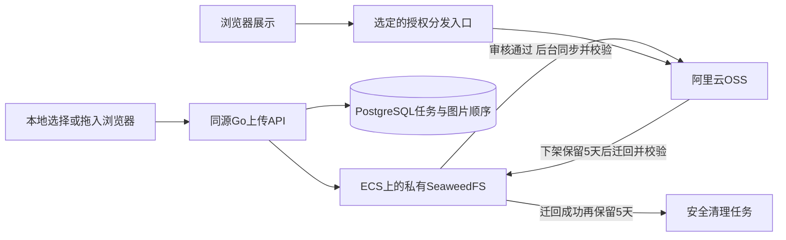

# STORAGE-R20 -- ECS存储选型与测试环境方案

最新实施口径：单次选择或拖入1—99张，100张及以上整批拒绝且不发送上传请求；300张按99＋99＋99＋3分四批追加，不设商品总张数上限。隔离测试使用每张1—10KB的合成图片。用户端只展示上传进度和“上架中”等业务状态；对象键、存储位置、迁移/清理阶段与技术错误仅在管理端授权接口展示。已授权实现、隔离验收后部署152测试环境并推送GitHub；未有实际回执前不得标记已上线。

日期：2026年11月13日。状态：R20选型与实施方案，已授权在152测试环境实施并验收；部署结果另记。关联[图片需求](../前期设计文档/MEDIA-R20--商品图片上传存储与展示需求.md)、[Go安全模块](SECURITY-R20--Go安全模块设计.md)及[验收清单](../计划/MEDIA-R20--实施与验收清单.md)。

## 1 选型结论

首选SeaweedFS作为ECS上的私有暂存对象存储，以S3接口对接Go。依据是持续维护、可用的S3与分片能力、单机起步及后续扩展方式，匹配大量商品图片暂存。性能要在152实际磁盘、内存和业务负载下测量，不能从宣传吞吐推导本项目容量。

| 候选 | 本轮判断 |
| --- | --- |
| SeaweedFS | 首选。官方仓库约3.6万Star，当前latest发布为4.53，2026年11月8日发布；Star仅是社区关注度，不能等同真实使用人数。采用锁定版本和校验后的产物。[仓库](https://github.com/seaweedfs/seaweedfs)、[发布页](https://github.com/seaweedfs/seaweedfs/releases/tag/4.53) |
| MinIO原社区版 | 不用于新接入。官方仓库已于2026年4月25日归档并明确不再维护；AIStor是另一产品线，不能混称为继续更新的原社区版。[官方状态](https://github.com/minio/minio) |
| Garage | 备选，官方2.5.0于2026年10月24日发布，提供S3与Go接入，定位小规模自托管；仍需核对所用S3操作及运维方式，当前没有为它增加第二套适配的必要。[发行列表](https://garagehq.deuxfleurs.fr/_releases.html)、[Go接入](https://garagehq.deuxfleurs.fr/documentation/build/golang/) |
| 现有私有文件目录 | 保留现有图读取兼容和发布失败时的现行业务；新增对象存储通过适配接入，不先批量搬走历史原图 |

历史记录中的152曾安装SeaweedFS而未接应用。本轮已新增专用适配并在隔离范围验证真实读写，不能恢复旧暂停代码或覆盖历史数据。采用单机私有S3形态，不引入Kubernetes、纠删码或多机集群；单机仍是单机故障域，不等于高可用。官方[单机入门](https://github.com/seaweedfs/seaweedfs/wiki/Getting-Started)只作部署依据，实际启动组件和监听端口必须逐项检查。

## 2 与Go和OSS的关系



Go使用AWS SDK for Go v2访问SeaweedFS，OSS使用独立阿里云适配。两者已在普通R20构建链接，由显式配置启用；旧 `oss_read` 预备包仍独立关闭。应用层统一上传、读取、校验和精确删除，数据库保存媒体ID、提供方、键、代次/散列和有效位置。不能假定两者只换Endpoint就全部API语义相同。最新要求每张新商品图只持久保存一张安全重编码后的展示原图，不生成独立预览小图，浏览器blob预览保留，迁移临时双副本仍允许。

SeaweedFS[官方S3兼容表](https://github.com/seaweedfs/seaweedfs/wiki/Amazon-S3-API)列出分片创建、上传、完成、取消和查询操作。存储支持分片不等于浏览器自动支持续传；上传会话、文件匹配、顺序、重试和取消仍由前后端共同实现。当前R20使用受控分片会话，页面内恢复先对账已确认偏移；跨页面重选File恢复未完成队列仍未实现。

该兼容表还列出删除目录和上传解压等扩展，与AWS纯对象使用习惯有差异。适配器只接受数据库绑定的精确文件对象键，拒绝空键、目录键、任意前缀删除；不启用上传解压扩展，不转发客户端提供的存储扩展头。续传、HEAD/校验、删除和签名行为须做提供方兼容测试。

只开放应用所需的私有S3入口，Master、Volume、Filer、管理UI和控制接口不公开；Go使用限定暂存范围的凭据，用户浏览器不持有长期存储密钥。部署时关闭不需要的协议入口，不能直接照抄示例中的开发口令或匿名模式。

## 3 五天清理与磁盘空间

商品留存由Go持久任务决定，不直接给整个桶配置统一五天自动删除；否则上架、重上架、审核和迁移窗口会被绕过。

SeaweedFS删除对象后，卷文件的空间通常需要后台压缩回收；对象不可读不表示磁盘立刻变空。应记录访问撤销、对象删除和物理回收三个结果，并为压缩保留空间。官方[FAQ](https://github.com/seaweedfs/seaweedfs/wiki/FAQ)和[Master回收说明](https://github.com/seaweedfs/seaweedfs/wiki/Master-Server-API)描述了这一机制。

152部署前需核对可用磁盘，按实际余量设置卷大小、分配数量、回收阈值及水位，不能直接沿用较大的默认卷配置。容量预算必须覆盖已有文件、新暂存、未完成分片、重编码中间文件、迁移短暂双副本、日志及压缩工作空间。接近水位时先暂停新上传和新的迁回任务，保持OSS源图；不能为了腾空间先删唯一有效图。该服务器级保护不修改现有账号2 GiB额度口径。

清理验收包括连续上传/到期删除后的实际磁盘回收，不只检查DeleteObject返回成功。单份业务文件与备份策略分开；本轮不自行扩展多副本或删除历史备份。

## 4 腾讯云先测试 阿里云后生产

| 项目 | 152腾讯云测试端 | 未来阿里云北京生产端 |
| --- | --- | --- |
| 暂存 | 本机私有SeaweedFS，独立测试目录/桶及凭据 | 同样的存储适配，独立生产数据及凭据 |
| ECS至OSS | 公网Endpoint；不能用阿里云内网地址 | 同地域内网Endpoint，单独核验实际网络可达性 |
| OSS数据范围 | 优先独立测试桶；或在权限受限的测试前缀下验证，不混入历史迁移目录 | 独立生产范围，按已核对的迁移映射接管 |
| 生命周期 | 在隔离库和测试对象范围先演练 | 业务期限保持5天加5天，经迁移验收后启用 |
| 图片展示 | 新版仅对完成验证且明确启用范围的素材测试新链路 | 域名、边缘防护与生产权限落实后启用 |

用户此前说明腾讯公网带宽3 Mbps、流量包300 GB，当前剩余额度和带宽仍需部署前确认。假设腾讯至OSS可持续跑满3 Mbps，100 MB约需267秒，300 MB约需800秒；这是十进制大小的理论下限，含重试或与历史复制共享带宽时更慢。不能将套餐出网带宽直接等同浏览器上传入网限速。

因此用户端只展示上传进度及“上架中”等业务状态；ECS/OSS同步进度、重试与失败原因仅由管理员查看。迁移后台限速、限并发，旧复制与新任务统一评估出网占用；不要让HTTP请求等待几百张同步完，也不要因网络慢误报失败或先删ECS文件。跨云测试的流量与延迟不能作为未来同地域内网性能结论。

腾讯至OSS上传会使用腾讯出网；OSS回迁腾讯属于OSS外网下载，会产生相应OSS外网流出计量，腾讯300 GB流量包不能抵扣阿里云账单。因此真实往返测试使用少量专属测试对象，避免反复搬整套历史原图，不自动购买加速或流量包。[OSS流量计费](https://help.aliyun.com/zh/oss/traffic-fees)

## 5 今晚更新的实施顺序

目标是可验证的R20测试交付，具体完成范围以实际代码和检查结果为准，不能仅因计划今晚发布就跳过验收。

1. 取得最新源码、确认R19运行版本，检查磁盘/内存/端口/SeaweedFS现状、OSS复制进度与映射；旧R16工作树不能直接构建覆盖测试环境。本轮已取得b5e97dd干净基线，提交与发布前仍须核对远端变化。
2. 在独立验收环境接暂存适配、Go安全规则、批量上传/续传/排序，使用新测试商品和专属对象范围验证。失败时保留现有服务，不能靠放宽鉴权赶进度。
3. 覆盖99＋99＋99＋3四批累积300张、顺序调整、断网恢复、重试/取消和手机内存，再验证少量对象ECS→OSS→ECS的真实校验与清理。
4. 五天加五天的状态转换用隔离时钟或测试记录演练，检查任务重启、重新上架和停权竞态；共享测试环境仍保留真实期限，不能全局改成几分钟。
5. 完成三轮审查及同版本功能/并发/性能/安全检查后，部署152新版本并核对构建与回执。先启用验证通过的新素材范围，历史图仍沿用原路径；每个读写和清理开关的状态都记录清楚。
6. 历史复制完成并核对全部映射、当前商品状态和新旧差异后，再单独接管旧图；不因R20部署顺带批量迁移、删除旧图。CDN域名尚未落实时如只完成部分展示验证，发布记录明确标注，不能声称整套R20已完成。

所谓分阶段启用是本轮实施建议，不改变此前“图片未传完，现有OSS读取预备代码保持关闭”的要求。对新测试素材接新链路须有独立范围和验证证据，不能取消旧全局保护开关。

## 6 图片数量与排序验收

1—99张是一次本地拖入/选择的数量，同一商品分批累计200—300张及更多。当前不新增固定总张数限制，仍保留真实字节、容量与并发保护。

旧本地用户/管理`ImageUploader.tsx`及共享`ordered-uploads.ts`已有拖入、多文件选择、选择顺序保持和上传后前后移动。R20复用并在最新源码验证，不把这些入口当作已实现完整队列拖拽、跨页排序及300图性能。

- 队列排序保持稳定ID，网络完成先后不改变用户排列；断网或失败重试回到原位置。
- 上传后拖拽或移动、跨批次调整、设封面与预览一致；刷新后读取服务端保存顺序。
- 排序只更新图片关系，不重新上传、重命名或复制对象；并发冲突显示恢复路径，不能静默覆盖。
- 300图使用按需加载、分批渲染及及时释放本地blob预览URL，手机支持触控与按钮操作，不一次解码全部原图；小尺寸显示不等于另外持久生成小图。历史R19缩略图规则保持。

## 7 R20磁盘水位与压缩维护验收

### 7.1 准入保护

R20启用时，`MEDIA_R20_MIN_FREE_BYTES` 默认保留2 GiB；这是宿主机磁盘可用空间底线，独立于用户账号额度。非R20本地适配的默认值为0，保持原行为。`mediafiles.CheckAvailable(path, reserve, requiredBytes)` 使用Linux的可用块数或Windows当前用户可用字节数，目标目录未建立时只读取最近存在父目录，拒绝路径中的符号链接，不创建测试目录。容量检查失败对用户统一返回图片存储暂不可用，不公开磁盘目录。

整图接收、分块接收和分块提交在新增文件写入前检查容量；图片净化按最多64 MiB输出预留。对象适配写本地spool前检查临时目录；写入本机SeaweedFS前还检查 `MEDIA_STAGE_CAPACITY_PATH` 所在磁盘，避免将来临时目录与存储卷分属不同挂载点却只查一个磁盘。远程S3不能用应用主机的空闲量代替存储服务器容量，应接入存储侧监控。读取、删除和已提交分块的只读校验不受水位拦截；新数据不足时保留原有效副本和任务状态。

这些是写入前的容量快照，不是跨进程磁盘预留，也不保证其他进程同时写入时仍严格保有2 GiB。因此仍需限制上传/净化/迁移并发、监控实际可用空间及SeaweedFS增长，并给数据库、Redis持久化和日志留余量。配置目录必须由运维控制，容量探测不替代对象键校验和文件系统访问边界。

### 7.2 删除与物理回收的区别

S3精确对象删除后，先验证该键不可读取；磁盘是否回收要另外看卷文件和文件系统可用字节。SeaweedFS 4.53压缩会创建 `.cpd`、`.cpx` 等新文件，在提交后交换有效数据文件；原卷与压缩副本会短暂共存。依据为固定版本的[压缩实现](https://github.com/seaweedfs/seaweedfs/blob/4.53/weed/storage/volume_vacuum.go)，不能将DeleteObject成功作为立即释放物理空间的证据。

当前测试方案采用512 MiB卷和2 GiB应用水位：512 MiB是单卷大小配置，不是所有存储的总上限；多个卷、索引、未完成分块和其他服务都另外占用磁盘。压缩一个卷至少还需要存活数据的新副本、新索引/临时索引和压缩期间新增写入的空间。2 GiB约为四个512 MiB，但不能据此保证四卷并行压缩安全，也不能把保留量当作SeaweedFS预分配的专用空间。

本轮维护验收只串行压缩一个卷，并在2 GiB底线之外额外要求工作空间：`max(512 MiB, 目标.dat逻辑大小 + 4 × .idx大小 + 256 MiB)`。这是本项目保守的运维准入估算，不是SeaweedFS官方给出的硬上界；索引规模、其他写入和卷配置改变后需重估。默认512 MiB工作空间时，脚本要求至少2.5 GiB可用。缺少余量时停止新增上传/迁回，不删除唯一有效源图，也不以清除Filer、Master或Volume元数据的方式腾空间。

### 7.3 仅隔离桶的可执行检查

脚本：[r20_storage_vacuum_check.py](../../代码/工具/r20_storage_vacuum_check.py)。本地12项脚本安全测试通过；152已完成限定卷的小样本物理回收验证，证据见下节及[R20隔离验收记录](../业务验收与审查记录/MEDIA-R20-ACCEPTANCE--商品媒体隔离验收记录.md)。这不代表满卷容量或生产维护吞吐已经测定。

- 固定桶及collection为 `qingye-acceptance`，拒绝其他桶、远程S3/OSS和非回环地址；版本限定SeaweedFS 4.53。
- 默认只读，读取全量拓扑是为了发现跨collection重复卷ID。存在重复ID、解析失败、远程卷或目标归属不符时拒绝维护；不会执行全局vacuum。
- `--exercise` 只生成14张约3 KiB的PNG，使用本次随机运行ID的精确对象键。先保留两张验证相邻对象未受影响，再删除其余对象并确认404；最终只清理本次生成的键。没有目录删除、批量前缀删除、桶删除或文件系统删除调用。
- `--vacuum` 必须同时提供 `--exercise` 和已经核实的正整数 `--volume-id`。命令同时携带固定collection和单卷ID；只压缩这个卷，不触发整个collection扫卷。精确删除后每3秒检查该卷DeleteCount/DeletedByteCount，最多45秒，只有相对删除前基线都增加才请求压缩；超时失败留证，不以404或固定睡眠代替异步删除传播验证。压缩前再次检查归属与可用空间。
- 记录已有对象的键/大小/ETag清单、存活样例内容哈希、卷 `.dat/.idx` 状态、分配块数及磁盘可用空间。其他collection文件在检查期间变化会标记结果不确定，不能直接归因为本脚本，也不能据此宣称完全隔离。目标卷未观察到实际分配块减少则失败并保留报告，可能选中了没有本次删除数据的卷；不能只因vacuum返回成功就写“物理回收通过”。

运行前，在152本机已有的私密环境中加载验收环境变量，不把密钥写入命令行或仓库。确认存储服务实际数据目录、Master回环端口、验收任务无并发写入后执行。下面的变量值必须从实际部署读取，示例不猜测卷ID或卷目录：

```bash
export PYTHONUTF8=1
# 已加载：MEDIA_R20_ENVIRONMENT=acceptance、MEDIA_STAGE_BUCKET=qingye-acceptance
# 以及MEDIA_STAGE_ENDPOINT、MEDIA_STAGE_ACCESS_KEY_ID、MEDIA_STAGE_ACCESS_KEY_SECRET。
# STORAGE_VOLUME_DIR为已核实的卷数据目录；STORAGE_MASTER为已核实的回环host:port。
# STORAGE_REPORT_DIR为仓库外的私密验收报告目录；TOOLS_DIR为本次发布的代码/工具目录。

python3 "$TOOLS_DIR/r20_storage_vacuum_check.py" \
  --master "$STORAGE_MASTER" --volume-dir "$STORAGE_VOLUME_DIR" \
  --report "$STORAGE_REPORT_DIR/storage-preflight.json"

python3 "$TOOLS_DIR/r20_storage_vacuum_check.py" \
  --master "$STORAGE_MASTER" --volume-dir "$STORAGE_VOLUME_DIR" \
  --exercise --report "$STORAGE_REPORT_DIR/storage-exact-delete.json"

# 根据预检报告与最新volume.list核实该卷属于qingye-acceptance且已有删除数据，设置STORAGE_VOLUME_ID。
python3 "$TOOLS_DIR/r20_storage_vacuum_check.py" \
  --master "$STORAGE_MASTER" --volume-dir "$STORAGE_VOLUME_DIR" \
  --exercise --vacuum --volume-id "$STORAGE_VOLUME_ID" \
  --report "$STORAGE_REPORT_DIR/storage-vacuum.json"
```

脚本通过 `weed shell -master=...` 执行 `lock`、`volume.vacuum -collection=qingye-acceptance -volumeId=已核实ID -garbageThreshold=0`、`unlock`。这把锁用于运维命令互斥，不代表暂停应用写入；必须在隔离验收空闲窗口测试，不抢占其他管理员锁。脚本等待上限240秒；超时只意味着客户端观察结束，不能认定后台压缩已经停止，需检查实际状态再决定重试，禁止强制解锁后盲目重跑。依据为4.53的[Shell启动参数](https://github.com/seaweedfs/seaweedfs/blob/4.53/weed/command/shell.go)、[卷列表及重复ID检查](https://github.com/seaweedfs/seaweedfs/blob/4.53/weed/shell/command_volume_list.go)、[锁操作](https://github.com/seaweedfs/seaweedfs/blob/4.53/weed/shell/command_lock_unlock.go)及[指定collection/卷的压缩参数](https://github.com/seaweedfs/seaweedfs/blob/4.53/weed/shell/command_volume_vacuum.go)。

最终清理两张存活样例还会产生少量待回收空间，这部分不再次自动压缩；报告分别保留“压缩后”和“样例清理后”快照。脚本从不清除元数据目录，测试中也不通过重建存储服务伪装回收成功。

### 7.4 本轮真实观测与剩余验证

主验收已在152运行14张专属PNG的S3上传、GET完整内容校验、精确删除及存活样例检查，报告为仓库外的 `/root/qingye-private/r20-20261113/storage-exercise.json`。服务用户 `qingye-test` 对700权限存储目录执行statfs成功，未为探测扩大目录权限。

另用[单对象元数据探针](../../代码/工具/r20_storage_metadata_probe.py)创建一张3172字节PNG，仅查询该对象Filer元数据后精确删除：`inline_bytes=0`、chunk的fileId属于卷2、collection为 `qingye-acceptance`。这份实测排除了“小图未入卷”的推测；Master拓扑曾短暂报告该卷8字节，属于滞后观测，不能用旧拓扑数字取代对象chunk证据。固定4.53的[S3写入实现](https://github.com/seaweedfs/seaweedfs/blob/4.53/weed/s3api/s3api_object_handlers_put.go)显式设置 `SaveSmallInline=false`，不可将邻近smallFileLimit常量误读成S3实际启用inline；Filer HTTP的saveToFilerLimit属于另一条路径。

首次指定卷2压缩尝试未观察到物理块减少，脚本正确失败，未扩大到其他卷且本次样例全部清理。增加删除计数的有界等待后，152真实重跑通过：只压缩卷2 / `qingye-acceptance`，`.dat`逻辑大小减少84,656字节，分配块减少122,880字节，压缩用时0.416秒；已有对象清单与其他collection文件保持不变，最后fixture键清单为空。私密报告为 `/root/qingye-private/r20-20261113/storage-vacuum.json`。最终两张存活样例删除产生的少量垃圾不再追加自动压缩。

该结果只证明本次约3 KiB合成图的异步删除传播、精确卷压缩及实际空间回收闭环，不是512 MiB满卷测试，也不是并发维护或生产性能结论。S3逻辑404、Filer删除传播、卷压缩和文件系统物理回收必须分别验证。
