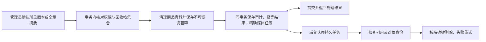

# 回收站永久删除与清空

2026年11月14日。用户在确认回收站保留数据库和图片后，要求增加“永久删除／清空回收站”。本轮新增可操作功能，不代替管理员执行现有业务回收站清空。测试写入和删除只在独立验收环境进行。

## 管理操作

- 普通删除继续移入回收站，保留恢复草稿；永久删除只允许管理员对已在回收站的商品执行，最终驳回商品也可永久删除。
- 单条确认显示商品编号、标题及不可恢复说明，输入“永久删除”后提交所见版本。版本变化或商品已恢复时拒绝，不自动获取新版本再删除。
- 清空先读取整个回收站的数量与快照摘要，不受列表搜索、分类、页码影响。输入“清空回收站”确认；期间回收站发生增删、恢复或版本变化时整批拒绝，要求重新预览。
- 图片在确认后通过持久任务清理，失败自动重试；页面不把受理成功表述为磁盘或OSS已释放空间。仍被其他内容引用的图片保留。
- 操作请求使用固定request_id，响应丢失后以同请求重试，返回原结果；不能自动取得新快照再次清空。

## 数据与存储

商品业务资料、报价、私密交接资料和图集关联删除；清空自身审核快照和商品聊天卡片中的资料，保留审核动作、操作审计及用户聊天正文、附件。数据库保留最小不可恢复墓碑，保障商品编号、导入去重、外键和创建幂等，不作为恢复来源。

图片按媒体ID和精确存储键清理，覆盖服务器原图与派生图、R20暂存/OSS对象，以及已经校验登记的历史OSS副本。清理前核对其他商品、聊天附件、头像库、当前头像、客服二维码和其他审核引用；不得按目录、对象前缀或整桶删除。现有备份、历史导入归档不随在线清空立即擦除。

历史OSS复制已完成，最终校验清单位于服务器私有目录。登记副本只用于追踪并精确清理，不能启用旧OSS读取预备功能，也不能恢复复制任务。清单、存储凭据和真实商品信息不入Git。

## 接口与一致性

| 接口 | 输入／用途 |
| --- | --- |
| `GET /api/v1/admin/products/trash/preview` | 返回整个回收站`total/image_count/snapshot`；图片数是图集关联及审核留存的去重候选数，不等于最终可删除文件数 |
| `POST /api/v1/admin/products/{id}/purge` | `expected_version/confirmation/reason/request_id` |
| `POST /api/v1/admin/products/trash/purge` | `snapshot/confirmation/reason/request_id` |

预览为只读、no-store；snapshot是稳定集合摘要，作为并发前置条件，不替代管理员授权。移入、恢复和永久删除共享事务锁，再按商品ID锁行；清空锁内重新计算全部集合。任何冲突整批回滚，网络存储操作不占数据库事务。请求幂等记录与资料清理、任务入队和审计同事务提交。

一次清空最多1000件商品、100000张候选图片；超限整体拒绝并提示分次处理，不能悄悄只清理当前页。普通商品、会员删除墓碑和已永久删除商品均不属于可清空范围。

确认文字必须精确匹配；原因最多500个字符，API允许空原因，管理界面要求填写。领域校验沿用422，非法查询参数400，版本、集合或幂等绑定冲突409。成功返回`purged_count/cleanup_pending/image_count`，其中`cleanup_pending`表示后台清理已安排，不是物理删除完成证明。

0018中`media_legacy_replicas`保存已经核验的旧副本身份，`media_retired_keys`防止永久删除后的存储键被重新引用，`media_permanent_cleanup`保存本机和旧OSS副本任务；均通过媒体ID关联`media_files`。R20媒体继续使用原生命周期队列并增加共享引用保护，不重复创建第二套R20删除队列。

## 验证与发布

新增0018迁移，0017及以前迁移不修改。验证需要覆盖权限／Origin、确认词、旧版本、集合变化、幂等重试、恢复竞争、敏感资料清空、引用保护、精确存储删除与失败重试。先功能，再并发，再安全；公开测试站发布后只读复验，不执行真实永久删除。

部署前备份数据库、配置和current，比较业务表摘要；登记历史副本需绑定已完成的校验清单。永久删除一旦执行，不得仅回滚旧程序声称商品恢复；恢复涉及备份与已删除的文件，属于另行授权的操作。
