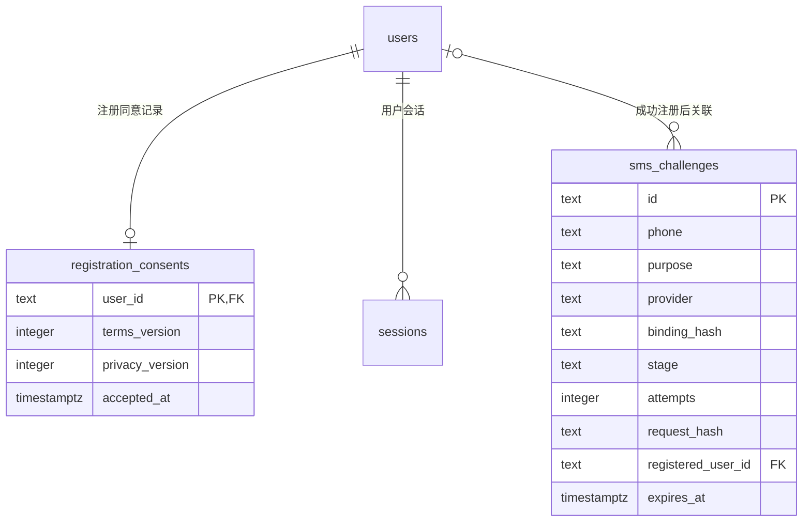

# R21 注册短信认证

日期：2026年11月13日。本文记录首批注册短信基线；同日新增短信登录与新手机号补充注册，仍归入R21，见[短信登录与注册衔接](AUTH-R21--短信登录与注册衔接.md)。重置密码、换绑手机号未开放；个人中心本轮不新增业务。下文首批开关及部署状态为历史记录，以最新发布记录为准。

## 服务与配置

使用阿里云号码认证服务 PNVS 的短信认证，官方 Go SDK dypnsapi-20170525/v3 v3.0.0。调用 SendSmsVerifyCode 与 CheckSmsVerifyCode，固定 HTTPS 地址 dypnsapi.aliyuncs.com。这是号码认证产品，不是短信服务 SMS 的发送接口，两者套餐不能混用。[官方选型说明](https://help.aliyun.com/zh/sms/product-overview/selection-guide-for-short-message-service-and-sms-verification-service)

用户确认复用现有 OSS 所属 RAM 用户的 AccessKey，已添加短信权限。部署时从服务器私有配置读取，显式写入独立的 SMS_ACCESS_KEY_ID / SMS_ACCESS_KEY_SECRET；程序不会静默借用 OSS 配置。密钥、测试号码、验证码和密码不提交 GitHub。

选用用户提供的已审核签名 **恒创联众**，注册模板 **100001**：

> 您的验证码为${code}。尊敬的客户，以上验证码${min}分钟内有效，请注意保密，切勿告知他人。

TemplateParam 固定为 {"code":"##code##","min":"5"}，验证码由阿里云生成，ReturnVerifyCode=false。100002—100005保留为后续业务资料，本次不调用。[发送接口](https://help.aliyun.com/zh/pnvs/developer-reference/api-dypnsapi-2017-05-25-sendsmsverifycode)

## 用户流程

1. 注册页读取后台能力及已发布的协议版本，协议未就绪时显示原因和重试入口，不先发送无从完成注册的短信。
2. 输入手机号，申请与手机号、当前浏览器和注册用途绑定的挑战。
3. 完成 Turnstile 验证。服务端检查 sms_send、hostname、cData、时间和验证结果；图片验证通过状态不能替代短信验证。
4. 原子预留发送额度，记录发送意图，再调用阿里云。提交成功后显示60秒倒计时。提交成功不等于手机已经送达。
5. 用户填写6位验证码、密码，勾选服务协议和隐私说明。后端要求 Model.VerifyResult=PASS，并核对协议版本。
6. 一个数据库事务内创建普通会员、保存协议版本、消费注册凭据并创建 public 会话，完成后按原返回地址规则跳转。

手机号改变会清除旧验证码及挑战，旧请求返回也不会回填。演示模式不发送短信。协议版本来自页面实际加载的数据，不用提交瞬间的新版本替代用户所见版本。协议缺失时不可勾选，并明确提示；重新加载协议后可继续填写。

## 初始限制

| 项目 | 实现规则 |
| --- | --- |
| 号码 | 中国大陆11位手机号，国家码86 |
| 验证码 | 6位数字，300秒有效 |
| 发送间隔 | 同号码60秒 |
| 号码额度 | 每小时5次、24小时10次 |
| IP / 浏览器发送 | 每小时20次 / 10次 |
| 全站额度 | 默认首次计数后固定24小时窗口20次，SMS_DAILY_LIMIT可配置；不是滑动窗口 |
| 创建挑战 | 全站每小时600次，IP每10分钟20次，号码及浏览器每10分钟10次 |
| 核验尝试 | 每个挑战最多5次；号码及浏览器每15分钟20次，IP每15分钟60次 |
| 外部调用 | 每进程最多4个短信调用，8秒总期限，连接2秒，HTTP总超时7秒，禁止自动重试 |
| 密码 | bcrypt成本12，注册散列并行最多2个；8个字符以上、最多72字节 |
| 测试范围 | 必须配置1—10个明确的测试号码，其他号码不能发送 |

以上为本轮实现的初始限制，不是生产容量承诺。Redis Lua一次检查全部额度后一起扣减，拒绝请求不会部分消耗额度；供应商失败不自动返还已经预留的预算。调用外部服务时不占用数据库长事务。

阿里云 DuplicatePolicy=1 使后续成功发送的新验证码覆盖旧验证码。OutId只作业务关联，不视为供应商幂等保证。超时、进程中断或发送结果不明时不会自动再发；用户须稍后重新申请。核验仅HTTP成功或Code=OK不能通过注册。[核验接口](https://help.aliyun.com/zh/pnvs/developer-reference/api-dypnsapi-2017-05-25-checksmsverifycode)

## 数据与一致性

新增0013_registration_sms.sql，不改写0012。sms_challenges.code_hash允许为空，PNVS记录不存验证码；新增供应商标识、浏览器绑定散列、hostname、执行阶段、执行ID、请求指纹、供应商流水和注册会员ID。历史记录仍为legacy/unavailable，不会变成可用验证码。

阶段：challenge → verifying → sending → sent → checking → verified → registered。失败进入failed或unknown；错误验证码在剩余次数内返回sent。执行ID与行锁防止并发重复发送和核验。进程中断时拒绝猜测性恢复，需要重新申请。

registration_consents保存会员ID、协议版本和时间。账号、同意记录和会话同事务提交；手机号唯一约束保证不能覆盖已有会员、管理员或停用账号。注册响应丢失后，仅原浏览器、原有效期、完全相同请求指纹可恢复会话；更换密码、验证码或协议版本的重放会被拒绝。

请求指纹使用带密钥的HMAC，不保存正文。Redis只保留带过期时间的计数，号码及IP使用HMAC键。创建挑战时有界清理过期超过24小时的PNVS挑战，每次最多100条；用户协议记录独立保留。不保存短信正文、验证码、完整供应商错误或完整请求体。

## 接口

前缀均为 /api/v1，响应数据位于data内。

| 方法与路径 | 请求 / 返回 |
| --- | --- |
| GET /auth/capabilities | registration_sms、sms_login、password_reset，分别反映开关状态 |
| POST /auth/sms/challenges | phone,purpose=register；返回challenge_id,site_key,action,expires_in，并设置HttpOnly绑定Cookie |
| POST /auth/sms | phone,purpose=register,challenge_id,token；成功返回challenge_id,retry_after=60,expires_in=300 |
| POST /auth/register | phone,code,challenge_id,password,agreement:{accepted,terms_version,privacy_version}；返回脱敏会员资料并设置用户会话Cookie |

写接口要求精确匹配允许的Origin。管理员入口不提供注册路由。配置与迁移完成前默认关闭；VITE_SMS_ENABLED不再作为注册能力来源。

## 验收和发布边界

真实收信由用户确认，后端已记录供应商发送流水。完整结果见[R21验收记录](../业务验收与审查记录/AUTH-R21--注册短信验收.md)。隔离环境使用qingye_acceptance、Redis6382、API5184/5185；不能把隔离部署当作业务测试站已上线。

隔离库原先没有协议，造成首次真实验收时勾选框不可用。已补充明确标注的隔离测试说明，并补上前端加载失败提示与重试。业务测试库的服务协议与隐私说明仍为未发布草稿，不用隔离测试说明覆盖，也不自动发布为正式协议。

发布前备份数据库、环境和current链接，执行0013后核对原业务表。回退旧程序时保留新增结构，不删除已注册会员与协议记录。正式放开注册前需发布适用的协议，并另行决定测试白名单和额度。

权限包含dypns:SendSmsVerifyCode、dypns:CheckSmsVerifyCode，官方资源范围为*。14:21非发送探测仅确认STS为RAMUser和核验接口返回isv.ValidateFail，不作为正确验证码验收。服务器私有证据目录：/root/qingye-private/r21-sms-20261113/。
