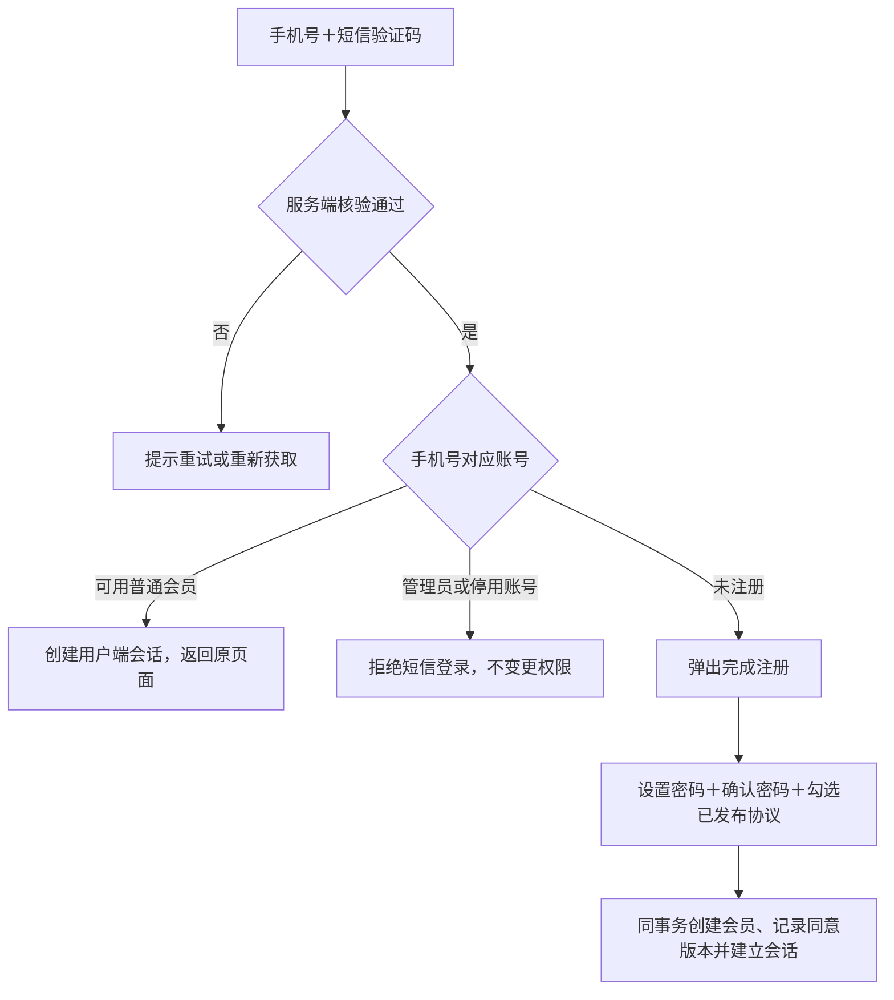

# R21 短信登录与注册衔接

日期：2026年11月13日。本次是 R21 的后续改动，与注册短信一并记录，不另立 R22。当前实施和验证状态以验收、发布记录为准。

## 用户流程

保留手机号密码登录，开启独立的短信登录入口。发送短信沿用人机验证、号码白名单、原子限频和现有赠送模板 100001。只有验证码通过后，才判断账号是否存在。

验证新手机号不会自动创建账号。取消弹窗不产生会员或登录会话。补充注册沿用尚未过期的短信核验结果，无需再发短信；凭据仍与原手机号、浏览器和用途绑定。验证码有效期内可继续填写，过期需重新获取。协议更新后须重新加载并再次勾选。

原 `/register` 页面保留，增加确认密码输入。密码登录、原返回地址约束、两端身份隔离不变。重置密码、换绑、管理员短信登录不在本次范围。

## 接口与配置

| 接口 | 增量行为 |
| --- | --- |
| `GET /api/v1/auth/capabilities` | 独立返回 `sms_login` 与 `registration_sms` |
| `POST /api/v1/auth/sms/challenges` | `purpose=login` 申请登录用途挑战；保留 `register` |
| `POST /api/v1/auth/sms` | 必须提交与挑战一致的用途 |
| `POST /api/v1/auth/login` | `method=sms`；已有会员返回 `authenticated` 与脱敏会员信息，新手机号返回 `registration_required` 与原挑战编号 |
| `POST /api/v1/auth/register` | 登录衔接时提交 `purpose=login`、原验证码凭据、`password`、`password_confirm` 与协议版本；不允许从未验证状态直接完成 |

新增 `SMS_LOGIN_ENABLED` 和 `SMS_LOGIN_SCHEME`。登录方案必须与注册方案不同，发送与核验使用相同方案；仍共享进程内外部调用并行上限及 Redis 发送额度，不能通过切换用途翻倍短信预算。阿里云要求核验时的方案与发送时一致，见[核验接口说明](https://help.aliyun.com/zh/pnvs/developer-reference/api-dypnsapi-2017-05-25-checksmsverifycode)。

两个开关分开：只启用短信登录时，已有会员可登录，新手机号明确提示注册未开放。管理员入口不装配短信认证服务。正式开放之前仍须发布适用的服务协议和隐私说明；不能把占位草稿当作已同意的协议。

## 数据与安全边界

新增迁移 `0014_sms_login.sql`，在短信挑战表增加 `completion_hash`。不修改已经部署的 0013。短信登录新增 `registration_pending`、`logged_in` 状态，注册成功继续使用 `registered`。

验证码核验指纹与注册提交指纹分开：前者绑定用途、手机号、验证码和挑战；后者进一步绑定密码、确认密码及协议版本。数据库只保存带密钥的 HMAC，不保存验证码、原始密码或请求正文。挑战过期、换浏览器、换用途、换验证码均拒绝；成功注册后换密码重放同一请求也拒绝。

已有会员只新增 public 会话，不覆盖原密码、昵称或角色。停用状态在每次会话签发时重新检查。新账号创建、协议同意、挑战消费和登录会话在同一事务完成；手机号唯一约束处理并发注册，不能覆盖别处已创建的账号。原有效期内、同浏览器、同请求的响应丢失重试可恢复会话，不再次调用供应商核验。

密码使用 bcrypt，成本参数 12。8 个字符以上、最多 72 字节；确认密码必须一致。登录通过 bcrypt 比较，无法解密还原密码。2026年11月13日只读检查中，业务测试库现有 5 个账号的密码字段均符合 bcrypt 格式且成本为 12；检查未输出任何密码散列。

## PostgreSQL 检查记录

本轮开始前已只读检查152测试服务器：2核、约1.92GiB内存，业务数据库约64.2MiB；580条商品、48,337条图片关联。10秒采样整机CPU忙碌约2.7%，I/O等待约0.1%，未见锁阻塞或超过5秒的业务查询。该结果不是高峰容量承诺。

本次不引入新数据库或修改 PostgreSQL 参数。后续建议记录查询耗时、连接池等待和历史数据保留策略，重点关注聊天未读汇总、图片权限查询及推荐批处理。本次短信增量复用现有 Go、PostgreSQL、Redis、Turnstile 和阿里云 PNVS。
