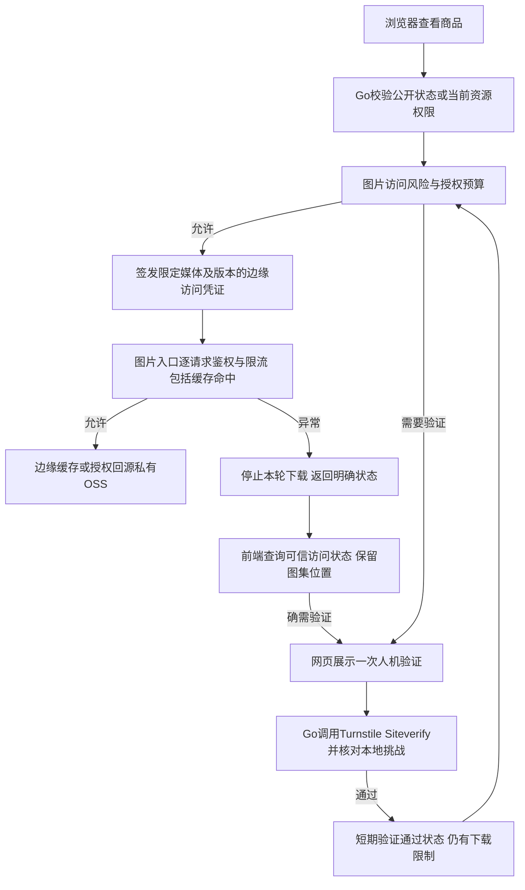

# R20-1 图片防刷与验证加固计划

日期：2026年11月13日。状态：用户已选择Cloudflare Turnstile，实施方案待审阅；尚未修改业务代码、创建验证组件、开通云服务或部署。核对基线：`714b9df9cf858127f2bc33e39cf389c158bf2c42`。本次只读核对152测试环境运行配置、媒体统计与公开图片响应，见[图片读取路径核查](../业务验收与审查记录/MEDIA-READ-20261113--图片读取路径核查.md)。

## 1 本轮要求与范围

用户要求记录R20-1，重点为图片防刷保护：异常流量增加人机验证，并补强相关代码及Go安全模块的局限。后续确认选择Cloudflare Turnstile，暂不拆独立安全微服务；验证适配继续放在现有Go服务内。

| 决策 | 当前状态 |
| --- | --- |
| 人机验证供应商 | 已确认Turnstile，替代此前优先评估阿里云验证码2.0的建议 |
| 接入方式 | 建议Free套餐、Managed组件；仅图片异常访问触发，React展示、Go核验。尚未创建组件或接入真实密钥 |
| 图片下载防护 | 仍需受保护图片入口逐请求鉴权与限流；选择Turnstile不等于选择Cloudflare CDN或China Network |
| 服务与数据 | 复用现有Go、Redis与PostgreSQL；不新增独立安全微服务 |
| 后续短信场景 | 用户提出短信验证码阶段可能复用；共用验证适配，独立场景与限额。本轮预留设计，不开发短信发送 |
| 待落实 | 测试/正式访问主机及组件配置、图片域名及边缘产品、正常流量基线与限流阈值 |

首期重点是商品图片的授权与实际下载入口。按本次现状，先覆盖当前实际承载图片的本机读图入口，同时保留R20新图OSS路径的独立保护与验收。旧商品图、暂存预览、聊天附件、头像及客服二维码分别说明覆盖范围；不把新商品OSS入口的验收结果当成全站所有图片已受保护，也不因增加旧图限流自动启用旧图迁移或清理。

保留现有路由与资源权限、完整图集、每批1—99张上传、无商品总图数上限、每图唯一展示原图和当前2 GiB额度。人机验证仅说明此次访问通过风险检查，不授予商品、聊天、上传或管理权限。异常下载不得自动触发上传停权、账号整体停用或图片删除。

管理员MFA和客服/运营/负责人权限拆分仍是独立安全待办，不因记录本计划视为已经实现或纳入此次图片防刷开发授权。

## 2 已核对的代码事实

2026年11月13日只读实查：双API的`MEDIA_R20_ENABLED=true`，运行二进制与R20发布散列一致；业务库48,345条就绪商品媒体均为本机路径，其中48,332条`legacy/`、13条其他本机路径，`media_objects`为空。3张公开旧图抽查由Go直接返回206和图片正文，没有OSS重定向。下表OSS签名描述的是已启用适配的分支能力，不表示现有商品图已经从OSS下载。历史复制的最后进度记录为8,803/48,345、状态failed，无全量完成回执；不将其当作OSS实时全量清单。

| 位置 | 当前行为 | R20-1需处理的边界 |
| --- | --- | --- |
| `application/media/service.go`的`Open` | 检查媒体状态、用途及当前资源访问权限，再调用存储读取 | 当前路径没有专门的读图风险决策；全局请求容量限制不能替代用户级图片防刷 |
| `infrastructure/mediaobject/files.go`的`Open` | OSS对象生成60秒有效的签名地址 | 地址有效期间可重复下载；签发次数不是下载次数或实际流量 |
| `transport/httpapi/media.go`的`serveMedia` | 302跳转，设置`private, no-store`及`Referrer-Policy: no-referrer` | Go不经手OSS下载正文；不能直接打开“拒绝空Referer”，否则可能损伤当前链路 |
| `infrastructure/cache/limiter.go` | Redis Lua固定窗口计数，依赖异常拒绝 | 无读图分级策略、实际下载字节预算或跨实例并发租约；固定窗口边界也允许短时集中请求 |
| `domain/security`、`application/security`及上传停权存储 | 管理员明确操作后的商品上传限制、撤销、版本复核及审计 | 是上传处置模块，不是自动图片流量风控，也不限制已有OSS链接的下载 |

上述事实不表示已有权限、重编码、配额和持久清理需要重写。新增策略应保留这些业务约束，在授权与下载的正确位置增加防护。

## 3 推荐的访问链路

Go负责业务权限、授权签发、验证码服务端核验和应用侧处置；图片入口负责每次实际下载的限制，包括已经命中缓存的请求。两侧的风险主体和验证状态必须有经过验证的传递方式，不能仅依赖前端传入一个`passed=true`。

图片入口仍待选型，可评估阿里云ESA或具备所需安全能力的CDN，与现有私有OSS衔接。Turnstile可独立接入，不要求整站流量经过Cloudflare。普通CDN缓存、私有Bucket回源、URL鉴权、人机验证是不同能力，需要分别确认套餐及配置，不把“接CDN”写成已经具备整套防刷。

公开商品优先使用独立图片域名的受保护访问地址。停止为该受保护路径向浏览器签发裸OSS地址，并检查其他API、对象公开权限和备用域名是否绕过防护。迁换期间旧签名仍有有效窗口；下架、撤销与边缘配置传播的延迟须实测记录。

当前IP加端口测试入口能先验证Go策略和验证码组件；真正的域名、缓存、边缘封控及绕过检查需要独立验收。边缘尚未接好时只能标记“应用侧完成”，不能标记“实际下载防刷完成”。

## 4 异常访问与人机验证

### 4.1 四种处理结果

| 结果 | 典型情形 | 用户体验 |
| --- | --- | --- |
| 正常放行 | 正常翻图、首屏并行加载、合理重试 | 不增加验证步骤 |
| 短暂限速 | 短时突发、同一图重复请求偏高，证据不足 | 有界退避，必要时提示稍后重试，不直接封账号 |
| 人机验证 | 多项异常同时出现，需确认当前访问 | 当前页面只弹一次验证，保留文字、滚动位置及已加载图片 |
| 临时限制图片访问 | 持续超预算、伪造/重放凭证，或验证后仍持续异常 | 明确冷却时间与重试入口；不影响无关业务、不自动删图 |

先组合请求频率、重复图片访问、授权异常、并发和下载流量。请求不经Go时，实际下载指标必须来自图片入口，不能用Go签发日志推算成真实出网。行为数据如滚动、停留和鼠标操作仅为辅助信号，不能作为服务端授权依据。

使用服务端认证账号、服务端签发的匿名会话、经校验的图片授权标识等维度，IP仅作组合信号与较宽的保护阈值。Clash、共享Wi-Fi、网络切换或单个商品图多，不单独判恶意。匿名会话可被重建，必须保留入口级与总量保护；不采用侵入式设备指纹作为必需条件。

热门商品可能被多人正常浏览，单资源高热度先用于观察和告警，不能直接据此封掉所有人访问该商品。阈值在正常300张图集、共享IP、移动网络及代理场景测量后确定；不先写死“每分钟多少张就是攻击”。

### 4.2 验证的位置与恢复

验证码放在网页交互层，图片入口只返回可区分的拒绝或限速结果，不向``返回滑块HTML。普通断网、图片不存在和签名过期不能全部被翻译成“请完成人机验证”。

跨域图片的`onerror`本身不能读取准确HTTP错误。实施时需提供有界的访问状态探测：由所选图片入口返回可读原因，或由其可信状态接口传给应用。若使用跨域探测，精确限制CORS来源与凭据范围；若使用事件同步，校验来源、防重放并标明传播延迟。不能假设边缘发生的封控会自动出现在Go的Redis里。

Go核验通过后，发放绑定当前账号或匿名会话、媒体读取用途、到期时间及策略版本的短期凭证。与图片域名之间的凭证传递、Cookie作用域或签名校验必须完成端到端验证，不向图片域名共享管理员登录Cookie。不能默认把Go的验证结果当成云厂商挑战Cookie。

通过验证只恢复合理额度，不清空累计滥用记录，也不绕过硬性限流。验证凭证与图片URL都不承诺不可复制；短有效期、主体校验、实际下载预算及必要的撤销能力共同限制影响。只含主体ID的签名URL仍是可转发凭证，不能宣称天然阻止转发。

前端合并并发验证与失败恢复，只补载当前可见区域及有限预取；避免验证通过后同时重试数百张图片再次触发限流。限速响应使用`Retry-After`，退避和重试次数有上限。

### 4.3 Turnstile接入方案（供应商已确认，尚未实现）

建议先用Free套餐的Managed组件，由Turnstile决定是否需要用户点击确认。业务侧仅在图片访问需要验证时创建组件，不把每张图片、每次翻图或每次进入网站都变成一次验证。用户提出后续短信阶段可能复用，按4.4预留公共能力；本轮不接短信供应商或发送真实短信。

前端在现有页面展示统一验证弹窗，沿用昼夜主题、移动布局及键盘可操作要求。动态加载官方脚本并显式渲染；合并同一页面的并发触发，处理完成、失败、过期、超时、关闭和重试。身份或路由变化时清理旧组件和回调，不能将前一个用户的结果用于新会话。只恢复当前可见图和有限预取，保留图集位置。

Go向官方`https://challenges.cloudflare.com/turnstile/v0/siteverify`发送验证请求；浏览器回调成功不能直接解除限制。具体校验约定如下：

| 项目 | 实施要求 |
| --- | --- |
| 验证结果 | HTTP成功不代表验证通过，必须要求响应`success === true`，非预期结构、超时或错误均不发新通行凭证 |
| 使用场景 | 当前图片处理器指定并检查`action=media_read`；公共校验适配由可信业务处理器传入预期场景，不接受客户端指定的任意场景 |
| 访问主机 | 按部署配置精确检查`hostname`；正式环境不接受localhost或测试主机。端口隔离另由应用Origin/会话校验保证 |
| 本地挑战 | Go生成不可预测的挑战ID，以`cData`传给组件，并核对返回的`cdata`及Redis记录；绑定当前主体、public/admin用途、策略版本与有效期，不在该字段放账号资料 |
| 防重放与重试 | 本地原子消费挑战并完成一次发证；同一业务尝试使用稳定的`idempotency_key`重试Siteverify。幂等响应不能重复增加下载额度 |
| 凭据 | sitekey可在前端公开，secret只存服务端密钥配置。隔离验收与真实部署分开；禁止真实部署使用测试密钥或测试放行开关 |

Turnstile令牌有效期为300秒，其重复兑换检测存在网络传播窗口，短时间并发验证可能同时成功。必须保留本地挑战的一次性状态和并发控制，不能只依赖供应商返回`timeout-or-duplicate`防重放。已消费令牌不能充当持续读图凭证；通过后另发应用侧有范围、有时效的访问凭证，原资源授权和下载硬限制继续生效。

挑战申请、提交验证及供应商调用均限频、限并发、有超时，并校验同源请求及现有CSRF边界。`remoteip`若传递，只使用可信代理链解析结果，不直接信任客户端转发头。原始令牌、secret、Cookie及完整签名链接不进入日志；Redis记录短期挑战状态与必要的摘要，限制匿名创建量。

当前Nginx的`script-src 'self'`会阻止验证脚本，实施需在实际使用组件的前端入口精确放行`https://challenges.cloudflare.com`的`script-src`和`frame-src`，保留现有其他限制；不通过`*`、新增`unsafe-eval`或关闭整条CSP解决。官方`api.js`不自行代理、缓存或下载到本站发布。脚本和验证失败应有明确重试提示，不无限刷新组件。

独立Turnstile的验证成功不自动生成本系统图片域名可识别的授权，也不自动解除其他厂商边缘规则。首期按应用自行维护短期验证状态设计，不依赖`cf_clearance`；如果后续采用Cloudflare边缘，再单独评估同域预放行条件与规则。禁止向图片域名传递管理端登录Cookie。

国内网络、Clash及移动端需分别实测脚本加载、挑战和Go的Siteverify请求。选定Turnstile不代表已经验证大陆本地节点能力；不因加载失败直接判恶意，也不在失败时免验证放开异常下载。中国网络套餐与本次独立组件选择分开，不自动开通企业服务。

### 4.4 后续短信验证码复用（预留设计）

共用前端验证组件、Go的Turnstile适配与本地挑战校验，业务入口分别决定何时要求验证及验证后允许的操作。不能将公共校验服务与图片额度恢复写在同一个固定处理器里，也不复用已消费令牌或图片通行凭证发送短信。

| 场景 | 建议action | 绑定与放行范围 |
| --- | --- | --- |
| 图片异常访问 | `media_read` | 绑定当前主体、媒体访问用途及策略版本；通过后恢复有期限、有额度的图片访问 |
| 后续请求短信验证码 | `sms_send` | 绑定当前主体、服务端规范化的目标手机号、短信用途及本次请求；通过后仅允许该次受限发送尝试 |

手机号及短信用途在服务端保存和核对，不放进公开的`cData`、日志或前端可修改的通过标记。图片验证通过不能抵扣短信验证；注册、登录、改绑等短信业务也需校验实际请求用途，避免拿一个场景的结果调用另一个场景。

短信阶段再实现手机号/主体/可信IP组合限频、重发间隔、全局发送预算和并发去重，在调用收费短信接口前检查；Turnstile通过后仍保留这些限制。短信发送超时或重试结合供应商回执和幂等能力处理，不能因重复提交重复发送或扣费。是否每次发送都要求验证、阈值和供应商在短信阶段确定。Turnstile不证明手机号归属，不能代替实际短信验证码校验。

## 5 代码补强清单

| 改动 | 建议落点 | 核心要求 |
| --- | --- | --- |
| 媒体读取策略 | 现有`domain/security`和`application/security` | 输出允许/限速/验证/限制、原因码、重试时间和策略版本；与上传停权分开，默认不扩大动作范围 |
| 读图授权入口 | `application/media`、`transport/httpapi` | 保留状态/归属/用途校验，加入受控读图预算；不以验证通过替代业务授权 |
| 验证服务适配 | `infrastructure/security`、配置与装配 | 服务端验证、场景绑定、防重放、结果分类、幂等完成；外部异常不提升信任 |
| 图片分发适配 | `infrastructure/mediaobject`与选定边缘配置 | 从裸OSS授权切到受保护入口，限定媒体版本、用途、时效；密钥分用途、支持轮换，不允许任意Bucket/Key |
| 读图限流 | Redis适配及边缘策略 | 应用侧允许合理突发，可用令牌桶/短长双窗口；边缘实际请求单独计数，不能全站统一套上传固定窗口 |
| 前端加载与恢复 | 共用图片加载逻辑、详情图集 | 单次验证提示、明确失败类型、有界恢复；图片总数不受影响，不生成第二份小图 |
| Turnstile组件与页面安全策略 | React验证弹窗、Nginx CSP、配置与装配 | 按需创建与销毁组件，精确放行官方脚本/iframe，失败可重试；前端仅公开sitekey，后端保管secret |
| 管理查看与解除 | 现有管理端及审计 | 显示异常原因、范围、到期时间和人工解除；修改须服务端权限、版本与审计，不做任意脚本规则编辑器 |
| 可信代理与绕过入口 | Nginx、Go代理配置、图片域名及OSS策略 | 仅信任真实代理链覆盖的来源信息，防伪造转发头；验证直连与其他入口不能绕过新增防护 |

补强顺序首先围绕图片下载。已有上传解码的进程内并发、实际接收字节保护应继续保留；跨public/admin进程及多实例的全局上传字节预算/并发租约属于后续资源保护增强，不能把新增下载限流当成它们已实现。

涉及跨实例租约时，需唯一持有者、续期、比较释放和最终状态复核；不能以锁到期为由让迟到处理继续完成。图像解码不能只依靠Context超时强行终止，输入体积、像素上限和受控并发仍是必要约束。上述扩展按实际测量决定是否同轮实施，避免为单一图片防刷引入独立安全微服务。

## 6 数据、缓存与费用保护

| 数据 | 存放与限制 |
| --- | --- |
| 短期计数、挑战状态、重放标识 | 复用Redis，短TTL、有限维度、创建速率及容量预算；不逐次下载持久存一条记录 |
| 管理员处置、策略版本、重要安全审计 | PostgreSQL持久化，沿用现有审计；如需新表，使用0013或后续迁移，不改已部署0012 |
| 实际请求与字节、边缘拒绝和缓存命中 | 图片入口指标及日志聚合；注明采样/延迟，不与Go估算字节混淆 |
| 图片二进制、聊天正文及商品数据 | 保持现有存储职责，不为本计划增加MongoDB、Kafka或Elasticsearch |

Redis设独立键前缀不等于资源隔离。必须测新增内存/命令耗时、限制匿名状态增长，并避免驱逐或挤占聊天租约及验证码状态。容量或隔离需求达到阈值时再拆专用实例；现阶段没有测量证据证明需要Redis Cluster。

边缘优先做实际请求限速；实际字节监测、告警与保护开关配合使用。按对象大小预估预算不等于精确出网，Range、取消请求及缓存响应都需明确统计口径。如果供应商无法提供实时全局字节硬上限，应如实记录，不能把定时日志告警称为实时硬限额。

流量保护分为异常来源限制、短期加强策略、极端情况下暂停新增图片访问。阈值和自动/人工动作待确认；紧急暂停会影响正常看图，应显示提示与恢复入口。Turnstile计划先使用Free套餐，不自动采购Enterprise/China Network；图片CDN、OSS出网、请求与服务器资源仍有成本。预算告警不保证费用绝不超过阈值。

共享缓存只考虑已公开商品图，并在每次命中前完成入口鉴权和防刷；缓存键与签名参数规范化按供应商验证，防止随机参数绕缓存反复回源。聊天、私有草稿及管理预览不得借用公开图缓存授权。

## 7 故障与回退

- 验证服务或Redis不可用：不新增“已验证”高信任凭证；异常请求可重试或等待冷却。正常用户如已有仍有效的边缘凭证，可在原硬限流范围内继续使用；不得解除原有资源权限。
- PostgreSQL不可用：无法验证当前资源归属/公开状态时不签发新授权；不凭“通过验证码”读出私有资源。
- 边缘故障：不自动跳转裸OSS或公开ECS作为备用入口；可回到已验收的保护配置，或明确暂停相关图片访问。
- 误封：临时限制可过期、可审核解除，保留原因及审计。不得以全站白名单或全局关闭鉴权作为常规处理。
- 紧急撤销/下架：停止新授权，执行支持的边缘失效或版本撤销；已经下载到浏览器的图片无法收回，短链和缓存窗口如实说明。

## 8 实施顺序与验收

开发不以历史图片复制完成为前提。当前本机路径可先落实实际响应限流、受控并发及验证恢复，验收后只标注已覆盖的本机入口。OSS路径可使用独立验收对象验证签名、下载限制与绕过，无需先搬完历史原图；边缘产品与配置未落实时，单列为尚未完成的范围。以后切换图片来源前，必须复验对应下载入口，不能沿用仅经过Go的旧计数结果。

1. **列清入口并采样**：现已只读确认业务图片仍从本机返回，后续先测量该入口，并分别核对私有预览与R20 OSS分支；记录正常多图、共享IP及Clash下的请求和流量基线。读取路径核查不等于防刷性能或功能验收。
2. **补应用侧能力**：加入有范围的安全决策、授权预算、Turnstile核验与前端恢复；先用隔离测试密钥覆盖成功/失败，再用真实组件完成一次通过、并发重放拒绝和国内网络验收。未接边缘时不宣称能限制已有OSS链接。
3. **接实际图片入口**：验证选定边缘鉴权、缓存命中限流、可信状态回传、通过验证后的恢复及直连绕过防护；没有这一环不算本项完成。
4. **调参与交付**：新异常规则先观察误报，既有权限和硬性资源限制保持；小范围启用后完成同版本性能、安全和三轮审查，单独记录测试部署及GitHub版本。

关键验收项：

- [ ] 正常匿名/登录浏览、300张图集按需查看、多人共享IP、开启Clash均可完成，不以代理本身处罚。
- [ ] 重复下载有效链接即便不再访问Go，也能在图片入口受限；缓存命中与未命中均覆盖。
- [ ] 已知直连OSS地址、备用域名及伪造转发头不能绕过新配置；保留必要后台任务的最小存储权限。
- [ ] ``拒绝不返回验证码HTML；网络错误、过期、无权限、需验证分别处理，验证弹窗不并发出现。
- [ ] 伪造前端通过、错误hostname/action/cdata、跨场景/会话、过期令牌、并发重放和测试密钥不会误获高信任通行。
- [ ] Siteverify重试保持同一业务尝试的幂等标识；即便模拟供应商对同一令牌并发返回成功，本地也只发证一次、不重复恢复额度。
- [ ] 实际Nginx CSP下组件可加载；脚本被拦截、代理切换、关闭弹窗与重新打开均不循环挑战、不错误放行；真实密钥验收与测试密钥结果分别记录。
- [ ] 验证通过后继续限流；令牌复制/过期、清Cookie与更换IP的绕过风险有明确测试或剩余边界。
- [ ] 验证完成只恢复有限可见图请求；中途刷新、切换登录身份、验证码服务超时和重复响应不串号、不放大流量。
- [ ] 私有图、转接后的聊天附件及下架商品仍遵守原权限；通过验证不增加业务权限。
- [ ] Redis键增长、调用费用、日志风暴和聊天资源竞争有测量；不对每次下载同步写PostgreSQL。
- [ ] 实际字节与估计值、监控延迟、预算保护动作及误封恢复有证据；不把告警当绝对费用封顶。

本记录仅新增计划及导航，不产生R20-1测试通过或部署声明；现有R20测试数字不能用来勾选上述新验收项。

## 9 依据

- [R20 Go安全模块及当前边界](../开发产出文档/SECURITY-R20--Go安全模块设计.md)。
- [Turnstile概述](https://developers.cloudflare.com/turnstile/)与[套餐](https://developers.cloudflare.com/turnstile/plans/)：独立组件、Managed模式和Free套餐；不要求整站接入Cloudflare CDN。
- [Turnstile服务端核验](https://developers.cloudflare.com/turnstile/get-started/server-side-validation/)：有效期、action/hostname/cdata、幂等重试与重复兑换的传播窗口。
- [Turnstile前端接入](https://developers.cloudflare.com/turnstile/get-started/client-side-rendering/)与[CSP配置](https://developers.cloudflare.com/turnstile/reference/content-security-policy/)：动态组件生命周期和脚本/iframe来源限制。
- [Turnstile预放行边界](https://developers.cloudflare.com/cloudflare-challenges/concepts/clearance/)：组件令牌与Cloudflare边缘通行Cookie并非同一授权。
- [ESA自定义规则](https://help.aliyun.com/zh/edge-security-acceleration/esa/user-guide/waf-custom-rules/)：图片资源直接使用JS/滑块挑战存在显示问题，不能套用网页挑战交互。
- [ESA防护配置](https://help.aliyun.com/zh/edge-security-acceleration/esa/user-guide/waf-quick-start)：观察、频次控制与缓存命中请求的配置应核对。
- [OSS与CDN访问防护](https://help.aliyun.com/zh/oss/user-guide/cdn-acceleration)：私有回源与访问者鉴权、边缘防盗链及监控需分别配置。

官方资料核对日期为2026年11月13日；最终供应商协议、套餐、地区可用性和实际配置须在实施时复核。
