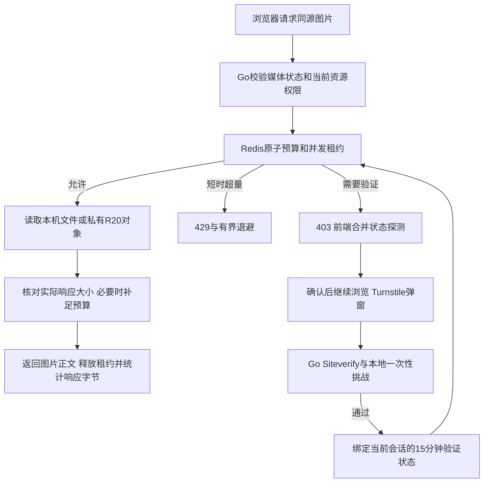

# R20-1 图片防刷与验证加固

日期：2026年11月13日。用户已授权开发、隔离验收、152测试部署及GitHub提交。本文件记录最终实施口径；具体测试与发布结果以[验收记录](../业务验收与审查记录/SECURITY-R20-1--图片访问保护验收.md)和[发布记录](RELEASE--测试环境发布记录.md)为准。

## 1 范围与选型

Cloudflare Turnstile **Free、Managed**组件已创建，名称`QingYeGame test R20-1`。仅在图片访问达到验证阈值时加载官方组件，不要求每次进入网站验证。没有购买Enterprise、China Network或CDN套餐；不变更生产站DNS。

继续使用现有Go服务、Redis短期状态和PostgreSQL审计，不增加安全微服务或数据库。管理员MFA、客服权限拆分与短信发送仍是独立后续功能。

当前业务图片仍从152本机读取。对R20新上传且已到OSS的图片，本轮采用**Go受控代理读取**：资源授权和下载预算通过后读取私有对象，校验内容，再返回图片正文，停止向浏览器返回裸OSS签名地址。暂存文件关闭后立即删除，不新增持久图片副本。这会使用服务器转发带宽，不能等同于边缘缓存或DDoS防护。

保留既有公开状态、聊天参与者、草稿归属与管理权限；商品完整图集、每批1—99张、无总张数上限及R20留存规则不变。异常下载不触发上传停权、注销账号或删除图片。

## 2 实际链路

`/api/v1/media/:id`、`/file`、`/preview`和`variant=thumb`全部经过同一入口。商品、历史图、客服二维码、头像和聊天附件都适用防刷；每种用途继续执行原资源授权。静态站没有公开媒体目录作为备用入口。

验证不授予访问权限。下架商品、无权草稿、转接后原客服的聊天图片仍不可读。图片响应保留`private, no-store`；本轮没有共享CDN缓存命中路径。

## 3 限制与计量

| 维度 | 初始默认值 / 行为 |
| --- | --- |
| 正常请求桶 | 每主体容量120，补充2次/秒；持续耗尽后要求验证 |
| 验证后正常桶 | 同一绑定15分钟内容量和补充速率为2倍；不重置硬额度 |
| 主体硬请求桶 | 容量600，补充10次/秒 |
| 可信IP请求桶 | 容量1200，补充20次/秒；不因Clash或共享IP本身要求验证 |
| 主体字节预算 | 容量128 MiB，补充2 MiB/秒 |
| IP字节预算 | 容量512 MiB，补充8 MiB/秒 |
| 双API共享字节预算 | 容量1 GiB，补充8 MiB/秒 |
| 活跃下载 | 同一主体6、每入口同一IP16、双API合计24个；75秒租约，HTTP写超时60秒 |
| 状态空间 | 最多10000个活跃主体，每IP每小时最多创建256个主体；主体/IP运行状态闲置1小时过期 |
| 挑战空间 | 每主体保留一个挑战键，300秒过期；刷新替换旧挑战，旧请求不能再发证 |
| 验证接口 | 每主体12次/分钟、IP60次/分钟；外部Siteverify每进程最多8个并发，8秒超时 |
| 管理页面 | 最近200个活跃主体，20条分页；运行计数闲置24小时过期，不是滚动24小时统计 |

主体使用服务端HMAC标识：已登录账号额度按账号计，匿名额度按签名HttpOnly Cookie计；验证状态额外绑定会话、浏览器Cookie及public/admin入口。可信IP只接受回环反向代理提供的单一IP，Nginx覆盖客户端传入的转发头。两端会话密钥独立，IP桶按入口分别计算，全局字节桶与24个下载租约跨入口共享。

下载前按数据库记录的完整文件大小预留额度，Range与取消请求不退还预留额度。旧缩略图可能比原图更大，因此发送正文前再按实际文件大小补足差额；不足则拒绝发送。缺失大小保守预留64 MiB，超过64 MiB或无法读取大小时拒绝。只接受单个Range，避免多段响应额外放大。请求失败仍释放并发租约。

`reserved_bytes`是准入预留量，`bytes_sent`是Go写入响应的字节，不代表用户实际收到的字节或云账单。连接中断时内核/代理可能已有缓冲。以上是入口保护，不是绝对费用封顶。默认值为测试起点，真实大图、带宽及用户量变化后应重新调参。

## 4 Turnstile服务端核验

真实secret仅存服务器私有配置，不进入GitHub、前端、日志或截图；sitekey可以公开。生产装配拒绝供应商测试密钥。组件允许`152.136.252.204`、`127.0.0.1`和`localhost`，测试业务API实际只接受152主机，隔离API另允许本地主机。正式域名后续单独配置。

验证必须同时满足：成功结果、`action=media_read`、精确hostname、服务端挑战ID对应的`cdata`、300秒内时间戳和当前主体绑定。Origin与入口来源逐项匹配，客户端不能指定短信action或任意主机。

Redis原子认领挑战：同一挑战只允许一个核验执行者；并发重复提交返回忙碌，已消费挑战不能再次增加额度。20秒认领租约带独立执行ID，过期旧执行者不能覆盖新执行者。Siteverify使用稳定挑战UUID作为`idempotency_key`，网络失败不发通行状态，同一令牌重试不变更幂等键。手动重新验证创建新挑战并撤销旧挑战。

供应商失败、超时、格式错误、错误主机/场景、跨会话、过期或重放都不能提升权限。验证成功只恢复有限的软额度，不清除主体/IP/全局硬限制，也不解除管理员限制。

## 5 前端体验

两端共用`共享/MediaSecurity.tsx`、`media-access-client.ts`与`media-security.css`。标题按最新反馈统一为**“确认后继续浏览”**。

- 首次看图合并一次匿名会话初始化；blob、本地图标及外部资源保留原行为。
- 同时失败的图片合并状态探测，404或普通网络失败不直接触发验证码。
- 同一页面只弹一个验证框；支持关闭、重开、过期、失败和重试，保留滚动位置。
- 验证后仅恢复可见区域及附近图片，队列最多同时启动4张；短暂限速最多自动重试3次，另保留手动重试。
- 身份或路由变化清理验证组件，旧异步响应不能回填新会话。
- 昼夜主题、手机布局、键盘焦点与减少动态效果设置均沿用现有设计。

只动态加载官方`https://challenges.cloudflare.com/turnstile/v0/api.js`。两套Nginx配置精确新增`script-src`与`frame-src`来源，不增加通配域名、`unsafe-eval`或自托管脚本。脚本加载失败提供重试，不自动免验证放行。

## 6 管理与审计

管理菜单新增“图片访问保护”，查看匿名/会员/管理员主体、入口、原因、请求数和到期时间。支持“限制图片访问10分钟”和“解除临时限制”，必须填写原因并使用列表版本号；不扩大为账号停用。

人工处置先在现有`admin_logs`写入意图，再以Redis版本检查执行，最后记录`applied`、`not-applied`或`unknown`。数据库意图写入失败时不执行处置；Redis响应丢失不能误报“未执行”。进程中断或审计结果回写失败可留下`pending/unknown`，界面提示刷新核对，不自动重放命令。本轮没有新增跨系统事务或自动审计补偿器。

临时运行状态不取代持久审计。Redis重启会失去短期预算和限制，重新建立基础额度；不会改变资源权限。匿名用户清Cookie可能重建主体，IP与全局预算仍保留；分布式来源、真实用户批量验证及源站带宽攻击仍需后续边缘防护。

## 7 接口与代码位置

| 接口 | 用途 |
| --- | --- |
| `GET /api/v1/security/media-access` | 初始化Cookie、读取当前访问状态及公开sitekey |
| `POST /api/v1/security/challenges` | 创建绑定当前主体的图片挑战 |
| `POST /api/v1/security/challenges/verify` | 服务端核验令牌并原子消费挑战 |
| `GET /api/v1/admin/security/media-access` | 管理端运行记录与统计 |
| `PUT /api/v1/admin/security/media-access/:id` | 带版本及原因的临时限制/解除 |

领域规则在`internal/domain/security/media_read.go`，用例在`application/security`，Redis原子操作在`infrastructure/cache/media_read.go`，供应商适配在`infrastructure/security/turnstile.go`，HTTP装配在`transport/httpapi/media_safety.go`。不新增数据库迁移，不改写0012。

未来短信可复用`HumanVerifier`和Turnstile适配，使用独立`sms_send`挑战、目标手机号绑定、单次发送许可与短信额度。现有图片挑战存储的完成动作只授予图片读取状态，不能直接用于短信。短信处理器和真实发送尚未实现。

## 8 部署与边界

开关及凭据项见后端`.env.example`。两个API必须同时部署并使用相同策略与共享Redis；入口会话仍独立。启用前先通过隔离验收，保存API、前端链接和私有环境文件备份。失败时恢复同一套已验证版本并重启双API，不能只更换磁盘软链接。

当前实现保护经过Go的实际图片响应。R20新地址不再向浏览器直出OSS；已经签发的旧60秒链接需自然过期。OSS原有私有权限与后台凭据仍需保留。没有更改Bucket全局权限、边缘缓存规则或生产域名，不宣称已解决CDN缓存、防DDoS或所有已外泄存储凭据问题。

Turnstile免费独立组件不等于Cloudflare中国网络服务。真实网络验收与自动化浏览器结果分别记录；失败不能当成功，也不能用测试密钥代替真实核验。

## 9 官方依据

[Turnstile套餐](https://developers.cloudflare.com/turnstile/plans/)、[服务端核验](https://developers.cloudflare.com/turnstile/get-started/server-side-validation/)、[前端组件](https://developers.cloudflare.com/turnstile/get-started/client-side-rendering/)、[CSP要求](https://developers.cloudflare.com/turnstile/reference/content-security-policy/)。